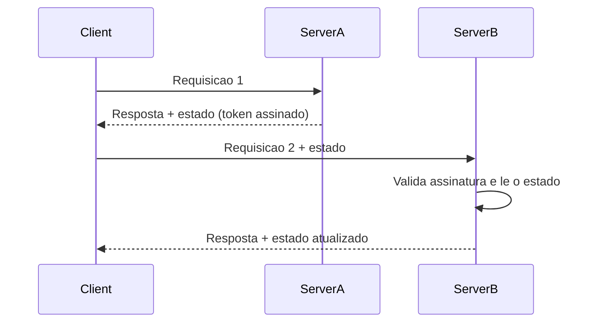

# Client Session State

## Descrição

O Client Session State armazena o estado da sessão no cliente. A cada resposta, o servidor devolve os dados da sessão (em um cookie, um campo oculto de formulário, um parâmetro de URL ou um token) e o cliente os reenvia em cada requisição seguinte. O servidor não guarda nada entre requisições e reconstrói o contexto a partir do que chegou.

Como o servidor permanece sem estado, qualquer instância pode atender qualquer requisição, o que facilita a escala horizontal e a recuperação de falhas. Em contrapartida, os dados trafegam a cada chamada e ficam em um ambiente que o servidor não controla, então precisam ser pequenos e protegidos contra leitura e adulteração.

Hoje a forma mais comum é o JWT em cookie ou em header: o token carrega identidade e algumas claims, é assinado (e opcionalmente cifrado) e é validado pelo servidor a cada chamada.

## Problemas que resolve

- Necessidade de manter o servidor sem estado para escalar horizontalmente sem afinidade de sessão (sticky sessions).
- Custo e complexidade de operar um armazenamento de sessão compartilhado para dados pequenos.
- Perda da sessão quando uma instância do servidor cai ou é reiniciada.
- Contexto de usuário que precisa viajar entre serviços sem consulta a um repositório central.

## Quando usar

- Quando o estado da sessão é pequeno (identidade, preferências, passos de um wizard curto).
- Quando se quer servidores totalmente stateless, com balanceamento livre entre instâncias.
- Quando os dados podem ser assinados ou cifrados e a expiração é aceitável como mecanismo de invalidação.

## Quando evitar

- Quando o estado é grande, pois o tráfego em cada requisição e os limites de cookie (cerca de 4 KB) tornam a abordagem inviável.
- Quando há dados sensíveis que não devem sair do servidor, mesmo cifrados.
- Quando é preciso revogar sessões imediatamente (logout forçado, conta comprometida) sem manter uma lista de revogação.
- Quando o estado deve ser consistente entre abas ou dispositivos, já que cada cliente carrega sua própria cópia.

## Trade-offs

| Ganho | Custo / Risco |
| --- | --- |
| Servidor sem estado e escala horizontal simples | Estado viaja a cada requisição e consome banda |
| Sem armazenamento de sessão no servidor para operar | Limite de tamanho (cookies, URLs) |
| Sobrevive a reinícios e troca de instância | Dados expostos ao cliente: exige assinatura, cifragem e validação |
| Implementação simples | Revogação difícil antes da expiração |

- **Segurança:** o cliente é não confiável; sem assinatura (HMAC) o estado pode ser forjado, e sem cifragem ele é legível.
- **Consistência:** não há fonte única; cópias antigas do token podem ser reenviadas (replay).
- **Desempenho:** elimina consultas a um store, mas aumenta o payload de cada chamada.

## Diagrama



O `Client` guarda o estado e o reenvia a cada chamada. Qualquer servidor valida a assinatura e usa os dados, sem consultar armazenamento compartilhado.

## Exemplo

Uma API emite um JWT com o identificador do usuário e o papel, assinado com HMAC. O cliente o envia no header `Authorization`, e qualquer instância verifica a assinatura sem acessar um banco.

```typescript
import jwt from "jsonwebtoken";

const SECRET = process.env.JWT_SECRET!;

export function issueSession(userId: string, role: string): string {
  return jwt.sign({ sub: userId, role }, SECRET, { expiresIn: "15m" });
}

export function readSession(authHeader?: string) {
  const token = authHeader?.replace("Bearer ", "");
  if (!token) throw new Error("unauthenticated");
  // Lança erro se a assinatura for inválida ou o token expirou
  return jwt.verify(token, SECRET) as { sub: string; role: string };
}
```

Frameworks como ASP.NET (cookies de autenticação protegidos), Rails (cookie store cifrado) e Flask (sessões assinadas) usam essa abordagem.

## Padrões relacionados

- [Server Session State](/design/poeaa/session-state/server-session-state) — alternativa que mantém os dados no servidor e envia ao cliente apenas um identificador.
- [Database Session State](/design/poeaa/session-state/database-session-state) — persiste o estado em banco, em vez de enviá-lo ao cliente.
- [Data Transfer Object](/design/poeaa/distribution/data-transfer-object) — o estado enviado ao cliente costuma ser serializado como um objeto de transferência.
- [Access Token](/architecture/microservices/security/access-token) — o JWT é a forma mais comum de Client Session State em arquiteturas de microsserviços.

## Referência

- [Página do padrão no catálogo do Fowler](https://martinfowler.com/eaaCatalog/clientSessionState.html)
- *Patterns of Enterprise Application Architecture*, Martin Fowler (Addison-Wesley, 2002)
