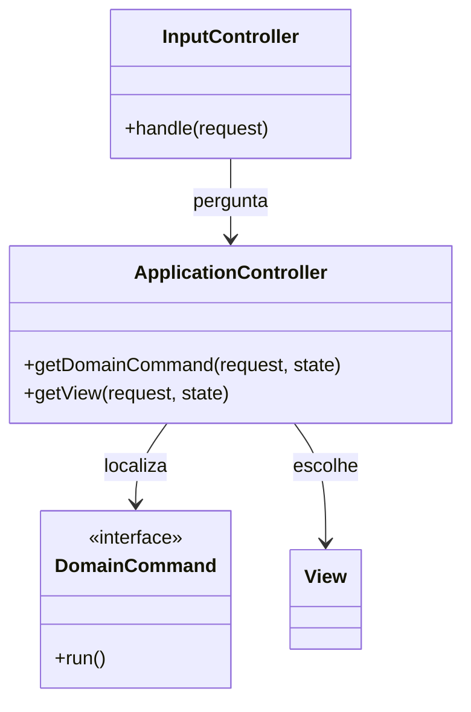

# Application Controller

## Descrição

O Application Controller é um ponto central para tratar a navegação entre telas e o fluxo da aplicação. Ele decide, com base na requisição e no estado atual, qual **comando de domínio** executar e qual **view** apresentar em seguida. Assim, o controller de entrada (Page ou Front Controller) fica livre da responsabilidade de conhecer a ordem das telas.

O padrão tem duas partes: uma que mapeia a entrada para a lógica de domínio apropriada e outra que escolhe a view com base no resultado. Essas regras de fluxo, como wizards ou telas dependentes do estado do objeto, ficam em um lugar só, que pode ser configurado, e as views e o domínio não precisam saber da navegação.

## Problemas que resolve

- Lógica de navegação espalhada entre vários controllers e views.
- Fluxos dependentes de estado (assistentes, aprovações) difíceis de alterar e testar.
- Acoplamento entre telas, que precisam conhecer a próxima tela.

## Quando usar

- Em aplicações com fluxo de telas complexo ou dependente do estado do domínio.
- Quando as regras de navegação mudam com frequência ou são configuráveis.
- Quando se quer testar a navegação sem o framework web.

## Quando evitar

- Quando a navegação é simples e linear, que um mapeamento direto resolve.
- Quando o framework já traz máquina de fluxos (Spring Web Flow) e basta usá-la.

## Trade-offs

| Ganho | Custo / Risco |
| --- | --- |
| Regras de navegação centralizadas | Camada extra de indireção para fluxos simples |
| Telas independentes umas das outras | Pode virar uma máquina de estados difícil de entender |
| Fluxo testável sem interface | Exige modelar explicitamente estados e transições |
| Facilita reaproveitar a lógica em outros canais | Risco de absorver regras de domínio indevidamente |

- **Acoplamento:** reduz o acoplamento entre telas e entre a web e o domínio.
- **Testabilidade:** o fluxo é testado com objetos comuns, sem servidor.
- **Estado:** fluxos longos exigem guardar o passo atual, tipicamente na sessão.

## Diagrama



O `InputController` consulta o `ApplicationController`, que localiza o `DomainCommand` a executar e escolhe a `View` seguinte conforme o resultado e o estado.

## Exemplo

A abertura de conta passa pelas telas de dados pessoais, documento, selfie e análise. O application controller decide a próxima tela pelo estado.

```python
class OnboardingFlow:
    TRANSITIONS = {
        ("personal_data", "ok"): "document",
        ("document", "ok"): "selfie",
        ("document", "unreadable"): "document_retry",
        ("selfie", "ok"): "review",
        ("review", "approved"): "account_opened",
        ("review", "rejected"): "rejected",
    }

    def next_view(self, state: str, result: str) -> str:
        return self.TRANSITIONS.get((state, result), "error")

class OnboardingController:
    def __init__(self, flow, commands):
        self.flow, self.commands = flow, commands

    def handle(self, session, action):
        result = self.commands[session["step"]].run(action)
        session["step"] = self.flow.next_view(session["step"], result)
        return session["step"]
```

Spring Web Flow, os fluxos do JSF e o Windows Workflow são exemplos. Em SPAs, bibliotecas de roteamento e máquinas de estado (XState) fazem esse papel no cliente.

## Padrões relacionados

- [Front Controller](/design/poeaa/web-presentation/front-controller) — normalmente delega a este padrão a decisão do fluxo.
- [Page Controller](/design/poeaa/web-presentation/page-controller) — idem, quando a navegação deixa de ser trivial.
- [Model View Controller](/design/poeaa/web-presentation/model-view-controller) — o Application Controller refina o papel do controller.
- [Server Session State](/design/poeaa/session-state/server-session-state) — guarda o passo atual de fluxos longos.
- [Service Layer](/design/poeaa/domain-logic/service-layer) — os comandos de domínio costumam ser operações da camada de serviço.
- [Command](/coding/gof/behavioral/command) — comandos de domínio são objetos command.
- [State](/coding/gof/behavioral/state) — fluxos dependentes de estado podem ser modelados assim.

## Referência

- [Página do padrão no catálogo do Fowler](https://martinfowler.com/eaaCatalog/applicationController.html)
- *Patterns of Enterprise Application Architecture*, Martin Fowler (Addison-Wesley, 2002)
