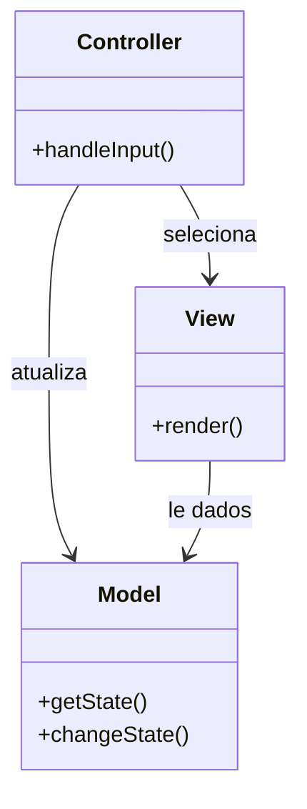

# Model View Controller

## Descrição

O Model View Controller (MVC) divide a interação com o usuário em três papéis. O **model** é um objeto que representa informação e comportamento do domínio e não conhece a interface. A **view** exibe os dados do model na tela. O **controller** recebe a entrada do usuário, atua sobre o model e escolhe qual view deve ser exibida.

O ponto central é a separação entre apresentação e model: o model não depende de nenhuma view, o que permite ter várias apresentações do mesmo dado e testar a lógica de domínio sem interface. A separação entre view e controller, embora central no Smalltalk original, é menos relevante em aplicações web, onde a distinção entre ver e reagir à entrada acontece em requisições distintas.

Na web, o MVC costuma ser realizado combinando padrões mais específicos: um Page Controller ou Front Controller para o controle e um Template View, Transform View ou Two Step View para a visão.

## Problemas que resolve

- Lógica de domínio misturada com código de interface, impossível de testar sem a tela.
- Necessidade de exibir os mesmos dados de formas diferentes (HTML, JSON, relatórios).
- Mudanças visuais que obrigam a alterar regras de negócio e vice-versa.
- Equipes com perfis distintos (design e programação) trabalhando nos mesmos arquivos.

## Quando usar

- Em praticamente qualquer aplicação com interface de usuário não trivial.
- Quando se quer testar o comportamento do model sem depender da apresentação.
- Quando o mesmo model terá múltiplas views ou canais de entrada.

## Quando evitar

- Em telas muito simples ou scripts descartáveis, onde três papéis são cerimônia excessiva.
- Quando o framework já impõe outro modelo (por exemplo, MVVM com data binding) e misturar vocabulários só gera confusão.

## Trade-offs

| Ganho | Custo / Risco |
| --- | --- |
| Model independente da interface e fácil de testar | Mais arquivos e indireção para fluxos simples |
| Várias views sobre o mesmo model | Sincronizar views com o model pode exigir mecanismos de notificação |
| Mudanças visuais isoladas da lógica de domínio | Controllers inchados absorvem lógica de negócio ("fat controller") |
| Divisão clara de responsabilidades na equipe | Interpretações divergentes do termo MVC entre frameworks |

- **Acoplamento:** view e controller dependem do model, nunca o contrário.
- **Testabilidade:** o model e o controller podem ser testados sem renderizar a interface.
- **Complexidade:** moderada; a disciplina de manter o controller fino é o maior desafio.

## Diagrama



O `Controller` recebe a entrada, altera o `Model` e seleciona a `View`; a `View` lê os dados do `Model` para exibi-los. O `Model` não conhece nenhum dos dois.

## Exemplo

No internet banking, a tela de extrato exibe o mesmo `Statement` em uma página HTML e em um endpoint JSON para o app móvel. O controller busca o model e escolhe a view.

```python
class Statement:                    # Model
    def __init__(self, account_id, entries):
        self.account_id, self.entries = account_id, entries  # (data, descricao, amount_cents)

class StatementController:          # Controller
    def __init__(self, repo, views):
        self.repo, self.views = repo, views

    def show(self, account_id, fmt="html"):
        statement = self.repo.find(account_id)
        return self.views[fmt](statement)

def brl(cents):
    sign = "-" if cents < 0 else ""
    return f"{sign}R$ {abs(cents) // 100},{abs(cents) % 100:02d}"

def html_view(s):
    rows = "".join(f"<tr><td>{d}</td><td>{desc}</td><td>{brl(c)}</td></tr>"
                   for d, desc, c in s.entries)
    return f"<h1>Extrato</h1><table>{rows}</table>"

def json_view(s):
    return {"account": s.account_id,
            "entries": [{"date": d, "description": desc, "amountCents": c}
                        for d, desc, c in s.entries]}

controller = StatementController(repo, {"html": html_view, "json": json_view})
```

Spring MVC, ASP.NET MVC e Rails implementam esse padrão. Em SPAs, o MVC se desloca para o cliente (ou vira MVVM/componentes), e o servidor expõe apenas o model como API.

## Padrões relacionados

- [Page Controller](/design/poeaa/web-presentation/page-controller) — controller por página, uma das formas de realizar o C do MVC na web.
- [Front Controller](/design/poeaa/web-presentation/front-controller) — controller único na entrada, outra forma de realizar o C.
- [Template View](/design/poeaa/web-presentation/template-view) — forma comum de implementar a view.
- [Transform View](/design/poeaa/web-presentation/transform-view) — view implementada como transformação dos dados do model.
- [Two Step View](/design/poeaa/web-presentation/two-step-view) — view em duas etapas para manter aparência consistente.
- [Observer](/coding/gof/behavioral/observer) — mecanismo clássico para a view reagir a mudanças no model.
- [Strategy](/coding/gof/behavioral/strategy) — a relação entre view e controller costuma ser uma estratégia substituível.

## Referência

- [Página do padrão no catálogo do Fowler](https://martinfowler.com/eaaCatalog/modelViewController.html)
- *Patterns of Enterprise Application Architecture*, Martin Fowler (Addison-Wesley, 2002)
- [GUI Architectures, Martin Fowler](https://martinfowler.com/eaaDev/uiArchs.html)
