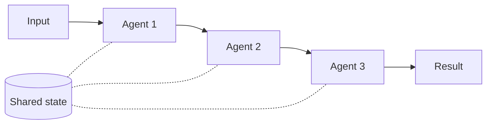

# Sequential Orchestration

## Description

Sequential Orchestration chains AI agents in a predefined linear order. Each agent receives the previous agent's output, processes it, and passes the result along, forming a pipeline of specialized transformations. The final result is the last agent's output.

The order is defined in the workflow (code or configuration), not by the agents: the choice of which agent is invoked next is never delegated to one of them. Context passes from stage to stage, raw or compacted (for example, a summary of the previous outputs), and shared state can be kept along the chain.

It's also known as *pipeline*, *prompt chaining*, *linear delegation* or, in Google Cloud terminology, *Multi-Agent Sequential* (sequential pattern). In that view, a sequential workflow agent follows predefined logic and no AI model orchestrates the subagents, as in a data pipeline with extraction, cleaning, and loading agents. It resembles the Pipes and Filters pattern, with AI agents in place of hand-coded processing components.

## Problems it solves

- Multistep tasks where each stage depends on the previous one's result.
- Progressive refinement of an output (draft, review, polish) without overloading a single prompt.
- Prompts and tool sets too large for a single agent, which become simpler when split by specialty.
- The need for a predictable, easy-to-debug flow, where you know which agent produced which part of the result.

## When to use

- Multistage processes with clear linear dependencies and predictable progression.
- Data transformation pipelines where each stage adds value that the next one depends on.
- Stages that can't be parallelized.
- Progressive refinement, such as *draft, review, polish* workflows.
- Structured, repeatable processes where the order of the steps never changes.
- Systems where the availability and performance of each agent are known, and where one agent's failures or delays are tolerable for the task as a whole.

### When to avoid

- Stages that can be parallelized without loss of quality or contention over shared state.
- A few stages that a single agent handles well.
- Early stages can fail or produce poor output, and there's no way to stop the following stages from processing that accumulated error.
- The agents need to collaborate, not just pass work along.
- The flow requires backtracking or iteration.
- Dynamic routing based on intermediate results is needed.

## Trade-offs

| Benefit | Cost / Risk |
| --- | --- |
| Predictable flow, with fixed order and explicit dependencies | No parallelism: latency is the sum of the stages |
| Each agent specializes, with a lean prompt and tool set | Failures and poor outputs from early stages propagate through the following ones |
| Easy to test and debug per stage | Rigid flow: no backtracking or dynamic detours |
| Progressive refinement improves output quality | Token cost accumulates at each step |
| Lower latency and operating cost than model-orchestrated patterns | Hard to skip unnecessary steps: a slow step adds to the total latency |

- **Flexibility:** efficiency comes at the cost of flexibility; choose the pattern only when the flow is truly fixed.
- **Context:** the context window grows at each transition; compact it (summary or pruning) between stages and pass only what the next agent needs.
- **Reliability:** validate each agent's output before passing it along, and use timeout and retry; fail explicitly instead of hiding the error.
- **State:** in long flows, persist progress in durable storage to resume after interruptions.
- **Observability:** instrument each stage and monitor tokens and latency per agent.

## Diagram

The flow follows a fixed order: each agent transforms the previous one's output, and optional shared state accompanies the chain.

## Related patterns

- [Concurrent Orchestration](/ai/agent-orchestration/deterministic-workflows/concurrent-orchestration) — alternative when the stages are independent and can run in parallel; the two can be combined.
- [Maker-Checker Loop](/ai/agent-orchestration/dynamic-orchestration/maker-checker-loop) — adds iteration and review, which the sequential flow doesn't support.
- [Handoff Orchestration](/ai/agent-orchestration/dynamic-orchestration/handoff-orchestration) — also passes work between agents, but the agent decides who comes next, not the flow.
- [Pipes and Filters](/cloud/cloud-design-patterns/messaging/pipes-and-filters) — the cloud pattern that inspires Sequential, with agents in place of filters.
- [Routing Slip](/architecture/eip/message-routing/routing-slip) — defines the sequence of steps per message, analogous to a predefined chain of agents.
- [Retry](/cloud/cloud-design-patterns/resiliency/retry) — handling of transient failures at each stage.

## Reference

- [AI agent orchestration patterns — Sequential orchestration (Azure Architecture Center)](https://learn.microsoft.com/en-us/azure/architecture/ai-ml/guide/ai-agent-design-patterns#sequential-orchestration)
- [Choose a design pattern for your agentic AI system — Sequential pattern (Google Cloud Architecture Center)](https://docs.cloud.google.com/architecture/choose-design-pattern-agentic-ai-system#sequential-pattern)
