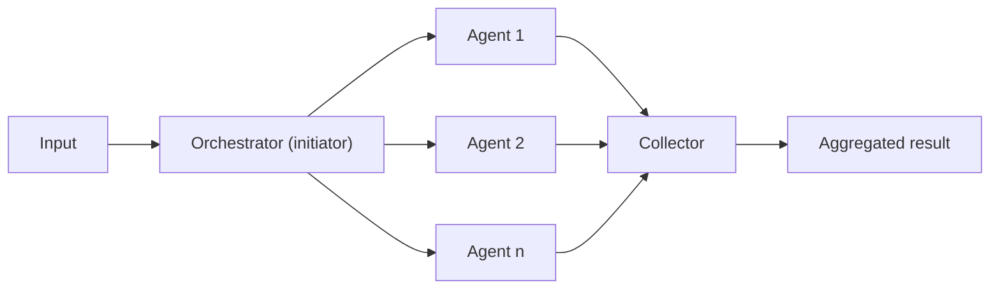

# Concurrent Orchestration

## Description

Concurrent Orchestration runs several AI agents at the same time on the same task, so that each one brings an independent analysis from its own perspective or specialty. An orchestrator (initiator and collector) distributes the input, waits for the agents, and gathers the intermediate outputs.

The agents work independently and don't pass results to one another. The orchestrator must know the registered agents and can either call all of them deterministically or dynamically choose which ones to invoke based on the task. Aggregation is optional: when it's needed, the strategy depends on the task, such as voting or majority for classification, weighted merging for scored recommendations, or a summary synthesized by a language model to reconcile the results. Each agent can also act on its own, for example by updating different data stores in parallel.

It's also known as *parallel*, *fan-out/fan-in*, *scatter-gather*, *map-reduce* or, in Google Cloud terminology, *Multi-Agent Parallel* (parallel pattern). In Google's view, a parallel workflow agent controls when and how the subagents run, with no model-driven orchestration; one example is customer feedback analysis, where sentiment, keywords, categorization, and urgency are evaluated at the same time and a final agent merges the outputs.

## Problems it solves

- The need for diverse perspectives or approaches to the same problem (technical, business, creative).
- High latency when independent analyses run one after another.
- Incomplete coverage of the problem when a single agent has only one point of view.
- Decisions that benefit from brainstorming, ensemble reasoning, or quorum voting.

## When to use

- Parallelizable tasks, with a fixed set of agents or with agents chosen dynamically based on the requirements.
- Tasks that gain from multiple independent perspectives or different specialties: brainstorming, ensemble reasoning, and quorum or voting decisions.
- Collecting data from several sources or evaluating several options at the same time.
- Time-sensitive scenarios, where parallel processing reduces latency.

## When to avoid

- The agents need to build on each other's work or require cumulative context in sequence.
- The task requires a specific order of operations or deterministic, reproducible results in a defined sequence.
- Resource constraints, such as model quota, make parallelism inefficient or unfeasible.
- The agents can't safely coordinate changes to shared state or external systems at the same time.
- There's no clear conflict-resolution strategy for contradictory results.
- The aggregation logic is too complex or degrades the quality of the result.

## Trade-offs

| Benefit | Cost / Risk |
| --- | --- |
| Shorter total time, since the agents run in parallel | Peak model consumption and risk of rate limiting or quota exhaustion |
| Broad coverage, with independent and specialized perspectives | Results may contradict each other and require conflict resolution |
| One agent's failure can be tolerated with graceful degradation | Aggregation adds complexity and can reduce quality |
| End-to-end latency usually lower than a sequential approach | Higher immediate resource and token consumption, which raises operating cost |
| Isolated agents, easy to add or swap | Shared mutable state causes transactional inconsistency |

- **Synthesis:** the merge step may require complex logic to reconcile conflicting results, with development and maintenance overhead; weigh the latency gain against the cost and this complexity.
- **Cost:** parallelism increases throughput but multiplies simultaneous model calls; use smaller models for agents with simple tasks.
- **Reliability:** define timeout, retry, and what to do if one or more agents fail; avoid shared single points of failure (for example, a single model endpoint).
- **State:** avoid shared mutable state between concurrent agents.
- **Observability:** track tokens and latency per agent and per run to find bottlenecks.

## Diagram

The orchestrator sends the same input to all agents at the same time, and the collector combines, compares, or selects the intermediate outputs.

## Related patterns

- [Sequential Orchestration](/ai/agent-patterns/deterministic-workflows/sequential-orchestration) — alternative when there are dependencies between stages; it's common to use sequential for preprocessing and concurrent for the parallel analysis.
- [Group Chat Orchestration](/ai/agent-patterns/dynamic-orchestration/group-chat-orchestration) — also gathers several perspectives, but in a conversation, with agents reacting to one another.
- [Magentic Orchestration](/ai/agent-patterns/dynamic-orchestration/magentic-orchestration) — a manager can parallelize tasks dynamically within an adaptive plan.
- [Scatter-Gather](/architecture/eip/message-routing/scatter-gather) — the integration equivalent: distributes the request and gathers the responses.
- [Aggregator](/architecture/eip/message-routing/aggregator) — correlates and combines the agents' outputs.
- [Recipient List](/architecture/eip/message-routing/recipient-list) — recipient selection, analogous to choosing agents dynamically.
- [Circuit Breaker](/architecture/cloud-design-patterns/resiliency/circuit-breaker) — protects the agents' dependencies against cascading failures.

## Reference

- [AI agent orchestration patterns — Concurrent orchestration (Azure Architecture Center)](https://learn.microsoft.com/en-us/azure/architecture/ai-ml/guide/ai-agent-design-patterns#concurrent-orchestration)
- [Choose a design pattern for your agentic AI system — Parallel pattern (Google Cloud Architecture Center)](https://docs.cloud.google.com/architecture/choose-design-pattern-agentic-ai-system#parallel-pattern)
