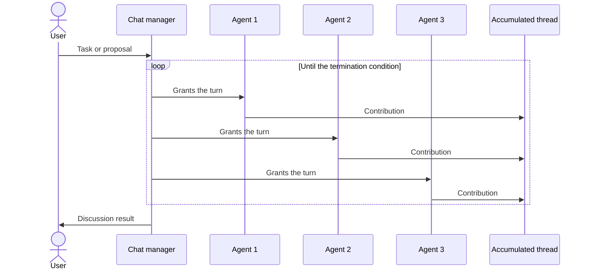

# Group Chat Orchestration

## Description

Several AI agents solve a problem, make a decision, or validate work by taking part in a single shared conversation. A **chat manager** coordinates the flow: it decides which agent can respond next and controls the interaction mode, from free-form brainstorming to formal reviews with fixed roles and approval gates.

All agents (and humans, if any) write to a single accumulated thread, which serves as context for the next turns and as the final result. The agents usually run in read-only mode: they discuss based on knowledge and models, without using tools that change running systems. A human can act as an observer, a participant, or even take on the chat manager role.

It's also known as *roundtable*, *collaborative*, *multiagent debate*, or *council*. The [Maker-Checker Loop](/ai/agent-patterns/iteration/maker-checker-loop) is a subtype of it.

## Problems it solves

- Decisions that benefit from debate, counterarguments, and consensus building across different perspectives.
- Multidisciplinary problems that require dialogue between experts, without a predetermined flow.
- Iterative refinement of a proposal through discussion.
- The need for transparency and auditing: every contribution is recorded in a single thread.
- Quality and compliance control that requires several expert views and separation between creation and validation.

## When to use

- Creative brainstorming where agents with different perspectives and knowledge sources build on each other's contributions.
- Decisions that call for debate, consensus, or iterative refinement.
- Quality assurance with structured review and iteration, including [maker-checker loops](/ai/agent-patterns/iteration/maker-checker-loop).
- Compliance and regulatory validation with multiple expert viewpoints.
- Scenarios with real-time human participation or oversight (human-in-the-loop).

### When to avoid

- Simple task delegation or a linear pipeline already solves the problem.
- Processing is real-time and the cost of discussion is unacceptable.
- A clear hierarchical decision or a deterministic flow, without discussion, is a better fit.
- The chat manager has no objective criterion to decide that the task is done.
- There are many agents: controlling the conversation and preventing infinite loops becomes hard. The source suggests limiting the pattern to three agents or fewer.

## Trade-offs

| Benefit | Cost / Risk |
| --- | --- |
| Quality and robustness of decisions through clashing perspectives | Conversations can loop and become hard to control with many agents |
| Transparency and auditability in a single thread | Context grows each turn, raising token cost and the risk of degradation |
| Natural human oversight, as observer or manager | High latency from the discussion overhead |
| Flexibility for free-form or structured modes | Depends on a clear termination criterion, defined by the chat manager |

- **Context:** compact or summarize the thread between turns and persist state in durable storage for long conversations.
- **Control:** define a turn limit and an explicit stop condition.
- **Human participation:** decide whether human input is optional or mandatory; mandatory gates make the step synchronous, so persist state at the checkpoint.
- **Safety:** since the agents are typically read-only, the risk of side effects is lower than in tool-based patterns.

## Diagram

The chat manager picks who speaks each turn; all contributions accumulate in the same thread, which feeds the following turns and produces the result.

## Related patterns

- [Maker-Checker Loop](/ai/agent-patterns/iteration/maker-checker-loop) — a group chat subtype with formal turns, acceptance criteria, and an iteration limit.
- [Magentic Orchestration](/ai/agent-patterns/dynamic-orchestration/magentic-orchestration) — an extension of group chat in which a manager builds a plan and the agents use tools to act on external systems.
- [Handoff Orchestration](/ai/agent-patterns/dynamic-orchestration/handoff-orchestration) — also dynamic, but with a single active agent and full transfer of control.
- [Sequential Orchestration](/ai/agent-patterns/deterministic-workflows/sequential-orchestration) — deterministic alternative when a linear pipeline is enough.
- [Concurrent Orchestration](/ai/agent-patterns/deterministic-workflows/concurrent-orchestration) — independent analyses in parallel, without debate between agents.
- [Process Manager](/architecture/eip/message-routing/process-manager) — central coordination of a process with several participants, but with a defined flow.

## Reference

- [AI agent orchestration patterns — Group chat orchestration (Azure Architecture Center)](https://learn.microsoft.com/en-us/azure/architecture/ai-ml/guide/ai-agent-design-patterns#group-chat-orchestration)
