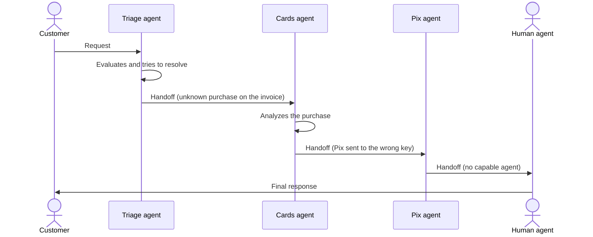

# Handoff Orchestration

## Description

Dynamic delegation of tasks between specialized agents. Each agent evaluates the task and decides whether to handle it itself or transfer it to a more suitable agent, based on the context and the requirements that emerge during processing. There's no central orchestrator deciding the order: the active agent itself chooses the next one.

Only one agent operates at a time, and full control passes from one to another, usually carrying the conversation and the relevant context. The chain of handoffs produces a single result. Any agent can end the conversation when it considers the goal met or when no other agent would add value, and some can transfer to a human.

It's also known as *routing*, *triage*, *transfer*, *dispatch*, or *delegation*.

## Problems it solves

- The ideal agent for the task isn't known in advance.
- Specialization requirements only become clear during processing.
- Multidomain problems that require experts acting one at a time.
- Getting the task to the most capable agent without hard-coding every possible route.

## When to use

- Tasks that require specialized knowledge or tools, but where the number and order of agents can't be predetermined.
- Expertise needs that emerge during processing, leading to dynamic routing based on content analysis.
- Multidomain problems solved by experts that operate one at a time.
- Predefined signals and logical relationships that indicate when an agent has reached its limit and which one should take over.

## When to avoid

- The right agent, or sequence of agents, can be identified from the initial input: use deterministic routing or a simple dispatcher that classifies and forwards without taking part in the processing.
- Routing is deterministic and rule-based, with no dynamic interpretation of context.
- Poor routing decisions would lead to a bad or frustrating user experience.
- Several operations need to run in parallel.
- It's hard to prevent infinite handoff loops or excessive back-and-forth between agents.

## Trade-offs

| Benefit | Cost / Risk |
| --- | --- |
| The right experts are engaged without a rigid plan | Unpredictable routing paths |
| Each agent has a smaller, focused scope and tool set | Handoff loops and bouncing between agents |
| Decentralized control, with no central manager | Poor routing can degrade the user experience |
| Escape hatch to a human when no agent can resolve it | No parallelism, and each hop adds latency |

- **Context:** decide what passes in the handoff (full raw context or a summary) to limit window growth.
- **Control:** set a transfer limit and detect cycles.
- **Observability:** record the handoff chain to debug unexpected routes.
- **Human participation:** a human can be the final escalation target.

## Diagram

Each agent decides whether to resolve or transfer control; only one is active at a time, and the chain ends in a single response, possibly from a human.

## Related patterns

- [Group Chat Orchestration](/ai/agent-patterns/dynamic-orchestration/group-chat-orchestration) — several agents in a managed conversation, instead of one active agent at a time.
- [Magentic Orchestration](/ai/agent-patterns/dynamic-orchestration/magentic-orchestration) — a manager plans and delegates, instead of the agents deciding the transfer.
- [Sequential Orchestration](/ai/agent-patterns/deterministic-workflows/sequential-orchestration) — fixed, predefined order, as opposed to the dynamic order of handoff.
- [Dynamic Router](/architecture/eip/message-routing/dynamic-router) — routing whose decision changes with the context at run time.
- [Content-Based Router](/architecture/eip/message-routing/content-based-router) — deterministic equivalent when the route follows from the content of the initial input.
- [Choreography](/architecture/cloud-design-patterns/distributed-coordination/choreography) — no central coordinator; each participant decides the next step.

## Reference

- [AI agent orchestration patterns — Handoff orchestration (Azure Architecture Center)](https://learn.microsoft.com/en-us/azure/architecture/ai-ml/guide/ai-agent-design-patterns#handoff-orchestration)
