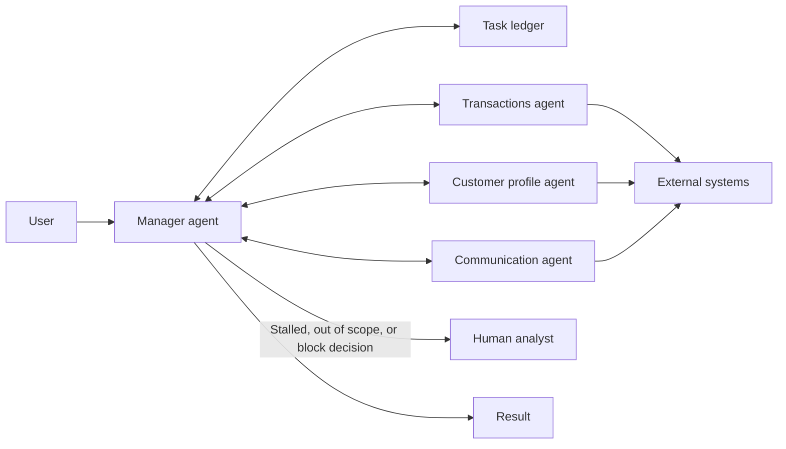

# Magentic Orchestration

## Description

Designed for open-ended, complex problems with no predetermined plan of approach. A **magentic manager agent** builds and refines a **task ledger**, the record of the plan with goals and subgoals, by talking directly with specialized agents to gather information. It iterates, backtracks, and delegates as many times as needed until it has an executable plan, which it then follows and tracks.

The agents usually have tools that change external systems, so the focus is as much on building and documenting the approach as on executing it. The manager regularly checks whether the original request has been fulfilled or has stalled and adjusts the ledger. The ledger is an audit trail and lets a human review the plan before or after execution. The approach is inspired by Magentic-One.

It's also known as *dynamic orchestration*, *task-ledger-based orchestration*, or *adaptive planning*. In a sense, it extends [Group Chat Orchestration](/ai/agent-patterns/dynamic-orchestration/group-chat-orchestration): instead of only discussing with their own knowledge, the focus is on one agent that plans while the others act with tools.

## Problems it solves

- There's no solution path known in advance, and the plan needs to emerge from collaboration between experts.
- Producing a complete plan of approach that a human can review and approve before tool-using agents act.
- Replanning when new information changes the situation (adding, removing, or reordering tasks).
- Keeping an audit trail of the plan and of the executed steps.

## When to use

- Complex or open-ended cases with no predetermined solution path.
- The need to consider input and feedback from several specialized agents to reach a valid path.
- The need for a complete plan of approach for human review before or after implementation.
- Tool-using agents that interact with external systems, consume resources, or change running systems, where the documented plan can be shown to the user before the tasks are released.

## When to avoid

- The solution path is, or should be, deterministic.
- There's no need to produce a ledger.
- The task has low complexity and a simpler pattern solves it.
- The work is time-sensitive: the pattern prioritizes building and debating viable plans, not speed.
- Frequent stalls or infinite loops with no clear way out are expected.

## Trade-offs

| Benefit | Cost / Risk |
| --- | --- |
| Solves open-ended problems without a predefined flow | Slow to converge |
| Explicit, auditable plan in the task ledger | Can stall on ambiguous goals |
| Continuous replanning as the context evolves | Higher token consumption from replanning and consulting several agents |
| Human review and approval of the plan before acting | Tool-using agents increase the risk of side effects |

- **Control:** the manager must detect stalls and avoid infinite remediation loops; set limits and escalation to humans.
- **Safety:** when acting on real systems, require approval gates and least-privilege permissions for each agent.
- **Observability:** the ledger and the execution history provide transparency for later reviews.
- **State:** persist the ledger in durable storage to resume after interruptions.

## Diagram

The manager builds and updates the task ledger by consulting the specialized agents, which use tools on external systems; when it stalls or goes out of scope, it escalates to a human.

## Related patterns

- [Group Chat Orchestration](/ai/agent-patterns/dynamic-orchestration/group-chat-orchestration) — the base pattern this one extends, with a focus on planning and acting with tools.
- [Handoff Orchestration](/ai/agent-patterns/dynamic-orchestration/handoff-orchestration) — dynamic delegation with no manager or global plan.
- [Maker-Checker Loop](/ai/agent-patterns/iteration/maker-checker-loop) — a verification cycle that can be used inside a task of the plan.
- [Sequential Orchestration](/ai/agent-patterns/deterministic-workflows/sequential-orchestration) — fixed order, when the plan is known in advance.
- [Process Manager](/architecture/eip/message-routing/process-manager) — central coordinator that keeps the process state and decides the next step.
- [Scheduler Agent Supervisor](/architecture/cloud-design-patterns/distributed-coordination/scheduler-agent-supervisor) — coordination and supervision of distributed tasks with failure recovery.

## Reference

- [AI agent orchestration patterns — Magentic orchestration (Azure Architecture Center)](https://learn.microsoft.com/en-us/azure/architecture/ai-ml/guide/ai-agent-design-patterns#magentic-orchestration)
