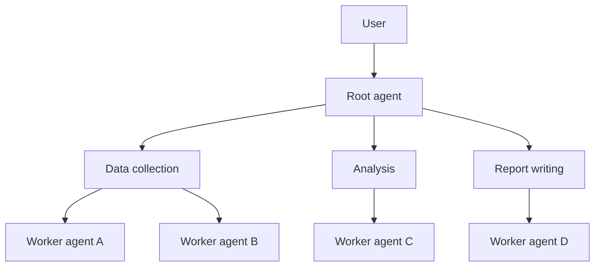

# Multi-Agent Hierarchical Task Decomposition

## Description

Agents are organized in a multi-level hierarchy. A root agent splits a complex task into subtasks and delegates them to lower-level subagents; each level decomposes the work it receives and delegates further, until a worker agent at the lowest level executes the task directly. The source describes it as an implementation of the [Multi-Agent Coordinator](/ai/agent-patterns/dynamic-orchestration/multi-agent-coordinator).

It suits ambiguous, open-ended problems that require multi-step reasoning, such as research, planning, and synthesis. In a research project, for example, the root splits the goal into data collection, analysis, and report writing, and specialized subagents either complete or further decompose each task.

## Problems it solves

- Complex problems that are too ambiguous for a single level of routing.
- The need to systematically decompose work down to executable units.
- More comprehensive results than simpler patterns produce.

## When to use

- Ambiguous, open-ended problems with multi-step reasoning: research, planning, and synthesis.
- Tasks that decompose naturally into subtasks that can themselves be decomposed.
- When quality and comprehensiveness matter more than cost and latency.

### When to avoid

- Simpler problems, where the extra layers only add complexity.
- Latency and cost are critical, since the number of model calls is high.
- A simple coordinator is already enough.

## Trade-offs

| Benefit | Cost / Risk |
| --- | --- |
| Systematically decomposes very complex problems | Hard to design, debug, and maintain |
| More comprehensive, higher-quality results | Multiple layers of delegation significantly increase latency and cost |
| Specialization per level | Decomposition errors propagate downward |

- **Core challenge:** decomposing ambiguity; define clear criteria for when to stop splitting.
- **Control:** limit the depth and the number of subagents to contain cost.
- **Observability:** trace the delegation tree to debug failures.
- **Evolution:** first evaluate whether a simple coordinator is enough.

## Diagram

The root agent delegates to intermediate subagents, which decompose and delegate until the worker agents execute.

## Related patterns

- [Multi-Agent Coordinator](/ai/agent-patterns/dynamic-orchestration/multi-agent-coordinator) — the pattern this one implements across multiple levels.
- [Single Agent](/ai/agent-patterns/dynamic-orchestration/single-agent) — the simpler starting point.
- [Multi-Agent Swarm](/ai/agent-patterns/dynamic-orchestration/multi-agent-swarm) — collaboration with no hierarchy or central supervisor.
- [Magentic Orchestration](/ai/agent-patterns/dynamic-orchestration/magentic-orchestration) — adaptive planning with a task ledger for open-ended problems.
- [Scheduler Agent Supervisor](/cloud/cloud-design-patterns/distributed-coordination/scheduler-agent-supervisor) — supervision of distributed tasks.

## Reference

- [Choose a design pattern for your agentic AI system — Hierarchical task decomposition pattern (Google Cloud Architecture Center)](https://docs.cloud.google.com/architecture/choose-design-pattern-agentic-ai-system#hierarchical-task-decomposition-pattern)
