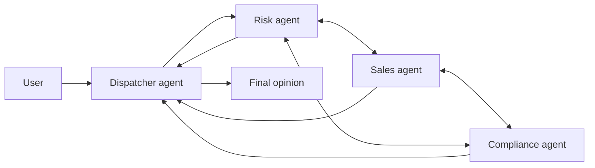

# Multi-Agent Swarm

## Description

Specialized agents communicate with one another in every direction (all-to-all) and iteratively refine a solution to a complex problem. A dispatcher agent sends the request to the agent best suited to start; from there the agents share findings, critique proposals, and hand work off to one another. There's no central supervisor: the dispatcher only facilitates communication between the swarm and the user.

You need to define an explicit exit condition, such as a maximum number of iterations, a time limit, or consensus. In a credit committee, risk, sales, and compliance agents debate trade-offs and converge on an opinion.

Compared with [Group Chat Orchestration](/ai/agent-patterns/dynamic-orchestration/group-chat-orchestration), which usually has a chat manager controlling the turns, the swarm is fully decentralized. It's close to [Choreography](/architecture/cloud-design-patterns/distributed-coordination/choreography): with no central controller, each participant reacts to the others.

## Problems it solves

- Ambiguous or very complex problems that benefit from debate and multiple perspectives.
- Solutions that depend on mutual critique among specialists.
- The absence of a single plan that a coordinator could impose.

## When to use

- Ambiguous or highly complex problems where debate between perspectives improves the result.
- Decisions such as the opinion of a credit committee, which balance competing requirements.
- When quality and creativity matter more than cost and predictability.

## When to avoid

- Cost and latency need to be predictable.
- A simpler answer is enough.
- You can't build the control logic it requires.

## Trade-offs

| Benefit | Cost / Risk |
| --- | --- |
| Simulates a team of experts; creative, high-quality solutions | The most complex and expensive multi-agent pattern |
| No central point of failure | Without a supervisor, risk of unproductive loops or failure to converge |
| Refinement through mutual critique | High operating cost and latency |

- **Control:** design sophisticated logic to manage communication and iterations.
- **Termination:** define a firm exit condition (iterations, time, or consensus).
- **Observability:** log the exchanges between agents to understand how consensus was reached.

## Diagram

The dispatcher hands the request to one agent; the agents debate among themselves, and the dispatcher returns the result once the exit condition is met.

## Related patterns

- [Group Chat Orchestration](/ai/agent-patterns/dynamic-orchestration/group-chat-orchestration) — collaborative conversation, usually with a chat manager.
- [Handoff Orchestration](/ai/agent-patterns/dynamic-orchestration/handoff-orchestration) — control passes between agents; also used in the swarm.
- [Choreography](/architecture/cloud-design-patterns/distributed-coordination/choreography) — decentralized coordination, with no central controller.
- [Multi-Agent Coordinator](/ai/agent-patterns/dynamic-orchestration/multi-agent-coordinator) — the centralized alternative.
- [Multi-Agent Review and Critique](/ai/agent-patterns/iteration/maker-checker-loop) — structured critique between two roles.

## Reference

- [Choose a design pattern for your agentic AI system — Swarm pattern (Google Cloud Architecture Center)](https://docs.cloud.google.com/architecture/choose-design-pattern-agentic-ai-system#swarm-pattern)
