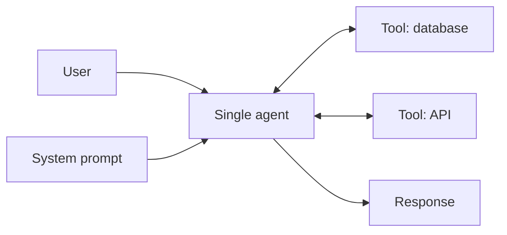

# Single Agent

## Description

A single model, a defined set of tools, and a detailed system prompt handle the user's request autonomously. The prompt defines the core task, the persona, the operations, and the conditions for using each tool. The model interprets the request, plans the sequence of steps, and chooses the tools, with no other agents involved.

It's the recommended starting point before any multi-agent architecture: it lets you refine the core logic, the prompt, and the tool definitions before adding components. Reasoning techniques such as [ReAct](/ai/agent-patterns/iteration/react) can improve the agent's performance without changing the topology. It's also called a *single-agent system*.

## Problems it solves

- Multi-step tasks that require external data (querying a database, calling APIs) without the complexity of coordinating agents.
- The need for a simple baseline to validate the prompt and tools before scaling the architecture.
- Minimal cost and latency in terms of the number of model calls.

## When to use

- Multi-step tasks that need external data, such as checking an order's status or summarizing recent news via APIs.
- The start of agent development, to refine logic, prompt, and tools.
- A single, cohesive scope of responsibility with few tools.

## When to avoid

- The agent needs many tools or faces increasingly complex tasks.
- The agent must manage several distinct responsibilities.
- Symptoms of degradation: higher latency, incorrect tool selection or use, and task failures.

## Trade-offs

| Benefit | Cost / Risk |
| --- | --- |
| Simpler; fewer model calls than multi-agent patterns | Performance drops as tools and complexity grow |
| Lets you refine the prompt and tools before scaling | A single context concentrates all responsibilities |
| Low cost, low latency, and straightforward debugging | Incorrect tool selection as the catalog grows |

- **Evolution:** start here and move to ReAct or a multi-agent pattern only when performance problems appear.
- **Observability:** keep traces of tool calls to identify when the agent has hit its limit.
- **Security:** grant only the tools that are needed.

## Diagram

The single agent interprets the request, chooses among the available tools, iterates as needed, and returns the response.

## Related patterns

- [ReAct](/ai/agent-patterns/iteration/react) — a reasoning-and-action technique that refines the single agent before resorting to multi-agent.
- [Multi-Agent Coordinator](/ai/agent-patterns/dynamic-orchestration/multi-agent-coordinator) — the next step when the single agent has too many responsibilities.
- [Multi-Agent Sequential](/ai/agent-patterns/deterministic-workflows/sequential-orchestration) — splitting into fixed stages when a single instruction isn't enough.
- [Handoff Orchestration](/ai/agent-patterns/dynamic-orchestration/handoff-orchestration) — dynamic delegation between agents when the scope splits.

## Reference

- [Choose a design pattern for your agentic AI system — Single-agent system (Google Cloud Architecture Center)](https://docs.cloud.google.com/architecture/choose-design-pattern-agentic-ai-system#single-agent-system)
