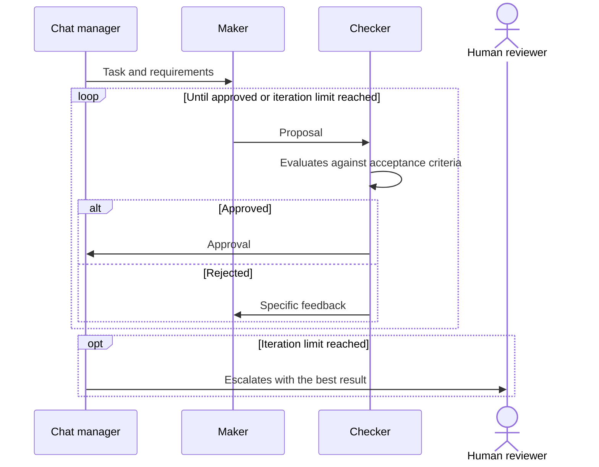

# Maker-Checker Loop

## Description

One agent, the **maker**, creates or proposes something, and another agent, the **checker**, evaluates the result against defined criteria. If the checker finds gaps or quality problems, it hands the conversation back to the maker with specific feedback. The maker revises the output and resubmits it. The cycle repeats until the checker approves or the maximum number of iterations is reached.

It's a specific type of [Group Chat Orchestration](/ai/agent-patterns/dynamic-orchestration/group-chat-orchestration). While the general group chat doesn't require agents to take turns, maker-checker requires a formal sequence of turns driven by the chat manager, with fixed roles (create and evaluate) and an objective stop condition. That makes it more predictable than a free-form group chat.

It's also known as *evaluator-optimizer*, *generator-verifier*, *critic loops*, or *reflection loops*. In Google Cloud it's **Review and Critique** (also called *generator and critic*): a generator agent produces the output and a critic agent evaluates it against criteria such as factual accuracy, format, or safety, approving it, rejecting it, or returning it with feedback. Google treats it as an implementation of the [Multi-Agent Loop](/ai/agent-patterns/iteration/multi-agent-loop), usually in a sequential flow; [Iterative Refinement](/ai/agent-patterns/iteration/multi-agent-iterative-refinement) is the other implementation, in which agents progressively change a result in the session state.

## Problems it solves

- An AI agent's output may contain errors or miss requirements, and needs independent verification before it's accepted.
- Separating creation and validation into distinct roles, so the same agent doesn't evaluate its own work.
- Iterative refinement guided by specific feedback, instead of a single attempt.
- Requiring dedicated verification for outputs that must be very accurate or meet strict constraints (for example, a critic that audits the security of generated code or checks that the tests pass).
- Ensuring a result only moves forward when it meets consistent acceptance criteria.

## When to use

- Content creation with editorial review and a clear separation between producing and validating.
- Quality and compliance assurance with explicit acceptance criteria (pass or fail).
- Scenarios that combine iterative refinement with human review as the checker or as a fallback.
- When you can write objective criteria so the checker decides consistently.

### When to avoid

- There are no clear acceptance criteria: the checker can't decide consistently.
- A single pass already meets the required quality, making the cycle a cost with no gain.
- Response time is critical and iterations are unacceptable.
- No iteration limit or fallback behavior is defined, which risks infinite refinement loops.

## Trade-offs

| Benefit | Cost / Risk |
| --- | --- |
| Higher quality, verifiable through explicit criteria | Each iteration adds latency and token consumption |
| More predictable behavior than a free-form group chat | Poorly defined criteria lead to inconsistent approvals or rejections |
| Separate creation and validation roles | Risk of an infinite refinement loop without an iteration limit |
| Natural point to escalate to a human | Maker and checker may share biases if they use the same model |

- **Cost of the critic:** the critic adds at least one model call, and each revision adds cost and delay.
- **Acceptance criteria:** must be clear so the checker makes consistent pass or fail decisions.
- **Iteration limit:** set a ceiling and what happens when it's reached.
- **Fallback:** escalate to a human reviewer or deliver the best possible result with a quality warning.
- **Human participation:** the human can be the checker, or the fallback; decide whether their response is an approval or feedback that goes back to the maker.

## Diagram

The chat manager drives formal turns between maker and checker; the cycle ends with approval or, when the limit is reached, with a fallback to a human.

## Related patterns

- [Group Chat Orchestration](/ai/agent-patterns/dynamic-orchestration/group-chat-orchestration) — the general pattern this one is a subtype of, with formal turns and acceptance criteria.
- [Sequential Orchestration](/ai/agent-patterns/deterministic-workflows/sequential-orchestration) — a single create-then-review pass with no repetition, when one cycle is enough.
- [Magentic Orchestration](/ai/agent-patterns/dynamic-orchestration/magentic-orchestration) — the manager also checks whether the request was fulfilled or stalled, but within an open-ended plan.
- [Multi-Agent Loop](/ai/agent-patterns/iteration/multi-agent-loop) — Google's pattern of which this is an implementation.
- [Multi-Agent Iterative Refinement](/ai/agent-patterns/iteration/multi-agent-iterative-refinement) — another implementation of the loop, in which agents improve a result in the session state up to a quality threshold, with no approver role.
- [Circuit Breaker](/cloud/cloud-design-patterns/resiliency/circuit-breaker) — the iteration limit with fallback resembles cutting off repeated attempts that don't make progress.

## Reference

- [AI agent orchestration patterns — Maker-checker loops (Azure Architecture Center)](https://learn.microsoft.com/en-us/azure/architecture/ai-ml/guide/ai-agent-design-patterns#maker-checker-loops)
- [Choose a design pattern for your agentic AI system — Review and critique pattern (Google Cloud Architecture Center)](https://docs.cloud.google.com/architecture/choose-design-pattern-agentic-ai-system#review-critique-pattern)
