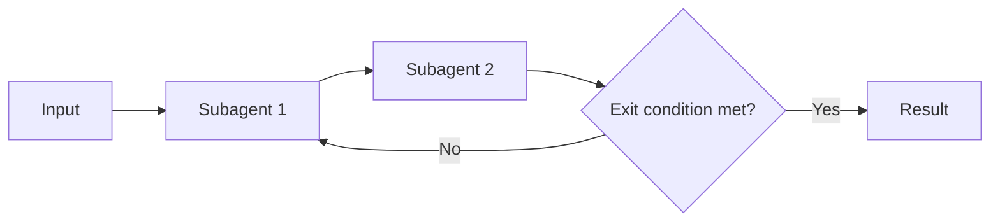

# Multi-Agent Loop

## Description

A loop agent runs a sequence of subagents and then checks an exit condition. If the condition hasn't been met, it repeats the sequence. The logic is predefined and doesn't rely on a model to orchestrate; the check can happen at any point in the flow.

Shared state carries the result from one round to the next. The final result is the state at the moment the exit condition is satisfied. [Review and Critique](/ai/agent-patterns/iteration/maker-checker-loop) and [Iterative Refinement](/ai/agent-patterns/iteration/multi-agent-iterative-refinement) are implementations of this pattern.

## Problems it solves

- Iterative refinement and self-correction of a result over several passes.
- Monitoring or polling tasks that repeat an action until a condition is reached.
- Controlled repetition without needing a model to decide when to continue.

## When to use

- Iterative flows in which agents refine their own work.
- Example from the source: one agent generates content and a critic agent reviews it until it meets a quality standard.
- When the exit condition can be expressed as an iteration count or as a state reached in the flow.

### When to avoid

- A single pass already meets the required quality.
- There's no reliable exit condition and no iteration cap.
- Latency must be predictable, since the time spent waiting for the condition varies.

## Trade-offs

| Benefit | Cost / Risk |
| --- | --- |
| Supports complex iterative flows with self-correction | A poorly defined exit condition can cause an infinite loop, with high cost and hangs |
| Predefined logic, with no model orchestrating | Unpredictable latency while waiting for the condition |
| Reuses specialized subagents in each round | Each round consumes additional tokens and time |

- **Exit conditions:** a maximum number of iterations or a custom state reached in the flow; combine both.
- **Subagents that don't produce the expected state:** without the cap, the loop never ends.
- **Observability:** log the state at each iteration to understand why the loop continued.

## Diagram

The sequence of subagents repeats until the exit condition is satisfied or the iteration limit is reached.

## Related patterns

- [Multi-Agent Review and Critique](/ai/agent-patterns/iteration/maker-checker-loop) — loop implementation with a generator and a critic.
- [Multi-Agent Iterative Refinement](/ai/agent-patterns/iteration/multi-agent-iterative-refinement) — loop implementation that progressively improves a result in the session state.
- [ReAct](/ai/agent-patterns/iteration/react) — also iterates, but the model decides each step, with no predefined flow.
- [Multi-Agent Sequential](/ai/agent-patterns/deterministic-workflows/sequential-orchestration) — the sequence of subagents within each round is a sequential flow.
- [Scheduler Agent Supervisor](/cloud/cloud-design-patterns/distributed-coordination/scheduler-agent-supervisor) — also repeats and supervises steps until completion.

## Reference

- [Choose a design pattern for your agentic AI system — Loop pattern (Google Cloud Architecture Center)](https://docs.cloud.google.com/architecture/choose-design-pattern-agentic-ai-system#loop-pattern)
