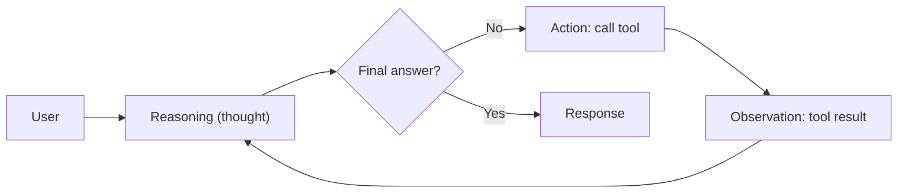

# ReAct

## Description

A single model-driven agent repeats a three-step cycle: it reasons about the task (*thought*), chooses between calling a tool or giving the final answer (*action*), and records the tool's result in the context (*observation*). On each round the model reassesses the plan based on what it just observed, until it finishes.

The model itself decides the next step at runtime, so the path isn't predictable. The context is the accumulated history of thoughts, actions, and observations. It's also known as *Reason and Act*.

## Problems it solves

- Tasks where the full plan can't be defined up front and must be adjusted as new information appears.
- The need to combine reasoning with access to tools and external sources in a single flow.
- Debugging the agent's decisions, since the reasoning transcript is recorded.

## When to use

- Complex, dynamic tasks that require continuous planning and adjustment.
- Scenarios where a single agent is enough, with lower cost and maintenance than a multi-agent system.
- Example from the source: a robotics agent plans a path to the goal, moves along a stretch, observes the environment, and replans when it meets new obstacles.

### When to avoid

- The flow is known and predictable: a deterministic workflow is cheaper and more stable.
- Latency is critical, since each round of the cycle increases it.
- The model's reasoning quality isn't reliable for the task, or the tools may return misleading results without validation.

## Trade-offs

| Benefit | Cost / Risk |
| --- | --- |
| Adapts the plan to each observation | Each iteration adds latency and tokens |
| Simpler and cheaper to build and maintain than a multi-agent system | Quality depends heavily on the model's reasoning |
| The reasoning transcript helps with debugging | A misleading tool result can contaminate the final answer |

- **Exit conditions:** the agent finds a conclusive answer, reaches a maximum number of iterations, or hits an error that prevents it from continuing. Always set the cap.
- **Context:** the history grows with each round; consider summarizing or truncating it.
- **Observability:** log thoughts, actions, and observations to audit the path taken.

## Diagram

The agent alternates reasoning, action, and observation until it decides it has the answer or reaches the iteration limit.

## Related patterns

- [Multi-Agent Loop](/ai/agent-patterns/iteration/multi-agent-loop) — also iterates, but with a predefined flow of subagents instead of a model deciding each step.
- [Multi-Agent Review and Critique](/ai/agent-patterns/iteration/maker-checker-loop) — separates creation and verification into distinct agents, instead of a single agent that reasons and acts on its own.
- [Magentic Orchestration](/ai/agent-patterns/dynamic-orchestration/magentic-orchestration) — similar dynamic planning, but with a manager coordinating several agents.

## Reference

- [Choose a design pattern for your agentic AI system — Reason and act (ReAct) pattern (Google Cloud Architecture Center)](https://docs.cloud.google.com/architecture/choose-design-pattern-agentic-ai-system#react-pattern)
