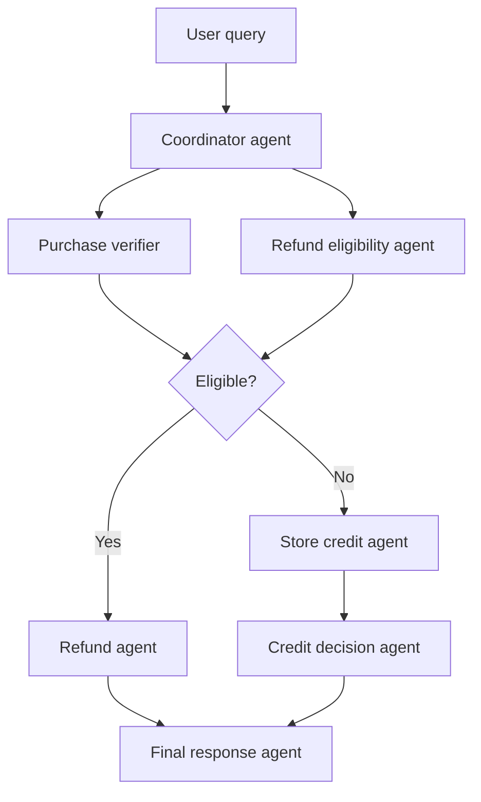

# Custom Logic

## Description

The orchestration is written in code, with conditionals, loops, and branches, instead of using a predefined pattern. It offers maximum flexibility and allows multi-path flows that combine deterministic rules (the code decides) with model reasoning (the agents decide within each step).

Each step can be an agent, a tool, or a check in code, and the code itself decides what runs next based on the previous result. You can mix patterns, such as a parallel check followed by a conditional branch.

## Problems it solves

- Flows that don't fit any of the predefined patterns.
- The need for fine-grained control over execution and over what each branch does.
- Mixing fixed business rules with decisions that require model reasoning.
- Composing patterns (sequential, parallel, review) in a single flow.

## When to use

- Complex logic, with branching beyond a linear sequence.
- When you need to combine predefined rules and model reasoning.
- When the workflow doesn't match any standard template.

### When to avoid

- A predefined pattern supported by the agent framework already meets your needs: it reduces development and maintenance effort.
- The team can't afford to design, implement, and debug the entire orchestration flow.

## Trade-offs

| Benefit | Cost / Risk |
| --- | --- |
| Maximum control over the flow design | You design, implement, and debug the entire orchestration |
| Combines fixed rules and model reasoning | More error-prone than predefined patterns |
| Handles flows outside the standard templates | Greater development and maintenance effort |

- **Testability:** deterministic branches in code are easy to test; isolate the steps that depend on the model.
- **Observability:** log the branch chosen in each run to aid debugging.
- **Evolution:** if the flow converges on a known pattern, consider migrating to it.

## Diagram

Example of a refund agent: a parallel check feeds a conditional branch in code (refund or store credit), and a final agent writes the response.

## Related patterns

- [Multi-Agent Sequential](/ai/agent-patterns/deterministic-workflows/sequential-orchestration) — one of the building blocks the code can compose.
- [Multi-Agent Parallel](/ai/agent-patterns/deterministic-workflows/concurrent-orchestration) — used in the parallel check step.
- [Human-in-the-Loop](/ai/agent-patterns/special-requirements/human-in-the-loop) — the code defines where to insert human approval.
- [Content-Based Router](/architecture/eip/message-routing/content-based-router) — rule-based routing on the content, equivalent to the conditional branch.
- [Process Manager](/architecture/eip/message-routing/process-manager) — orchestration with state and branching.
- [Scheduler Agent Supervisor](/architecture/cloud-design-patterns/distributed-coordination/scheduler-agent-supervisor) — coordination of distributed steps with supervision.

## Reference

- [Choose a design pattern for your agentic AI system — Custom logic pattern (Google Cloud Architecture Center)](https://docs.cloud.google.com/architecture/choose-design-pattern-agentic-ai-system#custom-logic-pattern)
