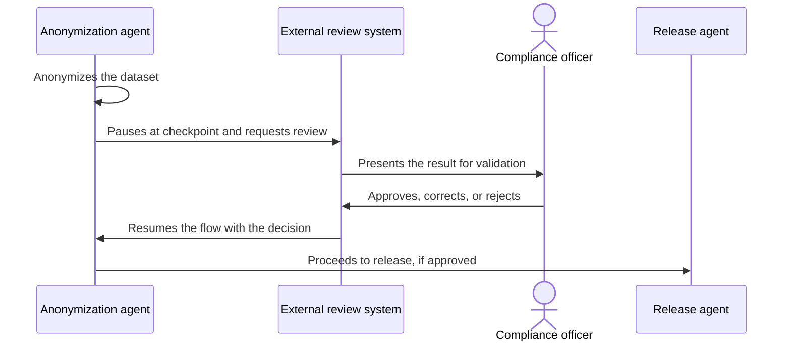

# Human-in-the-Loop

## Description

The agent runs the flow up to a predefined checkpoint, where it pauses and calls an external system so a person can review the work. The person can approve a decision, correct an error, or provide needed information before the agent continues.

The execution state is preserved during the pause. When the human responds (approval, rejection, edit, or additional input), the flow resumes from the checkpoint, incorporating the response into the context. The pattern can be combined with any other (sequential, parallel, review and critique), since it's a cross-cutting requirement about where the human steps in.

## Problems it solves

- Critical or irreversible actions that shouldn't be executed without approval.
- Subjective judgment tasks that the model can't validate on its own.
- Security, reliability, or compliance requirements that call for a human to be accountable for the decision.
- Model errors that need to be corrected before they propagate.

## When to use

- High-risk or subjective tasks, such as approving large financial transactions, validating summaries of sensitive documents, or giving feedback on creative content.
- Cases with compliance requirements, where a person must approve the release of the result.
- Flows where only a human can supply missing information.

## When to avoid

- Low-risk, high-volume tasks, where human review becomes a bottleneck without adding safety.
- Flows that need an immediate response or run with nobody available to review.
- When building and maintaining the external user-interaction system isn't feasible.

## Trade-offs

| Benefit | Cost / Risk |
| --- | --- |
| More safety and reliability, with human judgment at critical points | Architectural complexity: you must build and maintain the external review system |
| Meets compliance and accountability requirements | Unpredictable latency, since it depends on a person being available |
| Errors are corrected before they take effect | Becomes a bottleneck if there are too many checkpoints |

- **State:** persist the execution context during the pause and define an expiration (timeout) and what to do when no response arrives.
- **Choice of checkpoints:** place them only where the risk justifies it, so reviewers aren't overloaded.
- **Observability:** record who approved or changed what, for auditing.
- **Security:** give the reviewer enough context to decide, without exposing more data than necessary.

## Diagram

The flow runs up to the checkpoint, hands the work to an external review system, and continues only after the person responds. Example: an agent anonymizes patient data and a compliance officer validates it before release.

## Related patterns

- [Multi-Agent Review and Critique](/ai/agent-patterns/iteration/maker-checker-loop) — the review is done by agents; here the review is human.
- [Custom Logic](/ai/agent-patterns/special-requirements/custom-logic) — the orchestration code defines where and when to pause for a human.
- [Handoff Orchestration](/ai/agent-patterns/dynamic-orchestration/handoff-orchestration) — the handoff can have a human as its final destination.
- [Scheduler Agent Supervisor](/architecture/cloud-design-patterns/distributed-coordination/scheduler-agent-supervisor) — coordinates long-running, stateful steps, such as waiting for an external response.
- [Process Manager](/architecture/eip/message-routing/process-manager) — keeps the state of a process that is waiting for external events.

## Reference

- [Choose a design pattern for your agentic AI system — Human-in-the-loop pattern (Google Cloud Architecture Center)](https://docs.cloud.google.com/architecture/choose-design-pattern-agentic-ai-system#human-in-the-loop-pattern)
