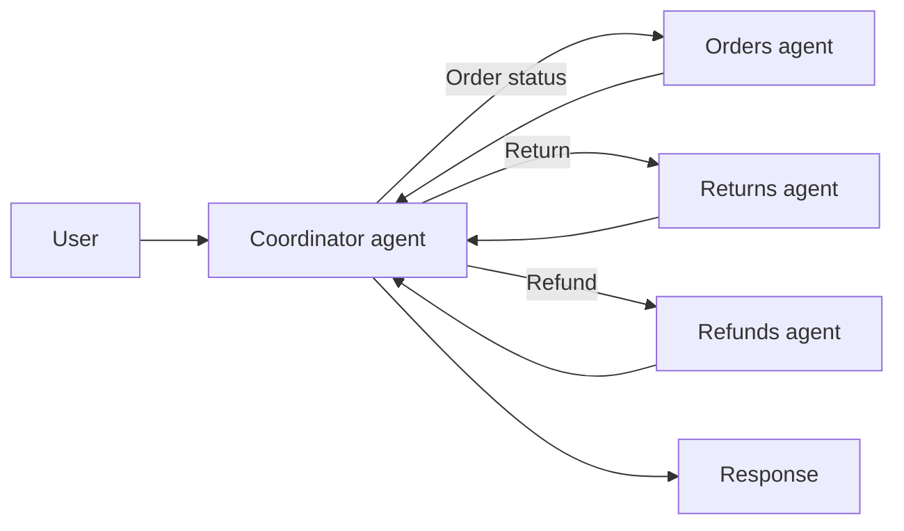

# Multi-Agent Coordinator

## Description

A central coordinator agent analyzes the user's request, splits it into subtasks, and dispatches each one to a specialized agent (for example, one that queries a database or calls an API). The coordinator uses a model to route tasks dynamically at runtime, in contrast to the parallel pattern, whose dispatch logic is fixed in code.

The typical case is customer service: the coordinator classifies the request as a status inquiry, a return, or a refund and sends it to the matching agent. The specialized agents return their results and the coordinator assembles the response. It's also known as the *coordinator pattern*.

Unlike [Magentic Orchestration](/ai/agent-orchestration/dynamic-orchestration/magentic-orchestration), which builds and refines a task ledger for open-ended problems with no plan, the coordinator here routes structured business processes and doesn't maintain an iterative, auditable plan. Compared with [Handoff Orchestration](/ai/agent-orchestration/dynamic-orchestration/handoff-orchestration), control stays with the coordinator instead of passing from agent to agent.

## Problems it solves

- Varied inputs that require adaptive routing, which can't be encoded in fixed rules.
- Structured business processes that involve several specialists.
- The rigidity of fixed flows when requests are of different types.

## When to use

- Automating structured business processes with adaptive routing for varied inputs.
- Requests that must be classified before a specialist handles them.
- Quality that benefits from the model's reasoning when choosing the path.

### When to avoid

- Routing is fixed and predictable: sequential or parallel flows avoid extra model calls.
- Cost and latency are hard constraints.

## Trade-offs

| Benefit | Cost / Risk |
| --- | --- |
| Handles a wider variety of inputs and adapts the flow at runtime | More model calls than a single agent: more tokens, cost, and latency |
| Model reasoning tends to produce higher-quality results | The cost of each call accumulates across the coordinator and the specialists |
| Independent, replaceable specialists | The coordinator is a single point of failure and a source of routing errors |

- **Reliability:** validate the coordinator's classification and define a fallback path for unrecognized requests.
- **Observability:** log routing decisions so you can audit and tune them.
- **Evolution:** first evaluate whether a deterministic flow is enough.

## Diagram

The coordinator classifies the request, routes it to the right specialist, and consolidates the result.

## Related patterns

- [Single Agent](/ai/agentic-ai/dynamic-orchestration/single-agent) — the starting point when a single agent is still enough.
- [Multi-Agent Hierarchical Task Decomposition](/ai/agentic-ai/dynamic-orchestration/multi-agent-hierarchical-task-decomposition) — a multi-level implementation of the coordinator.
- [Multi-Agent Parallel](/ai/agent-orchestration/deterministic-workflows/concurrent-orchestration) — dispatch fixed in code, with no model decision.
- [Multi-Agent Sequential](/ai/agent-orchestration/deterministic-workflows/sequential-orchestration) — fixed order of agents.
- [Magentic Orchestration](/ai/agent-orchestration/dynamic-orchestration/magentic-orchestration) — open-ended planning with a task ledger, distinct from the coordinator's routing.
- [Handoff Orchestration](/ai/agent-orchestration/dynamic-orchestration/handoff-orchestration) — control passes between agents, with no central coordinator.
- [Process Manager](/architecture/eip/message-routing/process-manager) — a central coordinator that decides the next step.

## Reference

- [Choose a design pattern for your agentic AI system — Coordinator pattern (Google Cloud Architecture Center)](https://docs.cloud.google.com/architecture/choose-design-pattern-agentic-ai-system#coordinator-pattern)
