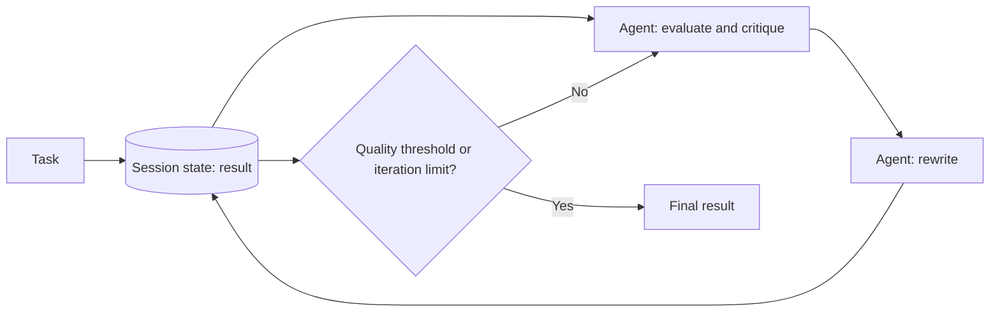

# Multi-Agent Iterative Refinement

## Description

One or more agents work in a loop, changing a result stored in the session state on each pass. Instead of approving or rejecting a proposal, the agents progressively improve the same artifact (a draft, a plan, code) until it reaches a quality threshold or the maximum number of iterations.

It's an implementation of the [Multi-Agent Loop](/ai/agentic-ai/iteration/multi-agent-loop). The source also lists it among the deterministic workflows, for flows with a predictable path and no model-driven orchestration, that prioritize quality over latency.

## Problems it solves

- Complex or open-ended generation tasks that are hard to complete in a single step.
- Progressive improvement of the output over several cycles.
- Writing and debugging code, building a detailed multi-part plan, or drafting and reviewing a long document.

## When to use

- Quality matters more than latency.
- The result can be evaluated against a quality threshold (for example, an automated evaluation).
- Example from the source: an agent drafts a post, critiques its fluency and tone, and rewrites it, repeating until it meets the standard or hits the iteration limit.

### When to avoid

- A single pass produces sufficient quality.
- There's no measurable quality criterion and no iteration cap.
- Latency and cost per request are constrained.

## Trade-offs

| Benefit | Cost / Risk |
| --- | --- |
| Polished, complex outputs that are hard to get in a single step | Each cycle adds latency and cost |
| Predictable path, with no model orchestrating | Additional architectural complexity |
| Session state keeps the evolution of the result | Poorly designed exit conditions cause runaway execution |

- **Exit conditions:** the result reaches a predefined quality threshold or the loop hits the maximum number of iterations.
- **Difference from Review and Critique / Maker-Checker:** here the agents modify the shared result in the session state on each pass, toward a quality threshold. In [Review and Critique](/ai/agent-orchestration/dynamic-orchestration/maker-checker-loop), a separate critic approves, rejects, or returns feedback to a generator that produces a new version.
- **State:** version or log each iteration to audit how the result evolved.

## Diagram

On each cycle the agents update the same result in the session state, until the quality threshold or the iteration limit is reached.

## Related patterns

- [Multi-Agent Loop](/ai/agentic-ai/iteration/multi-agent-loop) — the pattern this one implements.
- [Multi-Agent Review and Critique](/ai/agent-orchestration/dynamic-orchestration/maker-checker-loop) — another implementation of the loop, with a separate generator and critic and an approval decision.
- [Multi-Agent Sequential](/ai/agent-orchestration/deterministic-workflows/sequential-orchestration) — a deterministic flow with no repetition, for when one pass is enough.
- [Maker-Checker Loop](/ai/agent-orchestration/dynamic-orchestration/maker-checker-loop) — the Agent Orchestration (Azure) equivalent of Review and Critique.

## Reference

- [Choose a design pattern for your agentic AI system — Iterative refinement pattern (Google Cloud Architecture Center)](https://docs.cloud.google.com/architecture/choose-design-pattern-agentic-ai-system#iterative-refinement-pattern)
