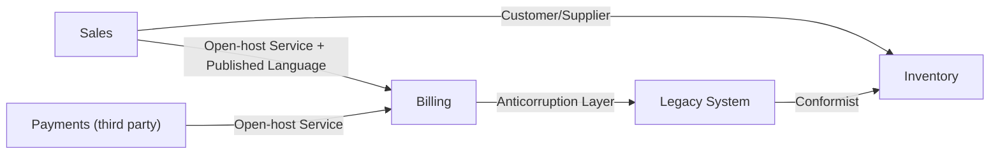

# Context Map

## Description

The Context Map is a global view of a project's Bounded Contexts and the actual relationships between them. It records which contexts exist, where the boundaries run, who depends on whom (upstream and downstream), and what kind of relationship exists at each integration point, such as Shared Kernel, Customer/Supplier, or Anticorruption Layer.

The map describes the situation as it is today, not as you'd like it to be. It can be a diagram, a table, or text, as long as it's shared and maintained by the teams. Each context gets a name, which becomes part of the team's common language, and each relationship makes clear where models need to be translated or changes need to be coordinated.

For Evans, the Context Map is the central artifact of strategic modeling: it exposes the friction between teams and models and guides decisions about where to invest in integration, where to isolate, and where to accept the dependency.

## Problems it solves

- Implicit boundaries between models, which cause concepts with the same name to have different meanings without anyone noticing.
- Teams that don't know who they depend on or who depends on them, discovering the impact only in production.
- Ad hoc integrations, with no clear translation or coordination policy.
- Difficulty planning changes that cut across contexts and sizing the integration effort.

## When to use

- Whenever more than one Bounded Context or more than one team participates in the same system or ecosystem.
- In modernization initiatives, to decide where to isolate the legacy system and where to extract new services.
- When integrating with external or third-party systems, to make the dependencies explicit.

### When to avoid

- Single-context systems, with one team and one model, where the map would be ceremony with no value.
- When the map is drawn as a future ideal and never checked against reality; it ends up misleading instead of informing.

## Trade-offs

| Benefit | Cost / Risk |
| --- | --- |
| Shared view of boundaries and dependencies | It has to be maintained; outdated maps are worse than none |
| Exposes power relations and friction between teams | May reveal uncomfortable organizational conflicts |
| Basis for integration and investment decisions | Upfront effort to survey and reach consensus |
| Common vocabulary for talking about relationships between contexts | Risk of becoming a bureaucratic document detached from the code |

- **Honesty:** map what exists, including bad relationships; improvement comes later.
- **Granularity:** start with a few contexts and refine; a Big Ball of Mud may show up as a single context on the map.
- **Evolution:** review the map when teams, products, or integrations change.

## Diagram

Each edge connects an upstream context to its downstream and is labeled with the relationship pattern that actually holds between them.

## Example

A retailer has the Sales, Inventory, and Billing contexts, a legacy ERP, and a third-party payment gateway. While drawing the map, the team discovers that Inventory simply adopts the ERP's model (Conformist), that Billing needs a translation layer to talk to the ERP (Anticorruption Layer), and that Sales exposes a stable API to several consumers (Open-host Service).

With that, the team decides to prioritize the biweekly meeting between Sales and Inventory (Customer/Supplier) and to plan the gradual retirement of the ERP, using the map as a reference for where translations are needed.

## Related patterns

- [Bounded Context](/application/ddd/model-in-practice/bounded-context) — the nodes of the map; without explicit boundaries there's nothing to map.
- [Shared Kernel](/application/ddd/context-mapping/shared-kernel) — one of the relationships the map records.
- [Customer/Supplier Development](/application/ddd/context-mapping/customer-supplier-development) — an upstream/downstream relationship with negotiation.
- [Conformist](/application/ddd/context-mapping/conformist) — a downstream that adopts the upstream's model.
- [Anticorruption Layer](/cloud/cloud-design-patterns/integration-and-modernization/anti-corruption-layer) — defensive translation on the downstream side.
- [Open-host Service](/application/ddd/context-mapping/open-host-service) — an open protocol for many consumers.
- [Published Language](/application/ddd/context-mapping/published-language) — a common language of exchange between contexts.
- [Separate Ways](/application/ddd/context-mapping/separate-ways) — an explicit decision not to integrate.
- [Partnership](/application/ddd/context-mapping/partnership) — teams with interdependent success.
- [Big Ball of Mud](/application/ddd/context-mapping/big-ball-of-mud) — a region of the map where models are mixed together.
- [Decompose by Subdomain](/architecture/microservices/service-boundaries/decompose-by-subdomain) — uses DDD subdomains to define services.

## Reference

- [DDD Reference, Eric Evans (2015)](https://www.domainlanguage.com/ddd/reference/)
- *Domain-Driven Design: Tackling Complexity in the Heart of Software*, Eric Evans (Addison-Wesley, 2003), ch. 14
- [DDD Crew: Context Mapping](https://github.com/ddd-crew/context-mapping)
