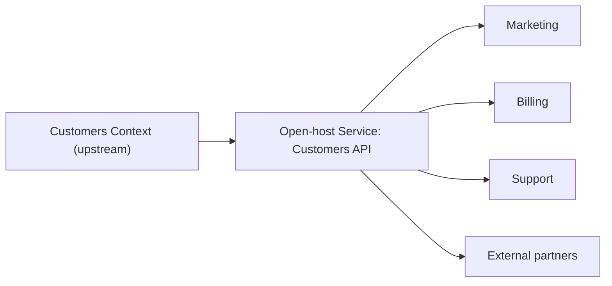

# Open-host Service

## Description

Open-host Service defines a protocol that gives access to your subsystem as a set of services. The protocol is open so that everyone who needs to integrate can use it, and it's enhanced and expanded to handle new integration requirements, except those that are idiosyncratic to a single team.

Instead of building a translator or a custom integration for each consumer, the upstream context publishes a coherent, stable, documented interface designed around its own model. Consumers adapt to it, with or without an Anticorruption Layer. When a consumer has a one-off need, it's handled on the consumer's side rather than by changing the protocol.

The protocol is usually described in a Published Language, which serves as the common exchange format.

## Problems it solves

- An explosion of point-to-point integrations, one for each consumer of the context.
- The growing cost of maintaining custom translators inside the upstream.
- Unstable interfaces that change according to the last customer who asked for something.
- The difficulty of evolving the upstream without knowing how each consumer uses it.

## When to use

- A context is used by several consumers, internal or external.
- It's possible to maintain a stable, versioned, documented API.
- The upstream has the capacity to evolve the protocol for new common requirements.

### When to avoid

- There's a single consumer; a Customer/Supplier relationship or a direct interface is cheaper.
- The context is changing rapidly and the protocol can't be stabilized yet.
- The cost of versioning and documenting isn't worth it for limited internal use.

## Trade-offs

| Benefit | Cost / Risk |
| --- | --- |
| A single interface serves many consumers | Need to maintain and version a public contract |
| Lower coupling between the upstream and each customer | Consumers with specific needs have to adapt |
| Predictable evolution, with compatibility | The API can grow too large trying to serve everyone |
| Makes it easier to onboard new customers | The upstream's model may leak to consumers |

- **Stability:** the protocol is a contract; incompatible changes should be versioned.
- **Format:** combine it with a Published Language for the message format.
- **Consumer defense:** consumers with their own models can protect themselves with an Anticorruption Layer.

## Diagram

The Customers context exposes a single open protocol, consumed by several contexts without custom integrations.

## Example

A company's Customers context has four consumers: Marketing, Billing, Support, and external partners. Instead of building a specific export for each one, the team publishes a versioned API, with resources such as `/customers/{id}` and change events, described in a Published Language. When Marketing asks for a field that's useful only to them, the Marketing team computes it in their own context from the API, without changing the protocol.

## Related patterns

- [Published Language](/application/ddd/context-mapping/published-language) — the documented format used by the protocol.
- [Context Map](/application/ddd/context-mapping/context-map) — records the upstream as an Open-host Service.
- [Anticorruption Layer](/cloud/cloud-design-patterns/integration-and-modernization/anti-corruption-layer) — protects a consumer that has its own model.
- [Customer/Supplier Development](/application/ddd/context-mapping/customer-supplier-development) — a relationship with a specific consumer.
- [Conformist](/application/ddd/context-mapping/conformist) — consumers that adopt the protocol's model.
- [API Gateway](/architecture/microservices/external-api/api-gateway) — an entry point that can expose the open service to external clients.
- [Domain-specific Protocol](/architecture/microservices/communication-styles/domain-specific-protocol) — a domain-specific protocol, related to the idea of an open protocol.

## Reference

- [DDD Reference, Eric Evans (2015)](https://www.domainlanguage.com/ddd/reference/)
- *Domain-Driven Design: Tackling Complexity in the Heart of Software*, Eric Evans (Addison-Wesley, 2003), ch. 14
- [DDD Crew: Context Mapping](https://github.com/ddd-crew/context-mapping)
