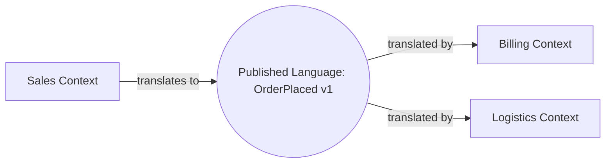

# Published Language

## Description

A Published Language is a well-documented, shared language capable of expressing the necessary domain, used as a common means of communication between contexts. Translation between each context's model and this language is done by each side, instead of one side translating directly into the other's model.

Evans suggests using an already established language whenever possible, such as industry standards (for example, healthcare or financial data interchange formats), and creating your own only when necessary. The language is published, meaning its schema, documentation, and versioning are accessible to anyone who needs to integrate.

It often goes hand in hand with Open-host Service: the service defines the protocol, and the Published Language defines the format of the messages exchanged.

## Problems it solves

- Direct translation between the models of different contexts, which grows in complexity with each new participant.
- Ambiguity in the data exchanged between systems due to the lack of a documented contract.
- Coupling of the exchange format to a context's internal model.
- The difficulty of integrating partners and third parties without knowing the internals of the systems.

## When to use

- Several contexts, internal or external, exchange information and need a single, stable format.
- There's an industry standard that expresses the domain well.
- There's a need to document and version the integration contract.

### When to avoid

- Only two closely related contexts integrate, and a Shared Kernel or a direct translation is enough.
- The cost of documenting and maintaining the language outweighs the benefit, in throwaway integrations.
- Existing industry standards don't express the domain well and adapting them would distort it.

## Trade-offs

| Benefit | Cost / Risk |
| --- | --- |
| Clear contract, independent of each internal model | Effort to define, document, and version the language |
| Each context translates only once, to the common language | Need to maintain a translator on each side |
| Makes it easier to integrate new participants | The common language can become too generic |
| Reduces ambiguity with schemas and examples | Evolution requires compatibility and governance |

- **Versioning:** define compatibility rules from the start.
- **Formats:** XML Schema, JSON Schema, Protocol Buffers, or Avro are common ways to specify the language.
- **Governance:** someone needs to own the schema and approve changes.

## Diagram



Each context translates between its internal model and the published language, without knowing the others' models.

## Example

The Sales context publishes the `OrderPlaced` event, described in a versioned JSON Schema. Billing and Logistics read this event and translate it into their own models.

```json
{
  "type": "OrderPlaced",
  "version": 1,
  "orderId": "ord-1042",
  "customerId": "cus-77",
  "currency": "BRL",
  "items": [
    { "sku": "SKU-9", "quantity": 2, "unitPrice": "49.90" }
  ],
  "placedAt": "2026-03-10T14:32:00Z"
}
```

The fields are defined in business terms and don't expose Sales' internal tables or classes.

## Related patterns

- [Open-host Service](/application/ddd/context-mapping/open-host-service) — the service that exposes the published language.
- [Context Map](/application/ddd/context-mapping/context-map) — where the language is recorded as a means of integration.
- [Anticorruption Layer](/cloud/cloud-design-patterns/integration-and-modernization/anti-corruption-layer) — the consumer's translation between the language and its internal model.
- [Conformist](/application/ddd/context-mapping/conformist) — a consumer that adopts the upstream's language as its model.
- [Ubiquitous Language](/application/ddd/model-in-practice/ubiquitous-language) — a context's internal language, distinct from the published language.
- [Domain-specific Protocol](/architecture/microservices/communication-styles/domain-specific-protocol) — a domain-specific protocol for communication between services.

## Reference

- [DDD Reference, Eric Evans (2015)](https://www.domainlanguage.com/ddd/reference/)
- *Domain-Driven Design: Tackling Complexity in the Heart of Software*, Eric Evans (Addison-Wesley, 2003), ch. 14
- [DDD Crew: Context Mapping](https://github.com/ddd-crew/context-mapping)
