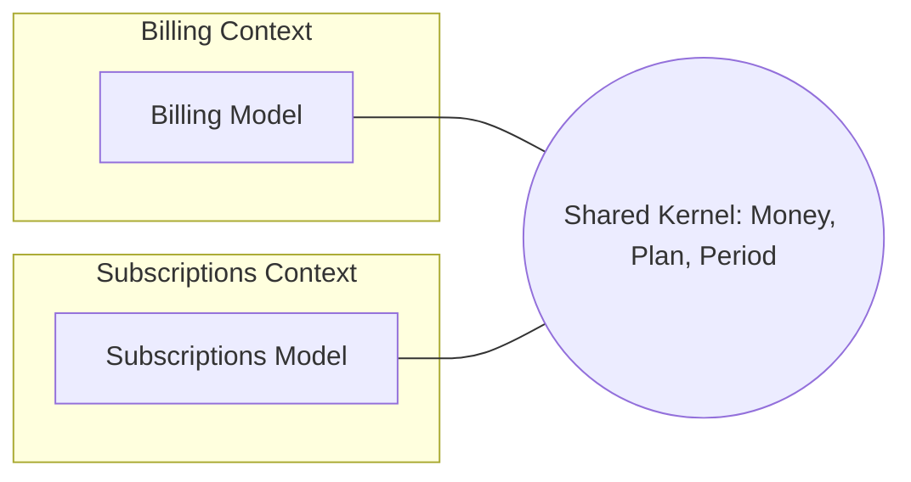

# Shared Kernel

## Description

A Shared Kernel is a subset of the domain model, and of the associated code or data schema, that two or more teams agree to share. This subset is explicitly delimited and can only be changed with the agreement of all the teams involved.

The teams designate the common part, usually small, and keep it under continuous integration with tests that everyone runs. Outside the kernel, each context keeps its own model. The goal is to reduce duplication and translation cost where two contexts really do need to speak exactly the same language.

It takes discipline: the kernel can't be changed unilaterally, and its existence must be known and recorded in the Context Map.

## Problems it solves

- Duplication of core concepts maintained divergently by two teams, with a high translation cost.
- Integration between very close contexts where a full translator would be overkill.
- Inconsistency between contexts that need to share identical rules or structures.

## When to use

- Two contexts with close teams and a strong overlap of business concepts.
- When the teams can maintain continuous integration and frequent communication about the kernel.
- When the cost of duplicating and translating is greater than the cost of coordinating changes.

### When to avoid

- Teams with poor communication, in different locations or organizations, with no way to agree on changes.
- When the kernel tends to grow out of control and turns the two contexts into one, in practice a Big Ball of Mud.
- When one side is a legacy or third-party system that can't be changed.

## Trade-offs

| Benefit | Cost / Risk |
| --- | --- |
| Less duplication and less translation | Strong coupling between the contexts and the teams |
| Guaranteed consistency in the shared part | Any change requires consensus among everyone |
| Common language reinforced at the core | Risk of the kernel growing and swallowing the contexts |
| Integration cheaper than full translation | Tests and releases have to be coordinated |

- **Size:** keep the kernel as small as possible; whatever doesn't need to be common should leave.
- **Governance:** define who can change what and how changes are validated.
- **Evolution:** if the coordination cost grows, consider separating the models and adopting Customer/Supplier or Anticorruption Layer.

## Diagram

The two contexts keep their own models but share a delimited core, changed only by agreement between the teams.

## Example

The Billing and Subscriptions teams at a software-as-a-service company need to use exactly the same definition of Plan, Period, and Money. They extract these concepts into a shared module, kept in a common repository, with tests run in both teams' pipelines. Any change requires review from both. The rest of the model, such as invoices and renewals, stays within each context.

## Related patterns

- [Context Map](/application/ddd/context-mapping/context-map) — the kernel and its participants should appear on the map.
- [Partnership](/application/ddd/context-mapping/partnership) — a Shared Kernel often arises from a close partnership.
- [Customer/Supplier Development](/application/ddd/context-mapping/customer-supplier-development) — an alternative when the coupling should be one-sided.
- [Separate Ways](/application/ddd/context-mapping/separate-ways) — the opposite extreme: no sharing at all.
- [Continuous Integration](/application/ddd/model-in-practice/continuous-integration) — a practice needed to keep the kernel coherent.
- [Value Object](/application/poeaa/base/value-object) — types like Money often make up the kernel.
- [Shared Database](/architecture/microservices/service-collaboration/shared-database) — an even stronger form of sharing, at the data level.

## Reference

- [DDD Reference, Eric Evans (2015)](https://www.domainlanguage.com/ddd/reference/)
- *Domain-Driven Design: Tackling Complexity in the Heart of Software*, Eric Evans (Addison-Wesley, 2003), ch. 14
- [DDD Crew: Context Mapping](https://github.com/ddd-crew/context-mapping)
