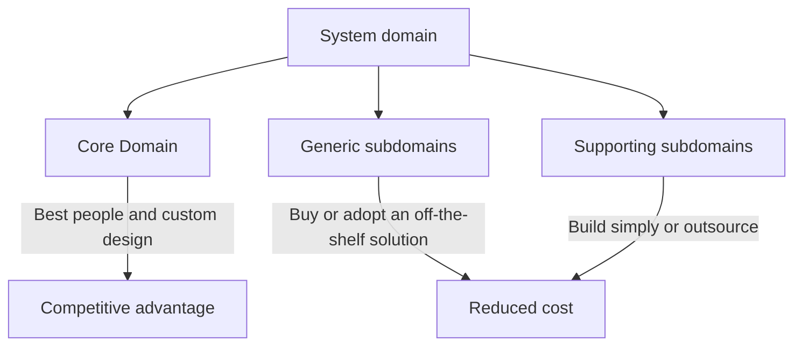

# Core Domain

## Description

The Core Domain is the part of the model that is most central to the business's success: what sets the organization apart from its competitors and justifies the software's existence. In a large system, not all parts of the model have the same strategic value, and treating them as equal dilutes the team's effort.

The pattern asks that the core be identified explicitly, kept as small as possible, and declared an investment priority. The best modelers and developers are assigned to it, and its design gets more care, more refactoring, and more domain knowledge than the rest of the system.

Distillation is the process of separating the essential from what is merely supporting. The Core Domain is the outcome of that decision: a small, valuable slice that guides where to build custom, where to buy, and where to outsource.

## Problems it solves

- Modeling effort spread uniformly, leaving little care for what truly differentiates the business.
- The most experienced developers assigned to peripheral parts or maintenance tasks.
- A model too large to be understood, where the essential gets lost among supporting details.
- No criteria for deciding what to build, what to buy, and what to outsource.

## When to use

- When the system is large and has parts of very different strategic value.
- When the software is a competitive advantage and not just a supporting tool.
- When you need to prioritize investment of modeling effort, people, and time.

### When to avoid

- Small or simple systems, where the whole model fits in the team's head and there's nothing to distill.
- Supporting software with no competitive differentiation, where the right call is to buy or adopt an off-the-shelf solution.
- When the organization can't agree on what is strategic; that debate has to be settled first.

## Trade-offs

| Benefit | Cost / Risk |
| --- | --- |
| Best talent focused on what creates differentiation | Requires a hard decision about what stays outside the core |
| Clear criteria for building, buying, or outsourcing | The core can change with strategy and require reassessment |
| A smaller central model that's easier to understand | Non-core parts may end up with neglected design |
| Alignment between business and technology | Requires business knowledge to identify the core |

- **Organization:** the choice has consequences for staffing, which often creates political friction.
- **Evolution:** today's core can become tomorrow's commodity; periodic review is part of the pattern.
- **Documentation:** the core needs to be communicated, for example with a [Domain Vision Statement](/application/ddd/distillation/domain-vision-statement) and a [Highlighted Core](/application/ddd/distillation/highlighted-core).

## Diagram

The domain is divided by strategic value: the core gets the highest investment, while the other subdomains are handled at a contained cost.

## Example

A logistics company competes for market share with faster and cheaper deliveries. Its Core Domain is route optimization and dynamic fleet allocation, where the algorithms and rules that no one else has live. The best engineers work on this model, with operations experts sitting alongside them.

Billing, payroll, authentication, and email delivery are necessary, but they don't set the company apart. For those areas, the team adopts an off-the-shelf ERP and identity provider, preserving investment capacity for the routing engine.

## Related patterns

- [Generic Subdomains](/application/ddd/distillation/generic-subdomains) — what's left outside the core and can be bought or outsourced.
- [Domain Vision Statement](/application/ddd/distillation/domain-vision-statement) — describes the core and its value in a few lines.
- [Highlighted Core](/application/ddd/distillation/highlighted-core) — makes the core visible in the repository and in the documentation.
- [Segregated Core](/application/ddd/distillation/segregated-core) — structurally separates the core from the rest.
- [Cohesive Mechanisms](/application/ddd/distillation/cohesive-mechanisms) — pulls technical mechanisms out of the core to keep it expressive.
- [Abstract Core](/application/ddd/distillation/abstract-core) — extracts the conceptual kernel when the core is large.
- [Bounded Context](/application/ddd/model-in-practice/bounded-context) — the core normally lives in a context of its own.
- [Context Map](/application/ddd/context-mapping/context-map) — places the core in relation to the other contexts.
- [Decompose by Subdomain](/architecture/microservices/service-boundaries/decompose-by-subdomain) — uses subdomains, the core among them, to delimit services.

## Reference

- [DDD Reference, Eric Evans (2015)](https://www.domainlanguage.com/ddd/reference/)
- *Domain-Driven Design: Tackling Complexity in the Heart of Software*, Eric Evans (Addison-Wesley, 2003)
