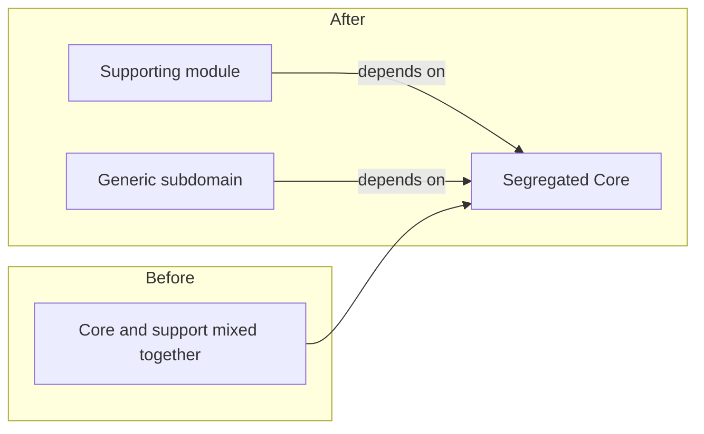

# Segregated Core

## Description

The Segregated Core is a restructuring of the model to physically separate the [Core Domain](/application/ddd/distillation/core-domain) from the other elements, so that the core is cohesive and has few dependencies. The core classes are moved into their own modules, and anything supporting or generic stays outside, depending on the core and not the other way around.

The separation reduces the core's coupling to the supporting parts and lets it be understood, tested, and evolved independently. It also makes it easier to assign a dedicated team to the core, with freedom to refactor, without dragging the rest of the system along.

The cost is a significant refactoring. Elements that serve both the core and the supporting parts have to be split or have their responsibilities redesigned, and the interface between the parts has to be made explicit. For that reason, it's usually adopted when the [Highlighted Core](/application/ddd/distillation/highlighted-core) is no longer enough.

## Problems it solves

- The core entangled with supporting elements, making it hard to understand and change.
- Changes to peripheral parts that break or slow down the core.
- Being unable to give the core a dedicated team or its own pace of evolution.
- The core depending on infrastructure details or generic subdomains.

## When to use

- When the coupling between the core and the rest prevents the core from evolving.
- When there's a team or investment dedicated to the core and its work needs to be isolated.
- When the core is large and visual highlighting isn't enough to manage it.

### When to avoid

- When the core is small or the separation brings no noticeable gain in clarity.
- When the cost and risk of refactoring outweigh the benefit, in which case the [Highlighted Core](/application/ddd/distillation/highlighted-core) is enough.
- When it isn't yet clear what the core is; separating too early can cement the wrong choice.

## Trade-offs

| Benefit | Cost / Risk |
| --- | --- |
| A cohesive core that's understandable and has few dependencies | Large, risky refactoring |
| Independent evolution of core and support | Mixed-use elements are hard to split |
| A dedicated team working autonomously | Possible duplication or need for new interfaces |
| Testing the core without the peripheral infrastructure | A poorly chosen boundary creates disguised coupling |

- **Direction of dependencies:** support depends on the core, and the core doesn't depend on support.
- **Modeling cost:** it can reveal new concepts, since splitting forces you to think about responsibilities.
- **Pace:** the restructuring should be done in small steps, preserving behavior.

## Diagram

The core is extracted into a module of its own, and the supporting and generic modules now depend on it, not the other way around.

## Example

In a fleet management system, the core is predictive maintenance planning, but its classes sit in the same package as vehicle registration, reports, and the ERP integration. Any change to reports requires recompiling and retesting the core.

The team moves `MaintenancePlan`, `WearModel`, and `FailureRisk` into a `maintenance-core` module with no external dependencies. Registration, reports, and the ERP integration now depend on it, and the data the core uses arrives through interfaces defined inside the module itself. The team dedicated to the core gets its own delivery pace.

## Related patterns

- [Core Domain](/application/ddd/distillation/core-domain) — the content being isolated.
- [Highlighted Core](/application/ddd/distillation/highlighted-core) — a lighter alternative that only points to where the core is.
- [Abstract Core](/application/ddd/distillation/abstract-core) — can be combined, extracting the core interfaces and concepts into a module of their own.
- [Generic Subdomains](/application/ddd/distillation/generic-subdomains) — what gets moved out of the core.
- [Module](/application/ddd/building-blocks/module) — the organizational unit used in the separation.
- [Layered Architecture](/application/ddd/building-blocks/layered-architecture) — another way to control the direction of dependencies.
- [Separated Interface](/application/poeaa/base/separated-interface) — a technique for inverting dependencies between core and support.

## Reference

- [DDD Reference, Eric Evans (2015)](https://www.domainlanguage.com/ddd/reference/)
- *Domain-Driven Design: Tackling Complexity in the Heart of Software*, Eric Evans (Addison-Wesley, 2003)
