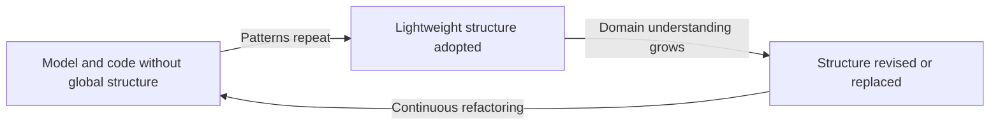

# Evolving Order

## Description

Evolving Order is the principle that guides all of DDD's large-scale structures: a system's overall structure shouldn't be imposed top-down at the start of the project, but left to evolve along with the application. A structure imposed too early, without knowledge of the domain, ends up constraining modeling decisions and becomes a burden that teams work around or abandon.

Instead, the structure is treated as something alive. It emerges from patterns that repeat in the model, is adopted in a lean form, and is revisited as the understanding of the domain matures. A good large-scale structure gives guidance and coherence without being rigid: it should constrain as little as possible and let the model keep deepening.

In practice, this means starting with no structure (or a very light one), watching where the team misses an overview, and only then introducing a pattern such as System Metaphor, Responsibility Layers, Knowledge Level, or Pluggable Component Framework. The chosen pattern can be swapped or dropped when it stops serving its purpose.

## Problems it solves

- Architectural structures imposed at the start of the project that don't match the real domain and become a straitjacket.
- Systems with many modules and concepts where nobody can see the whole, leading to inconsistent decisions across teams.
- "Corporate" structures applied to every project regardless of context, forcing the model to be contorted to fit.
- Structures that have become obsolete but are still followed out of inertia.

## When to use

- Large systems, with many modules and several teams, where the lack of an overall view already causes inconsistency.
- When the team already has enough of a model to recognize patterns that repeat across modules.
- In projects that practice continuous refactoring and accept changing the structure when understanding changes.

### When to avoid

- Small systems, where modules and the Ubiquitous Language already provide enough order and an extra structure is cost with no return.
- When a large-scale structure is used as a substitute for good context boundaries: the problem is then one of Bounded Context, not of structure.
- Teams that lack the autonomy to refactor and end up crystallizing the first structure they chose.

## Trade-offs

| Benefit | Cost / Risk |
| --- | --- |
| Structure that fits the real domain, not an assumed one | Requires discipline to review and refactor the structure frequently |
| Fewer constraints on the design of the parts | During the transition, the system may have orders only partially applied |
| Overview without bureaucracy | Without criteria, "evolution" turns into an absence of structure |
| Structure decisions made with more information | Requires domain knowledge and experience to recognize useful patterns |

- **Cost of change:** changing the structure touches many modules; that's why it needs to be light and have few rules.
- **Authority:** a structure only works if the teams follow it; whoever defines it must know the code and listen to the developers.
- **Minimalism:** the best structure is the simplest one that solves the current problem.

## Diagram

The system starts with no global structure, adopts a light version when it notices recurring patterns, and revises or replaces it as domain knowledge evolves, in a continuous cycle.

## Example

A logistics operator has four teams handling routing, warehousing, billing, and tracking. At first, each team organizes its modules however it likes. After a few months, the developers notice that almost every concept in the system sits at one of two levels: decision rules (routing policy, billing policy) and day-to-day operations (moving cargo, issuing invoices).

The team then adopts a Responsibility Layers structure with just those two layers and a simple dependency rule. A year later, when outsourced partners are added, the two-layer split proves insufficient and is refined into three, without rewriting the system: only the modules that didn't fit were moved. The structure was never fully designed up front, only adjusted when the pain showed up.

## Related patterns

- [System Metaphor](/application/ddd/large-scale-structure/system-metaphor) — one of the structures that can emerge and be adopted when a domain concept orders the whole.
- [Responsibility Layers](/application/ddd/large-scale-structure/responsibility-layers) — a structure that tends to emerge from observing recurring responsibilities.
- [Knowledge Level](/application/ddd/large-scale-structure/knowledge-level) — a structure adopted when the model's configuration rules need to vary.
- [Pluggable Component Framework](/application/ddd/large-scale-structure/pluggable-component-framework) — a high-cost structure, adopted only when there is the maturity for it.
- [Refactoring Toward Deeper Insight](/application/ddd/model-in-practice/refactoring-toward-deeper-insight) — the mechanism by which the structure is revisited.
- [Module](/application/ddd/building-blocks/module) — the basic unit that large-scale structures organize.
- [Bounded Context](/application/ddd/model-in-practice/bounded-context) — a context boundary that must be settled before resorting to large-scale structures.

## Reference

- [DDD Reference, Eric Evans (2015)](https://www.domainlanguage.com/ddd/reference/)
- *Domain-Driven Design: Tackling Complexity in the Heart of Software*, Eric Evans (Addison-Wesley, 2003)
