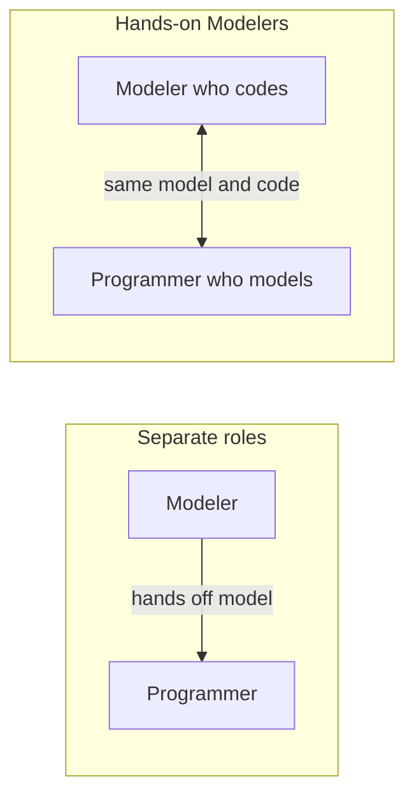

# Hands-on Modelers

## Description

Hands-on Modelers is the principle that everyone who contributes to the model should also have contact with the code, and everyone who changes the code should take part in the conversation about the model. If modelers distance themselves from the implementation, they lose their sense of practical constraints, and the model becomes an abstraction that doesn't work in practice.

On the other side, if programmers are handed a finished model and just implement it, feedback from the implementation never flows back to the model, and they tend to ignore what it was meant to achieve. A model stays useful only if the people who design it feel its limitations when they write code.

This doesn't mean everyone does everything: architects and analysts can lead the modeling, as long as they really do program, at least part of the time, in the same code.

## Problems it solves

- "Ivory tower" models designed by people who don't implement them and that don't work in code.
- Programmers who implement without understanding the model's intent and create a parallel design.
- Slow or nonexistent feedback between the model and the implementation.
- A separation of roles between analysts and developers that fragments knowledge.

## When to use

- In DDD projects where the model is the center of the design.
- When you notice the model says one thing and the code does another.
- For small or medium teams able to collaborate closely.

### When to avoid

- In organizations where architects can't touch the code due to formal restrictions; in that case, the pattern requires a process change first.
- As a justification for everyone changing everything without coordination, with no care for integrating the model.

## Trade-offs

| Benefit | Cost / Risk |
| --- | --- |
| Models that respect real implementation constraints | Requires modelers to keep their technical skills |
| Fast feedback between model and code | Challenges organizational structures with rigid roles |
| Domain knowledge spread across the team | Modeler time also spent on code |

- **Roles:** the pattern challenges the strict division between architects, analysts, and programmers.
- **Scale:** works best in contexts with a small team, close to the practice of Continuous Integration.
- **Culture:** depends on trust and respect between specialists and developers.

## Diagram

In the arrangement with separate roles, the flow is one-way; with Hands-on Modelers, the same people work on both model and code and feedback is continuous.

## Example

An architect at a fintech used to draw domain diagrams for the Payments context and hand them to developers, who implemented them in their own way. The diagrams quickly went out of date. The company changed its practice: the architect started spending part of the week programming in the same repository, pairing with the developers.

While implementing a chargeback rule, she realized the model she had drawn required querying three aggregates in a single transaction, which was unworkable. She reworked the model right there with her colleagues, and the new design went straight into the code. The developers, in turn, started joining the conversations with the business specialists.

## Related patterns

- [Model-Driven Design](/application/ddd/model-in-practice/model-driven-design) — the principle that requires model and code to be one.
- [Ubiquitous Language](/application/ddd/model-in-practice/ubiquitous-language) — the shared language unites modelers and programmers.
- [Continuous Integration](/application/ddd/model-in-practice/continuous-integration) — keeps the model cohesive when several people change it.
- [Refactoring Toward Deeper Insight](/application/ddd/model-in-practice/refactoring-toward-deeper-insight) — model refinement happens alongside the code.

## Reference

- [DDD Reference, Eric Evans (2015)](https://www.domainlanguage.com/ddd/reference/)
- *Domain-Driven Design: Tackling Complexity in the Heart of Software*, Eric Evans (Addison-Wesley, 2003)
