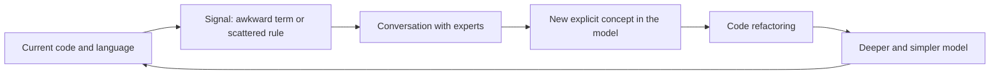

# Refactoring Toward Deeper Insight

## Description

Refactoring Toward Deeper Insight is the practice of refactoring the model and the code not just to clean up the implementation, but to incorporate new understanding of the domain. Useful models rarely emerge on the first try; they emerge from cycles of exploration, feedback, and discovery, with constant participation from experts.

The process is continuous and driven by signals: awkward terms in the language, code that has become hard to explain, implicit concepts that keep coming up in conversation. When an important concept was hidden in a fragment of code or a scattered rule, making it explicit often produces a breakthrough: a deeper, simpler model.

The effort should be directed at the Core Domain, where the business's competitive edge lies and where the model pays off the most. Other parts may deserve only technical refactoring.

## Problems it solves

- A shallow model that serves current cases but becomes rigid with every new requirement.
- Important concepts hidden in conditionals, flags, and utilities.
- Code that grows in complexity without gaining understanding of the domain.
- Model stagnation, with the model treated as done after the first version.

## When to use

- When the language gets awkward or the experts say things the model can't express.
- When new requirements demand repeated patches in the same spot in the code.
- In the Core Domain, where a deeper model is worth the investment.

### When to avoid

- In generic or supporting subdomains, where an off-the-shelf or simple solution is enough.
- Without tests that protect behavior: large-scale refactoring becomes risky.
- As refactoring for aesthetics, unrelated to new understanding of the domain.

## Trade-offs

| Benefit | Cost / Risk |
| --- | --- |
| A more expressive, simple, and flexible model | Ongoing investment of time and attention |
| Code and language that keep pace with the business | Deep changes can affect many places in the code |
| Competitive advantage in the Core Domain | Outcome is hard to predict and plan |

- **Discovery:** model breakthroughs can't be scheduled; what you can do is create the conditions for them to happen.
- **Tests:** the safety net of automated tests is what makes the practice viable.
- **Scope:** deep refactoring should be concentrated where the business differentiates itself the most.

## Diagram

A continuous cycle: signals in the language and the code lead to conversation, to the new explicit concept, to refactoring, and to a deeper model.

## Example

In an equipment rental system, the late-fee rule was scattered across several methods, with flags like `isPremium` and `isWeekend`. In a conversation with the operations manager, the team heard the term "grace policy", which didn't exist in the code. By making it explicit, they created a `GracePolicy` concept that encapsulates when and how much to charge.

The flags disappeared, the rule ended up in one place, and new policies, such as one for corporate customers, became just new variations. The change was only safe because the existing tests were kept and extended during the refactoring.

## Related patterns

- [Ubiquitous Language](/application/ddd/model-in-practice/ubiquitous-language) — awkward terms in the language signal where to refactor.
- [Model-Driven Design](/application/ddd/model-in-practice/model-driven-design) — the refined model is reflected directly in the code.
- [Hands-on Modelers](/application/ddd/model-in-practice/hands-on-modelers) — those who model refine the model alongside the code.
- [Core Domain](/application/ddd/distillation/core-domain) — where to concentrate refinement effort.
- [Conceptual Contours](/application/ddd/supple-design/conceptual-contours) — supple design emerges from domain-driven refactorings.
- [Intention-Revealing Interfaces](/application/ddd/supple-design/intention-revealing-interfaces) — explicit concepts call for names that reveal intent.

## Reference

- [DDD Reference, Eric Evans (2015)](https://www.domainlanguage.com/ddd/reference/)
- *Domain-Driven Design: Tackling Complexity in the Heart of Software*, Eric Evans (Addison-Wesley, 2003)
