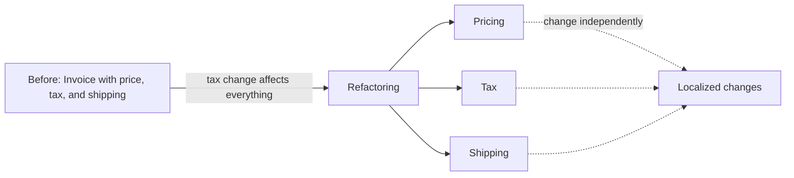

# Conceptual Contours

## Description

Conceptual Contours means decomposing the design into cohesive units (operations, interfaces, classes, and Aggregates) aligned with the natural contours of the domain. The division isn't arbitrary: it follows what changes together and what changes separately, so that each unit has a coherent responsibility.

When the contours are right, a requirement change tends to affect only one unit, and extensions use the existing pieces. When they're wrong, every change requires altering many parts at once, or you discover that separate concepts are mixed together in a single one.

Contours are rarely found on the first attempt. The team discovers them by refactoring, observing where change hurts, and testing the model against varied scenarios. The pattern guides the reflection: units that are too small fragment the concept, and units that are too large lose cohesion.

## Problems it solves

- Simple changes that require edits scattered across many classes.
- Classes that mix concepts that evolve at different paces.
- Concepts split into fragments that only make sense together.
- Interfaces that force the client to know the details of several pieces.

## When to use

- When you notice that small requirement changes cause large refactorings.
- When reviewing the model after new insights into the domain.
- In Aggregates and classes whose boundary seems arbitrary.

### When to avoid

- Before knowing the domain reasonably well: a division made early tends to be reworked.
- As an excuse for endless refactoring: apply it when there is concrete pain with change.

## Trade-offs

| Benefit | Cost / Risk |
| --- | --- |
| Changes localized in a few units | Discovering the contours takes iterations and refactoring |
| Reuse and composition of existing pieces | Excessive division fragments the concept |
| A model that reflects the domain's natural structure | The contours change when the domain changes |

- **Cohesion:** each unit expresses a whole concept.
- **Observation:** the change history shows where the real boundaries are.
- **Testing:** varied scenarios reveal whether the design accommodates extensions.

## Diagram



By separating price, tax, and shipping into units that change independently, each requirement change is confined to one of them.

## Example

An `Invoice` class calculated price, tax, and shipping in a single method. Because tax rules change with legislation and shipping rules change with logistics contracts, every change meant touching the same class. The decomposition follows the contours of the domain.

```java
public class Invoice {
    private final PricingPolicy pricing;
    private final TaxPolicy tax;
    private final ShippingPolicy shipping;

    public Invoice(PricingPolicy p, TaxPolicy t, ShippingPolicy s) {
        this.pricing = p; this.tax = t; this.shipping = s;
    }

    public Money total(Order order) {
        Money subtotal = pricing.priceOf(order);
        return subtotal
            .add(tax.taxOn(subtotal))
            .add(shipping.costFor(order));
    }
}
// New tax rule: only TaxPolicy changes.
```

## Related patterns

- [Refactoring Toward Deeper Insight](/application/ddd/model-in-practice/refactoring-toward-deeper-insight) — the main means of discovering the contours.
- [Aggregate](/application/ddd/building-blocks/aggregate) — Aggregate boundaries follow the contours of consistency.
- [Standalone Classes](/application/ddd/supple-design/standalone-classes) — correct contours make independent classes easier.
- [Intention-Revealing Interfaces](/application/ddd/supple-design/intention-revealing-interfaces) — each unit has a name that expresses its concept.
- [Drawing on Established Formalisms](/application/ddd/supple-design/drawing-on-established-formalisms) — formalisms suggest natural divisions.
- [Core Domain](/application/ddd/distillation/core-domain) — the most important contours go where the business value is.
- [Strategy](/coding/gof/behavioral/strategy) (GoF) — encapsulates each policy that varies separately.

## Reference

- [DDD Reference, Eric Evans (2015)](https://www.domainlanguage.com/ddd/reference/)
- *Domain-Driven Design: Tackling Complexity in the Heart of Software*, Eric Evans (Addison-Wesley, 2003)
