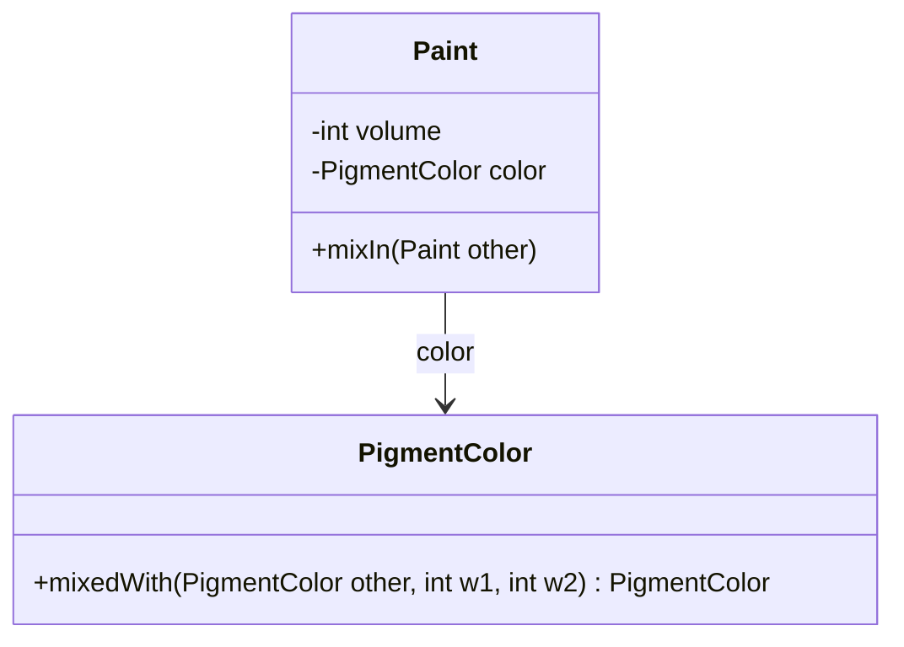

# Side-Effect-Free Functions

## Description

Side-Effect-Free Functions proposes separating operations into two categories: commands, which modify state, and queries, which only return a result. A function is free of side effects when it computes and returns a value without changing anything observable. Commands should be simple and should not return domain data.

Complex logic is placed in pure functions, preferably in Value Objects, which are immutable. That way, an operation that combines values returns a new object instead of modifying the existing one. When the calculation lives in an Entity, part of it can be extracted into a Value Object, leaving the Entity just applying the result.

The effect is a strong reduction in mental load: the developer can call and compose functions without fear of changing the state of another object, and tests become simple.

## Problems it solves

- Operations that mix calculation and state change, hard to predict and to test.
- Cascading side effects, where calling a method changes objects the caller didn't expect.
- Difficulty reusing a calculation without triggering its state change.
- Bugs caused by call order and by shared mutable state.

## When to use

- In complex domain calculations (prices, colors, deadlines, rates).
- When modeling concepts as Value Objects, which should be immutable.
- When a query is called in many places and needs to be safe to compose.

### When to avoid

- In large objects where copying on every operation is expensive and demonstrably a bottleneck.
- When the domain is by nature a sequence of state changes (for example, a long process): there the command is legitimate and should be explicit, not hidden.

## Trade-offs

| Benefit | Cost / Risk |
| --- | --- |
| Simple tests, no state setup | Creates new objects on every operation |
| Safe composition and local reasoning | Requires discipline to separate commands from queries |
| Caching and parallelism made easier | Can feel unnatural in mutable libraries |

- **Consistency:** fewer points where state can be corrupted.
- **Performance:** immutability can cost allocations; measure before giving it up.
- **Commands:** keep them small and with a clearly named effect.

## Diagram



`Paint.mixIn` is a command that changes state, while `PigmentColor.mixedWith` is a pure function that computes the new color without altering any object.

## Example

In a paint system, the pigment mixing rule is complex. It lives in `PigmentColor`, an immutable Value Object; the command in `Paint` just applies the result.

```java
public final class PigmentColor {
    private final double r, g, b;

    public PigmentColor(double r, double g, double b) {
        this.r = r; this.g = g; this.b = b;
    }

    // Pure function: returns a new color, nothing is modified
    public PigmentColor mixedWith(PigmentColor other, int w1, int w2) {
        int total = w1 + w2;
        return new PigmentColor(
            (r * w1 + other.r * w2) / total,
            (g * w1 + other.g * w2) / total,
            (b * w1 + other.b * w2) / total);
    }
}

public class Paint {
    private PigmentColor color;
    private int volume;

    // Command: simple, just applies the result
    public void mixIn(Paint other) {
        color = color.mixedWith(other.color, volume, other.volume);
        volume += other.volume;
    }
}
```

## Related patterns

- [Value Object](/application/poeaa/base/value-object) — the natural home for pure functions, since they're immutable.
- [Entity](/application/ddd/building-blocks/entity) — keeps the commands, delegating the calculation to values.
- [Closure of Operations](/application/ddd/supple-design/closure-of-operations) — operations that return the same type go well with pure functions.
- [Assertions](/application/ddd/supple-design/assertions) — document the effects of the commands that remain.
- [Intention-Revealing Interfaces](/application/ddd/supple-design/intention-revealing-interfaces) — the name should make clear whether it's a command or a query.
- [Money](/application/poeaa/base/money) (PoEAA) — an immutable value with pure operations.

## Reference

- [DDD Reference, Eric Evans (2015)](https://www.domainlanguage.com/ddd/reference/)
- *Domain-Driven Design: Tackling Complexity in the Heart of Software*, Eric Evans (Addison-Wesley, 2003)
- [Command Query Separation (Fowler's bliki)](https://martinfowler.com/bliki/CommandQuerySeparation.html)
