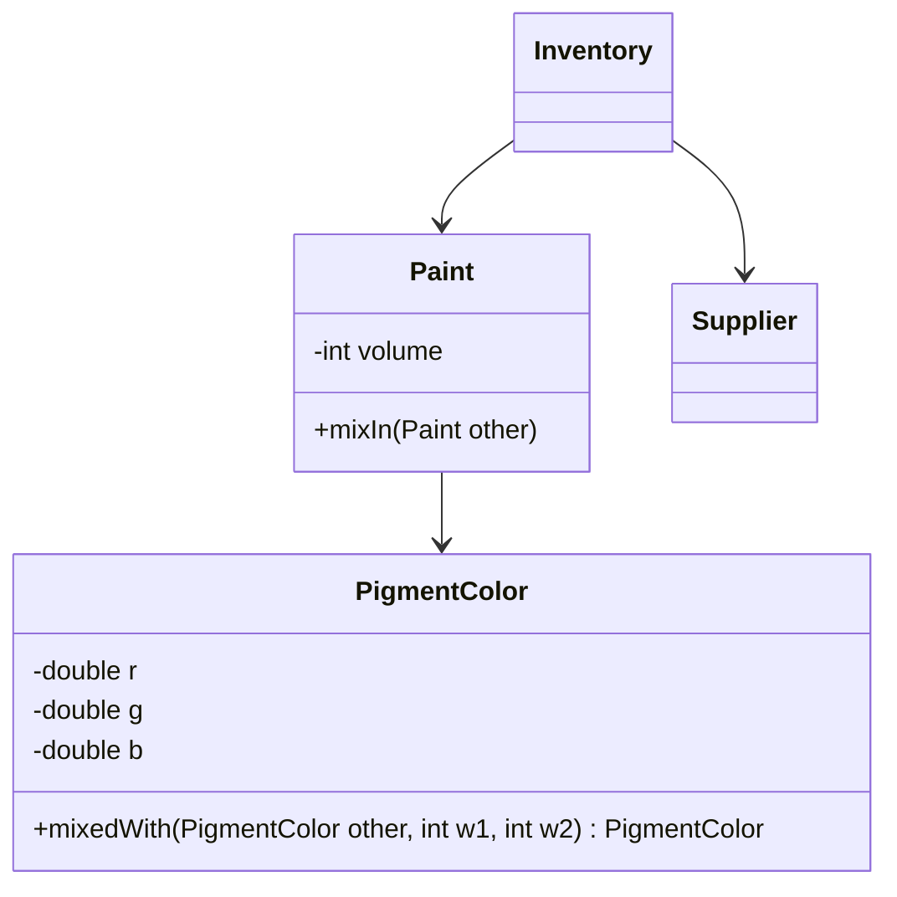

# Standalone Classes

## Description

Standalone Classes proposes reducing each class's dependencies to a minimum, until it can be understood and tested on its own, without referencing other classes beyond primitive types and the language's basic libraries. Every extra dependency requires the reader to understand the other concept as well.

The goal isn't to eliminate all coupling, but to make the essential coupling explicit and remove the remaining links. Each association and each parameter is examined: if the concept can be understood without the other class, the dependency is removed. Value Objects are usually ideal candidates.

When a Standalone Class is achieved, the gain is large: the concept can be understood, tested, and changed in isolation, and the model's mental load drops. The classes that can't achieve this are the ones that concentrate the domain's essential complexity.

## Problems it solves

- Classes that can only be understood together with several others, increasing mental load.
- Tests that require assembling a large graph of objects.
- Changes that propagate through unnecessary dependencies.
- Models in which every concept depends on every other one.

## When to use

- In domain concepts that can be expressed with just values and basic types.
- When modeling Value Objects and pure calculations.
- In model reviews, to identify dependencies that aren't essential.

### When to avoid

- When the concept is, by nature, a relationship with others: forcing isolation hides the real association.
- When isolation requires duplicating logic from other classes, increasing the total cost.

## Trade-offs

| Benefit | Cost / Risk |
| --- | --- |
| Isolated understanding and testing | May require rethinking the model to remove dependencies |
| Less propagation of changes | Some concepts can't be made independent |
| Easy reuse | Risk of duplicating logic to avoid a dependency |

- **Mental load:** every dependency removed is one less concept to keep in your head.
- **Essential coupling:** keep the dependencies that express the domain.
- **Priority:** apply it first to the most used and most complex classes.

## Diagram



`PigmentColor` depends only on primitive types and can be understood on its own, while `Inventory` concentrates the context's dependencies.

## Example

The `PigmentColor` class knows only numbers. It doesn't reference `Paint`, `Inventory`, or any service, so it's tested with no setup at all.

```java
public final class PigmentColor {
    private final double r, g, b;

    public PigmentColor(double r, double g, double b) {
        this.r = r; this.g = g; this.b = b;
    }

    public PigmentColor mixedWith(PigmentColor other, int w1, int w2) {
        int t = w1 + w2;
        return new PigmentColor(
            (r * w1 + other.r * w2) / t,
            (g * w1 + other.g * w2) / t,
            (b * w1 + other.b * w2) / t);
    }
}

// Isolated test, no other domain objects
PigmentColor c = new PigmentColor(0, 0, 1)
    .mixedWith(new PigmentColor(1, 1, 0), 1, 1);
```

## Related patterns

- [Value Object](/application/poeaa/base/value-object) — a natural candidate for a standalone class.
- [Module](/application/ddd/building-blocks/module) — low coupling between modules and high cohesion within them.
- [Side-Effect-Free Functions](/application/ddd/supple-design/side-effect-free-functions) — pure functions in standalone classes are very easy to understand.
- [Closure of Operations](/application/ddd/supple-design/closure-of-operations) — another way to reduce dependencies in operations.
- [Cohesive Mechanisms](/application/ddd/distillation/cohesive-mechanisms) — isolates complex mechanisms so the model stays focused.

## Reference

- [DDD Reference, Eric Evans (2015)](https://www.domainlanguage.com/ddd/reference/)
- *Domain-Driven Design: Tackling Complexity in the Heart of Software*, Eric Evans (Addison-Wesley, 2003)
