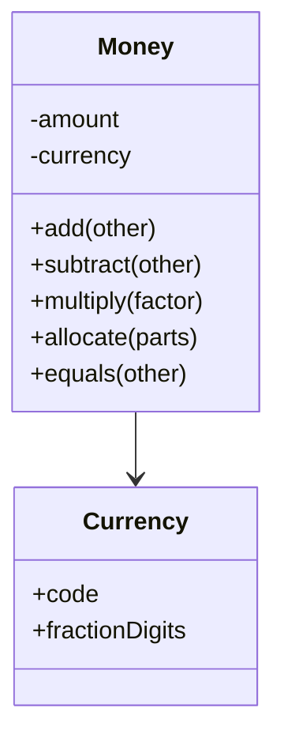

# Money

## Description

Money represents a monetary value. Most languages have no first-class type for money, and that causes two recurring problems: adding amounts in different currencies without accounting for conversion, and losing cents to rounding when dividing amounts in the currency's smallest unit.

The solution is to encapsulate the value in a `Money` class that carries an amount and a currency, rejects operations between different currencies, and concentrates the rounding rules. The amount is typically stored as an integer in the smallest unit (cents) or as a fixed-precision decimal, never as a binary floating-point number.

A key operation is allocation (`allocate`): splitting an amount into parts without losing or creating cents, distributing the remainder among the parts. Money is a specialization of [Value Object](/application/poeaa/base/value-object): immutable and compared by value.

## Problems it solves

- Adding or comparing amounts in different currencies without conversion.
- Rounding errors with `float` and `double` (for example, 0.1 + 0.2).
- Cents lost or created when splitting an amount (dividing 100.00 by 3).
- Formatting and rounding rules duplicated across the code.

## When to use

- In any system that does monetary calculations: invoicing, payments, shopping carts, accounting.
- When there is more than one currency in the system.
- When amounts must be split exactly (installments, expense sharing).

### When to avoid

- When the system only displays amounts and never calculates with them, and a plain decimal would do.
- When a mature money library already exists (for example, `javax.money`, `Joda-Money`, `py-moneyed`) that meets the requirements; in that case, use it instead of writing your own.
- When you need precision beyond the currency's smallest unit (exchange rates, fractional unit prices), which may call for a different type.

## Trade-offs

| Benefit | Cost / Risk |
| --- | --- |
| Prevents accidental mixing of currencies | Requires explicit conversion at the boundaries (database, JSON, APIs) |
| Correct, centralized rounding and allocation | One more type to map in persistence (amount and currency) |
| Code more expressive than loose decimals | Rounding decisions must be explicit |
| Immutable, safe, and easy to test | Currencies with 0, 2, or 3 decimal places need handling |

- **Consistency:** money never "vanishes" or "appears" when splitting.
- **Persistence:** usually mapped with [Embedded Value](/application/poeaa/object-relational-structural/embedded-value) into two columns (amount and currency).

## Diagram



`Money` combines the amount and the `Currency`, and exposes operations that respect the currency and the rounding.

## Example

Splitting 100.00 into 3 installments can't lose cents: `allocate` distributes the remainder.

```typescript
class Money {
  private constructor(readonly cents: number, readonly currency: string) {}

  static of(cents: number, currency: string): Money {
    return new Money(Math.round(cents), currency);
  }

  add(other: Money): Money {
    this.assertSameCurrency(other);
    return new Money(this.cents + other.cents, this.currency);
  }

  allocate(parts: number): Money[] {
    const base = Math.floor(this.cents / parts);
    let remainder = this.cents - base * parts;
    return Array.from({ length: parts }, () => {
      const extra = remainder-- > 0 ? 1 : 0;
      return new Money(base + extra, this.currency);
    });
  }

  private assertSameCurrency(other: Money) {
    if (other.currency !== this.currency) throw new Error("Different currencies");
  }
}

Money.of(10000, "BRL").allocate(3); // 33.34 / 33.33 / 33.33
```

## Related patterns

- [Value Object](/application/poeaa/base/value-object) — Money is the canonical example: immutable and compared by value.
- [Embedded Value](/application/poeaa/object-relational-structural/embedded-value) — maps the amount and the currency to columns of the owning table.
- [Special Case](/application/poeaa/base/special-case) — can represent special values, such as "no price set" or zero money.
- [Domain Model](/application/poeaa/domain-logic/domain-model) — uses Money for the entities' monetary attributes.
- [Flyweight](/coding/gof/structural/flyweight) — common immutable instances (such as zero) can be shared.

## Reference

- [Pattern page in Fowler's catalog](https://martinfowler.com/eaaCatalog/money.html)
- *Patterns of Enterprise Application Architecture*, Martin Fowler (Addison-Wesley, 2002)
