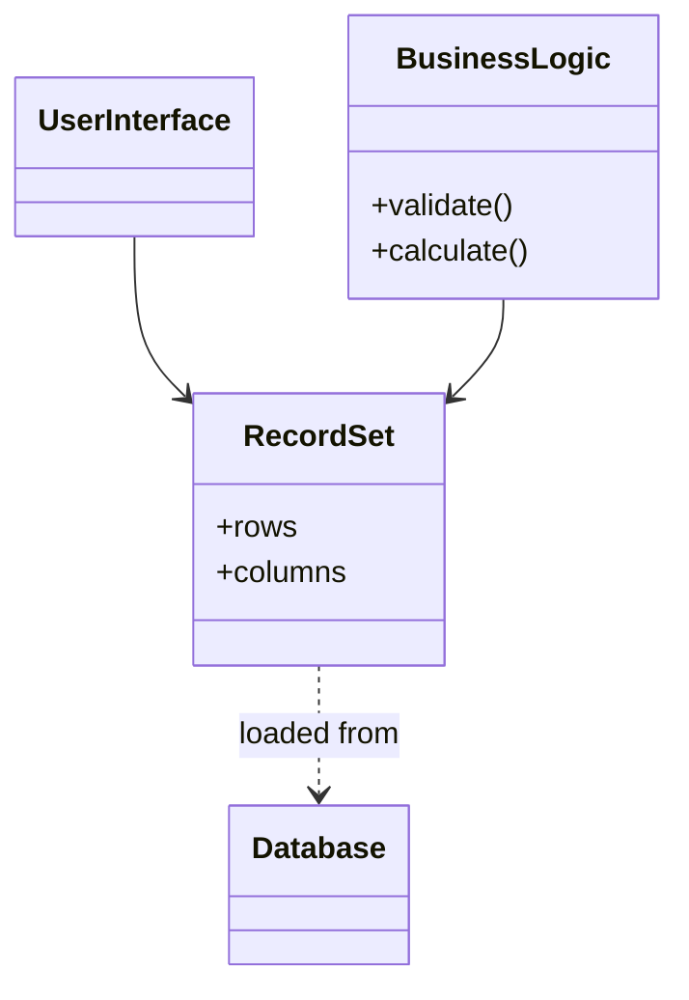

# Record Set

## Description

A Record Set is an in-memory representation of tabular data. It has the same shape as the result of a SQL query (rows and columns), but it can be created, read, and modified by any part of the system, without depending on an open database connection.

Data-aware user interface tools expect structures in this format. With a Record Set, the application keeps that convenience and also gains a place where business rules and validations can operate on the data, instead of living in stored procedures or being scattered across the interface.

It's the pattern behind structures such as .NET's `DataSet` and `DataTable`, JDBC's disconnected `ResultSet` (`RowSet`), and dataframes in data analysis languages.

## Problems it solves

- Data-aware interfaces need tabular data, but business logic shouldn't live in the screen itself.
- Validations and calculations richer than simple checks have nowhere to live without stored procedures.
- Query results tied to an open connection can't be passed along or safely modified.

## When to use

- When the application is centered on relational data and uses data-bound UI components.
- Together with [Table Module](/application/poeaa/domain-logic/table-module) or [Transaction Script](/application/poeaa/domain-logic/transaction-script), which naturally operate on tabular data.
- For reports and simple maintenance screens (CRUD) where an object model would be overkill.

### When to avoid

- When the domain logic is complex and would benefit from a [Domain Model](/application/poeaa/domain-logic/domain-model), since the Record Set pushes toward a table-oriented style.
- When the domain layer shouldn't know the database structure, since the Record Set reproduces it.
- When the datasets are very large and the cost of keeping them all in memory is unacceptable.

## Trade-offs

| Benefit | Cost / Risk |
| --- | --- |
| Direct integration with data-bound UI tools | Business logic ends up with a table structure, without expressive domain objects |
| Disconnected data that can be manipulated and passed along | Access by column name tends to be fragile and weakly typed |
| Fast development in data-centric applications | Domain layer coupled to the database schema |
| Allows business rules outside stored procedures | Can consume a lot of memory with large volumes |

- **Consistency:** many implementations track row changes to synchronize with the database, which helps with updates but requires care with concurrency.
- **Performance:** a disconnected set avoids going back to the database repeatedly.

## Diagram



The interface and the business logic operate on the same `RecordSet`, which is loaded from the `Database` but exists in memory independently.

## Example

An orders screen displays rows coming from the database, and a business rule calculates the total over them before the screen is bound to the same set.

```csharp
using System.Data;

DataTable orders = new DataTable("Orders");
orders.Columns.Add("Id", typeof(int));
orders.Columns.Add("Quantity", typeof(int));
orders.Columns.Add("UnitPrice", typeof(decimal));

orders.Rows.Add(1, 2, 10.50m);
orders.Rows.Add(2, 5, 3.00m);

// Business rule operating on the Record Set
decimal total = 0;
foreach (DataRow row in orders.Rows)
    total += (int)row["Quantity"] * (decimal)row["UnitPrice"];

// The same table can be bound to a UI grid
// grid.DataSource = orders;
```

## Related patterns

- [Table Module](/application/poeaa/domain-logic/table-module) — organizes domain logic by table and consumes the Record Set as its data structure.
- [Transaction Script](/application/poeaa/domain-logic/transaction-script) — scripts also work well on tabular data.
- [Domain Model](/application/poeaa/domain-logic/domain-model) — the object-oriented alternative, which replaces the Record Set with rich objects.
- [Table Data Gateway](/application/poeaa/data-source-architectural/table-data-gateway) — usually returns a Record Set as the result of queries.
- [Data Transfer Object](/application/poeaa/distribution/data-transfer-object) — also carries data, but with a fixed structure aimed at transfer between processes.

## Reference

- [Pattern page in Fowler's catalog](https://martinfowler.com/eaaCatalog/recordSet.html)
- *Patterns of Enterprise Application Architecture*, Martin Fowler (Addison-Wesley, 2002)
