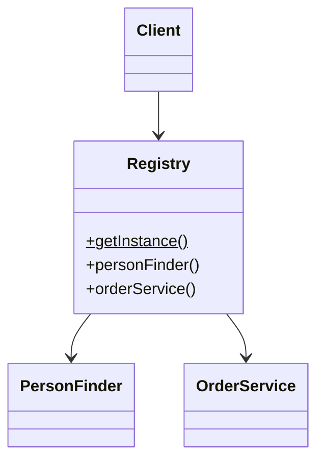

# Registry

## Description

A Registry is a well-known object that other objects use to find common objects and services. You normally reach related objects by navigating from one you already have (from a customer, you get to their orders). That fails when you only have an identifier and no reference: you need a finder object, and then the question arises of how to reach the finder itself.

The Registry answers that question: it's a well-known access point that behaves like a global object, but can be less global than it looks (for example, scoped to a thread, a request, or a session). Anyone who needs a service or a finder asks the Registry.

The Registry is a pattern of last resort: when possible, passing dependencies explicitly (as parameters or through dependency injection) is preferable.

## Problems it solves

- Objects need to reach common services or finders without holding a reference to them.
- Passing the same dependency through many intermediate layers pollutes signatures.
- No well-known entry point for locating shared objects.

## When to use

- When many points in the system need access to common objects or services and passing them along would be impractical.
- When you only have an identifier and need to resolve it to an object, for example via a [Repository](/application/poeaa/object-relational-metadata-mapping/repository) or finder.
- In legacy code or frameworks where dependency injection isn't available.

### When to avoid

- When dependency injection is feasible: explicit dependencies make the code clearer and more testable.
- When the Registry would become shared mutable global state, which makes testing and concurrency harder.
- When hidden dependencies make the code hard to understand, since the signature doesn't reveal what the class uses.

## Trade-offs

| Benefit | Cost / Risk |
| --- | --- |
| Simple access to common services from anywhere | Hidden dependencies: the signature doesn't show what the code uses |
| Avoids passing parameters through many layers | Behaves like global state, making isolation harder |
| Single point for swapping implementations (tests, environments) | Parallel tests can interfere with each other |
| Easy to implement | Risk of coupling to a central point and of overuse |

- **Testability:** requires the Registry to allow replacing implementations (for example, a method to install a stub) and tests to restore it.
- **Concurrency:** Fowler discusses per-thread, per-session, or per-request registries to avoid improper sharing.

## Diagram



The `Client` asks the `Registry` for the `PersonFinder` or the `OrderService` it needs, without having received either one as a parameter.

## Example

Some legacy code needs the person finder in many places. The Registry exposes static access and lets tests swap the implementation.

```java
public class Registry {
    private static Registry instance = new Registry();
    private PersonFinder personFinder = new DatabasePersonFinder();

    public static PersonFinder personFinder() {
        return instance.personFinder;
    }

    // For tests: installs a stub and resets the state
    public static void initializeForTests(PersonFinder stub) {
        instance = new Registry();
        instance.personFinder = stub;
    }

    public static void reset() {
        instance = new Registry();
    }
}

// Client
Person person = Registry.personFinder().find(42L);
```

Service locators (`ServiceLocator`) and manually queried application contexts are variations of the Registry.

## Related patterns

- [Singleton](/coding/gof/creational/singleton) — the Registry is often implemented as a Singleton, but the Singleton guarantees one instance, while the Registry provides an access point for locating several objects.
- [Service Registry](/architecture/microservices/service-discovery/service-registry) — not to be confused: that is a database of service instances on the network for discovery; the PoEAA Registry is an object inside a process that locates local objects.
- [Separated Interface](/application/poeaa/base/separated-interface) — the Registry can return the implementation associated with the interface.
- [Plugin](/application/poeaa/base/plugin) — a configuration-based alternative for choosing implementations.
- [Gateway](/application/poeaa/base/gateway) — gateways are typical examples of what you get from a Registry.
- [Repository](/application/poeaa/object-relational-metadata-mapping/repository) — finders and repositories are objects frequently located through a Registry.
- [Factory Method](/coding/gof/creational/factory-method) — also centralizes obtaining objects, but creates instances instead of locating existing ones.

## Reference

- [Pattern page in Fowler's catalog](https://martinfowler.com/eaaCatalog/registry.html)
- *Patterns of Enterprise Application Architecture*, Martin Fowler (Addison-Wesley, 2002)
