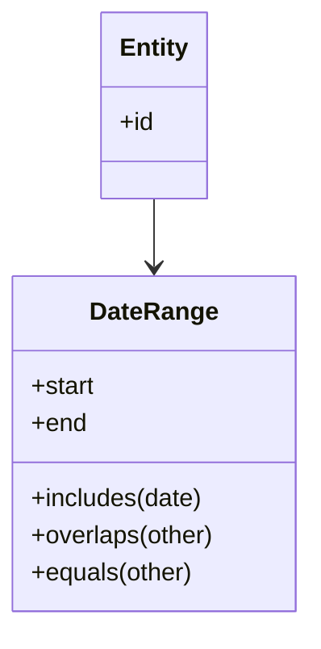

# Value Object

## Description

A Value Object is a small, simple object, such as a monetary amount or a date range, whose equality isn't based on identity. Two Value Objects with the same values are interchangeable: what matters is the value, not which specific instance is in use.

This sets it apart from reference objects (entities), which are identified by a key or by object identity. A Value Object resembles the primitive types of programming languages, except that it models domain concepts such as `Money`, `DateRange`, `Email`, or `Address`.

In practice, a good Value Object is immutable, compares by value (implementing equality and hash from its fields), and concentrates the validation and behavior of the concept it represents. In Domain-Driven Design, the Value Object is a building block of the model, alongside [Entity](/application/ddd/building-blocks/entity) and [Aggregate](/application/ddd/building-blocks/aggregate). Evans recommends preferring Value Objects whenever the concept doesn't require identity, since they're simpler to reason about, test, and share. Within an Aggregate, they describe the root and the internal entities and can be copied or replaced freely, with no concern for lifecycle.

## Problems it solves

- "Primitive obsession": loose strings and numbers representing domain concepts, with no validation or behavior.
- Aliasing: two parts of the code sharing and changing the same object without realizing it.
- Incorrect comparisons by object identity when values were meant to be compared.
- Validation and formatting rules duplicated in several places.

## When to use

- When the concept is defined only by its attributes (monetary amount, range, coordinate, email, postal code).
- When you want to guarantee invariants at construction, so the object is always valid.
- When you want immutability to avoid side effects and make concurrency easier.
- Together with [Embedded Value](/application/poeaa/object-relational-structural/embedded-value) to persist it inside the owner's row.

### When to avoid

- When the object has its own lifecycle and identity that need to be tracked (use an entity with an [Identity Field](/application/poeaa/object-relational-structural/identity-field)).
- When the concept changes frequently and immutability would cause a lot of object creation with no benefit.
- When the value is truly trivial and encapsulation would add only ceremony.

## Trade-offs

| Benefit | Cost / Risk |
| --- | --- |
| Eliminates aliasing and side effects, thanks to immutability | More objects created (allocation cost) |
| Validation and behavior concentrated in the concept | More small classes to write and maintain |
| Equality by value, simple to compare and test | Database mapping needs attention (Embedded Value, columns) |
| Code more expressive than loose primitives | Languages without native support require implementing equality and hash by hand |

- **Consistency:** invariants guaranteed at construction.
- **Testability:** pure objects, with no dependencies, are trivial to test.
- **Concurrency:** immutable objects are safe to share between threads.

## Diagram



The `Entity` owns a `DateRange`. The `DateRange` has no identity: it's compared and replaced by value.

## Example

A booking system represents the stay period as an immutable Value Object that validates itself.

```python
from dataclasses import dataclass
from datetime import date

@dataclass(frozen=True)
class DateRange:
    start: date
    end: date

    def __post_init__(self):
        if self.end < self.start:
            raise ValueError("end must be greater than or equal to start")

    def includes(self, day: date) -> bool:
        return self.start <= day <= self.end

    def overlaps(self, other: "DateRange") -> bool:
        return self.start <= other.end and other.start <= self.end

a = DateRange(date(2026, 1, 1), date(2026, 1, 10))
b = DateRange(date(2026, 1, 1), date(2026, 1, 10))
assert a == b  # equality by value
```

Java and C# records, Python's `dataclass(frozen=True)`, and Ruby's `Struct` are idiomatic ways to declare Value Objects.

## Related patterns

- [Money](/application/poeaa/base/money) — the classic example of a Value Object.
- [Embedded Value](/application/poeaa/object-relational-structural/embedded-value) — maps a Value Object to columns of the owning object's table.
- [Serialized LOB](/application/poeaa/object-relational-structural/serialized-lob) — an alternative for persisting a complex Value Object as a serialized block.
- [Special Case](/application/poeaa/base/special-case) — a special value (such as "no discount") can be modeled as a Value Object or as a Special Case.
- [Entity](/application/ddd/building-blocks/entity) — the DDD counterpart, defined by identity rather than by value.
- [Aggregate](/application/ddd/building-blocks/aggregate) — Value Objects make up aggregates and describe the root.
- [Domain Model](/application/poeaa/domain-logic/domain-model) — Value Objects make up the domain model alongside entities.
- [Flyweight](/coding/gof/structural/flyweight) — immutable objects can be shared safely, which makes Flyweight viable.
- [Data Transfer Object](/application/poeaa/distribution/data-transfer-object) — is also a data object, but with no behavior or invariants, aimed at transfer.

## Reference

- [DDD Reference, Eric Evans (2015)](https://www.domainlanguage.com/ddd/reference/)
- [Pattern page in Fowler's catalog](https://martinfowler.com/eaaCatalog/valueObject.html)
- [Value Object (bliki)](https://martinfowler.com/bliki/ValueObject.html)
- *Patterns of Enterprise Application Architecture*, Martin Fowler (Addison-Wesley, 2002)
