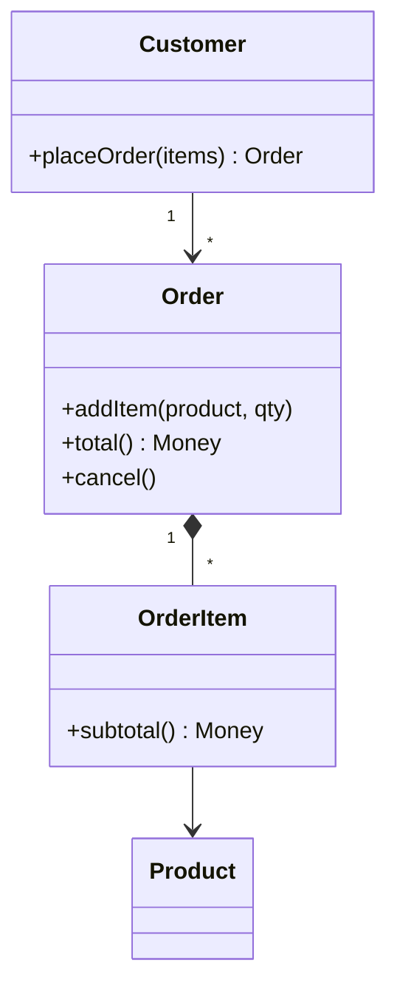

# Domain Model

## Description

Domain Model is an object model of the business domain that incorporates both behavior and data. Each object represents a meaningful business concept, from something large, like a company, to something small, like a line on an order.

The objects form an interconnected network, and the business rules live alongside the data they govern. Calculations, validations, and decisions sit inside entities and value objects, with support from inheritance, polymorphism, and other object-oriented techniques to handle many rule variations.

The model should be independent of the user interface and of persistence; the link to the database is usually made by a data mapper.

## Problems it solves

- Complex business logic, with many rules and exceptions that turn into conditionals scattered across procedural scripts.
- Rules duplicated across different use cases.
- Difficulty expressing the business language in code.
- The need to evolve rules without rewriting the whole application.

## When to use

- Domains with complex, constantly changing rules.
- When there are behavior variations that benefit from polymorphism and from patterns such as Strategy.
- When the team is skilled at object-oriented modeling and plans to invest in a ubiquitous language for the domain.

### When to avoid

- Essentially CRUD applications, where the logic is minimal.
- Teams unfamiliar with object orientation and object-relational mapping.
- When the cost of mapping objects to tables outweighs the gain in expressiveness.

## Trade-offs

| Benefit | Cost / Risk |
| --- | --- |
| Rules expressed in a rich, reusable way | Steep learning curve |
| Easy to test without a database | Requires object-relational mapping (Data Mapper, Unit of Work) |
| Extensible through polymorphism and composition | Risk of an anemic model, with logic outside the entities |
| Business language reflected in the code | Can load too many objects and queries if poorly designed |

- **Decoupling:** the model knows nothing about persistence or the interface.
- **Performance:** loading object graphs requires attention to Lazy Load and to efficient queries.
- **Boundary:** it's usually exposed through a Service Layer to avoid leaking details to clients.

## Diagram



`Customer`, `Order`, `OrderItem`, and `Product` form a network of objects in which each class holds data and the associated rules, such as `total()` and `cancel()`.

## Example

An order calculates its own total and prevents cancellation after shipping, rules that live in the entity.

```java
public class Order {
    private final List<OrderItem> items = new ArrayList<>();
    private Status status = Status.OPEN;

    public void addItem(Product product, int qty) {
        if (status != Status.OPEN) throw new IllegalStateException("Order is closed");
        items.add(new OrderItem(product, qty));
    }

    public Money total() {
        return items.stream()
            .map(OrderItem::subtotal)
            .reduce(Money.ZERO, Money::add);
    }

    public void cancel() {
        if (status == Status.SHIPPED) throw new IllegalStateException("Already shipped");
        status = Status.CANCELLED;
    }
}
```

## Related patterns

- [Transaction Script](/application/poeaa/domain-logic/transaction-script) — a simpler alternative for low-complexity logic.
- [Table Module](/application/poeaa/domain-logic/table-module) — organizes logic by table, a middle ground between the two.
- [Service Layer](/application/poeaa/domain-logic/service-layer) — the usual boundary of the Domain Model, coordinating use cases and transactions.
- [Data Mapper](/application/poeaa/data-source-architectural/data-mapper) — keeps the model independent of the database.
- [Unit of Work](/application/poeaa/object-relational-behavioral/unit-of-work) — tracks changes to the model's objects.
- [Strategy](/coding/gof/behavioral/strategy) — encapsulates rule variations inside the model.
- [Null Object](/coding/gof/behavioral/null-object) — avoids null checks in the rules.

## Reference

- [Pattern page in Fowler's catalog](https://martinfowler.com/eaaCatalog/domainModel.html)
- *Patterns of Enterprise Application Architecture*, Martin Fowler (Addison-Wesley, 2002)
- [Domain model on Wikipedia](https://en.wikipedia.org/wiki/Domain_model)
