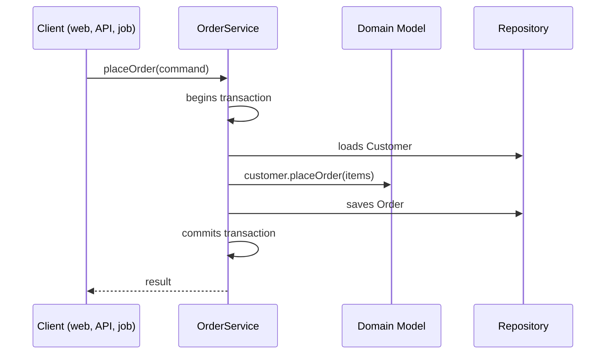

# Service Layer

## Description

Service Layer defines an application's boundary as a set of services that expose the available operations and coordinate the responses. It sits between the clients (web interface, API, data load, messaging) and the domain logic.

Enterprise applications have several interfaces to the same data and rules, and all of them need the same interactions, which can involve multiple transactions and resources. Without a common layer, this orchestration is duplicated in every interface.

Service Layer encapsulates the coordination of the use case, controls transactions and security, and delegates business rules to the domain. It can be thin (only orchestrates) or carry some application logic, but the core rules stay in the Domain Model.

## Problems it solves

- Coordination logic duplicated across different interfaces (web, API, jobs).
- Transaction and security control scattered across controllers.
- Clients coupled directly to the domain model and to persistence.
- Difficulty testing use cases without going through the interface.

## When to use

- When the application has more than one type of client running the same operations.
- When use cases involve multiple steps, transactions, or resources.
- When you want a single point for transactions, authorization, and events.

### When to avoid

- Simple applications with a single client and trivial logic, where the layer just passes calls through.
- When services accumulate business rules and hollow out the domain (anemic model).
- When the layer turns into a "god object" of unrelated operations.

## Trade-offs

| Benefit | Cost / Risk |
| --- | --- |
| Orchestration in one place, reused by all clients | Extra layer that may be mere indirection |
| Clear transactional boundary | Risk of concentrating rules and producing an anemic model |
| Domain isolated from interfaces and persistence | Services can grow too large |
| Use cases testable without an interface | Requires discipline to keep the layer thin |

- **Consistency:** one transaction per operation ensures the use case is atomic.
- **Coupling:** clients depend on the services, not on the model.
- **Variants:** the layer can be a domain facade (thin) or an operation script (with application logic).

## Diagram



The service begins the transaction, loads objects, delegates the rule to the domain, persists the result, and returns the response to the client.

## Example

An `OrderService` is used by both a REST controller and a queue consumer, concentrating transaction handling and orchestration.

```java
@Service
public class OrderService {
    private final CustomerRepository customers;
    private final OrderRepository orders;
    private final PaymentGateway payments;

    @Transactional
    public OrderId placeOrder(PlaceOrderCommand cmd) {
        Customer customer = customers.get(cmd.customerId());
        Order order = customer.placeOrder(cmd.items());   // rule in the domain
        orders.save(order);
        payments.authorize(order.id(), order.total());
        return order.id();
    }
}
```

In Spring, services annotated with `@Service` and `@Transactional` are the common form of this pattern.

## Related patterns

- [Domain Model](/application/poeaa/domain-logic/domain-model) — the Service Layer coordinates the model, which holds the rules.
- [Transaction Script](/application/poeaa/domain-logic/transaction-script) — can be the implementation of the services when the logic is simple.
- [Table Module](/application/poeaa/domain-logic/table-module) — can also sit behind the service layer.
- [Remote Facade](/application/poeaa/distribution/remote-facade) — coarse-grained facade for remote access, usually on top of the Service Layer.
- [Repository](/application/poeaa/object-relational-metadata-mapping/repository) — used by the services to fetch and save aggregates.
- [Facade](/coding/gof/structural/facade) — the Service Layer is a facade for the application's operations.

## Reference

- [Pattern page in Fowler's catalog](https://martinfowler.com/eaaCatalog/serviceLayer.html)
- *Patterns of Enterprise Application Architecture*, Martin Fowler (Addison-Wesley, 2002)
