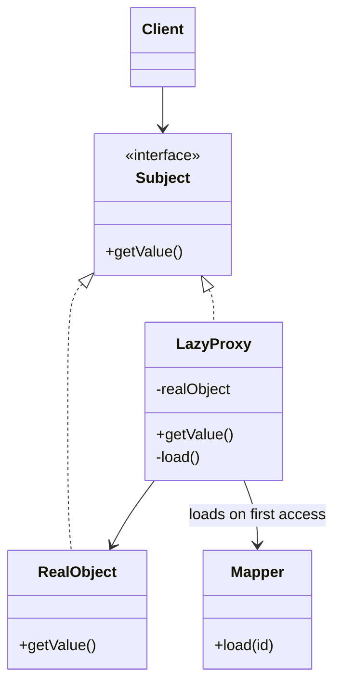

# Lazy Load

## Description

Lazy Load is an object that doesn't contain all the data it needs, but knows how to get it when it's required. When an object is loaded, associations and heavy fields aren't read right away; accessing them triggers the query only at the moment of use.

This avoids loading entire object graphs when only part of them will be used. Loading an order, for example, doesn't need to bring in all the items, the customer, and the history if the screen only shows the total.

Fowler describes four variants: **lazy initialization** (the field is null until first access, when it's loaded), **virtual proxy** (an object with the same interface as the real one that loads the real one when used), **value holder** (an object that wraps the value and loads it in `getValue()`), and **ghost** (the real object, partially loaded, which completes itself on the first access to any field).

## Problems it solves

- Loading large object graphs when only a small part is used.
- Slow queries and excessive memory use caused by rarely accessed associations.
- Heavy fields (LOBs, large collections) read unnecessarily.
- Coupling between domain logic and the decision of when to load data.

## When to use

- When associations or large fields are accessed only in some flows.
- When the cost of loading the full graph outweighs the cost of targeted queries.
- When you want to keep the domain unaware of how and when data is fetched.

### When to avoid

- When the related data is always used; eager loading with a `JOIN` is more efficient.
- When late access happens outside the session or transaction, causing errors such as `LazyInitializationException`.
- In loops that access the association of many objects, causing the N+1 query problem.

## Trade-offs

| Benefit | Cost / Risk |
| --- | --- |
| Less data read and less memory on initial load | Additional queries scattered across usage, hard to predict |
| Domain decoupled from loading logic | Risk of the N+1 query problem |
| Faster startup when the extra data isn't used | Failures if the session is already closed at access time |
| Loading is transparent to the caller (proxy, ghost) | Proxies complicate equality, serialization, and debugging |

- **Variants:** lazy initialization is simple but requires loading code in the domain; value holder exposes the mechanism to the API; virtual proxy and ghost are transparent but more complex.
- **Identity:** ghosts and proxies should go through the Identity Map so they don't duplicate objects.
- **Testability:** the behavior requires tests with the persistence context active to validate when the queries occur.

## Diagram



In the virtual proxy variant, the `Client` uses the `Subject` interface without knowing whether it received the real object or the `LazyProxy`. On first access, the proxy uses the `Mapper` to load the `RealObject` and then delegates to it.

## Example

A `Customer` has a list of orders that is only needed on the history screen. With a value holder, the query happens on first access.

```java
class ValueHolder<T> {
    private final Supplier<T> loader;
    private T value;
    private boolean loaded;

    ValueHolder(Supplier<T> loader) { this.loader = loader; }

    T getValue() {
        if (!loaded) { value = loader.get(); loaded = true; }
        return value;
    }
}

class Customer {
    private final ValueHolder<List<Order>> orders;

    Customer(long id, OrderMapper mapper) {
        this.orders = new ValueHolder<>(() -> mapper.findByCustomer(id));
    }

    List<Order> getOrders() { return orders.getValue(); }
}
```

In Hibernate, `@OneToMany(fetch = LAZY)` associations use proxies and lazy collections; in Entity Framework, lazy loading is enabled through loading proxies.

## Related patterns

- [Identity Map](/application/poeaa/object-relational-behavioral/identity-map) — ensures that ghosts and proxies resolve to the same instance.
- [Unit of Work](/application/poeaa/object-relational-behavioral/unit-of-work) — defines the scope within which lazy loading should occur.
- [Data Mapper](/application/poeaa/data-source-architectural/data-mapper) — runs the query triggered by lazy loading.
- [Proxy](/coding/gof/structural/proxy) — the virtual proxy variant is a direct application of the GoF Proxy.
- [Cache-Aside](/cloud/cloud-design-patterns/data-management/cache-aside) — also defers the read until it's needed, but stores the result in a shared cache.

## Reference

- [Pattern page in Fowler's catalog](https://martinfowler.com/eaaCatalog/lazyLoad.html)
- *Patterns of Enterprise Application Architecture*, Martin Fowler (Addison-Wesley, 2002)
- [Lazy loading on Wikipedia](https://en.wikipedia.org/wiki/Lazy_loading)
