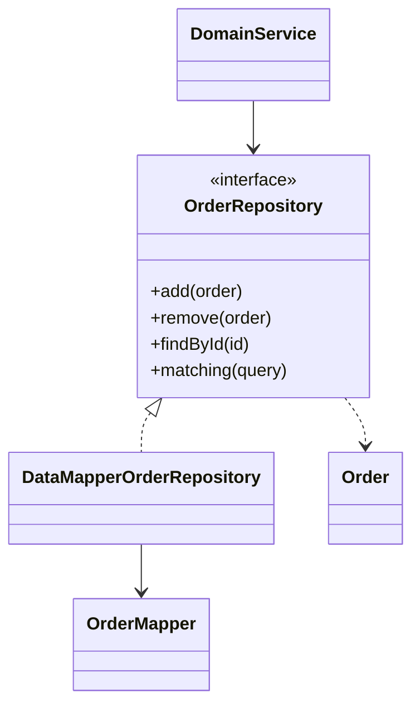

# Repository

## Description

A Repository sits between the domain and the data mapping layer and presents persisted objects through an interface similar to an in-memory collection. The client adds, removes, and finds objects as it would in a list, without knowing how or where they are stored.

Internally, the Repository delegates the work to a [Data Mapper](/application/poeaa/data-source-architectural/data-mapper) and to Query Objects. This concentrates the query logic in one place and makes the dependency point from the domain to the data layer, not the other way around.

In DDD (Domain-Driven Design), Evans defines the Repository as the mechanism that gives the illusion of an in-memory collection of all objects of a certain type. There is one Repository per [Aggregate](/application/ddd/building-blocks/aggregate) root: the aggregate's internal objects are accessed through the root, and the client should not query them directly. The interface is expressed in the language of the domain, and the creation of new objects is left to the [Factory](/application/ddd/building-blocks/factory), while the Repository takes care of storing and retrieving existing objects.

## Problems it solves

- Domain code polluted by query and persistence details.
- Query logic duplicated in several places in the application.
- Difficulty testing the domain without a database.
- Domain coupled to the data access technology.

## When to use

- When the domain model is complex and there are many classes and queries.
- When you want a clear boundary between the domain and the persistence infrastructure.
- When it is desirable to swap the storage for an in-memory version in tests.

### When to avoid

- In simple or CRUD systems, where the extra layer doesn't pay off.
- When the ORM already offers the abstraction and the Repository would only repeat its methods.
- When the Repository turns into a generic dumping ground of query methods that is hard to maintain.

## Trade-offs

| Benefit | Cost / Risk |
| --- | --- |
| Domain independent of persistence | One more layer to maintain |
| Centralized query logic | May duplicate the ORM's abstraction |
| Easy to replace with a test double in tests | Risk of growing with overly specific query methods |
| Object-oriented, collection-like interface | The abstraction can hide costs (N+1, excessive loading) |

- **Coupling:** the domain depends only on the Repository interface.
- **Testability:** an in-memory implementation allows fast domain tests.
- **Consistency:** the write itself is usually coordinated by a [Unit of Work](/application/poeaa/object-relational-behavioral/unit-of-work).

## Diagram



The `DomainService` uses only the `OrderRepository` interface. The implementation delegates to the `OrderMapper` and returns `Order` objects.

## Example

An order service needs to find and save orders without knowing the database. Spring Data generates the implementation from the interface.

```java
public interface OrderRepository extends JpaRepository<Order, Long> {
    List<Order> findByCustomerIdAndStatus(Long customerId, Status status);
}

@Service
public class OrderService {
    private final OrderRepository orders;

    public OrderService(OrderRepository orders) {
        this.orders = orders;
    }

    public void cancel(Long id) {
        Order order = orders.findById(id).orElseThrow();
        order.cancel();
        orders.save(order);
    }
}
```

In tests, an in-memory implementation of the interface is enough.

## Related patterns

- [Data Mapper](/application/poeaa/data-source-architectural/data-mapper) — the Repository sits on top of it and uses it to persist the objects.
- [Query Object](/application/poeaa/object-relational-metadata-mapping/query-object) — used to express declarative queries sent to the Repository.
- [Metadata Mapping](/application/poeaa/object-relational-metadata-mapping/metadata-mapping) — provides the mapping used by the implementation.
- [Unit of Work](/application/poeaa/object-relational-behavioral/unit-of-work) — tracks the changes made to the objects obtained from the Repository.
- [Identity Map](/application/poeaa/object-relational-behavioral/identity-map) — ensures the Repository returns the same instance for the same identity.
- [Aggregate](/application/ddd/building-blocks/aggregate) — the Repository works per aggregate root.
- [Factory](/application/ddd/building-blocks/factory) — creates new objects, while the Repository retrieves existing ones.
- [Domain Model](/application/poeaa/domain-logic/domain-model) — the domain model accesses persistence through the Repository.

## Reference

- [DDD Reference, Eric Evans (2015)](https://www.domainlanguage.com/ddd/reference/)
- [Pattern page in Fowler's catalog](https://martinfowler.com/eaaCatalog/repository.html)
- *Patterns of Enterprise Application Architecture*, Martin Fowler (Addison-Wesley, 2002)
