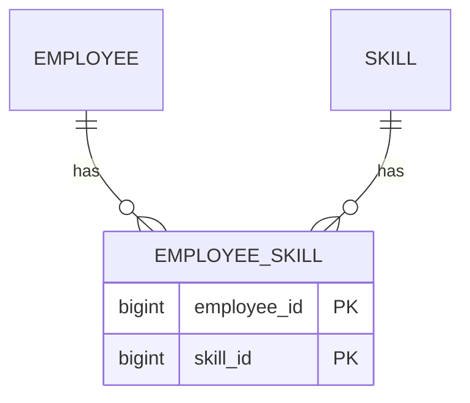

# Association Table Mapping

## Description

Association Table Mapping saves an association as a table with foreign keys to the tables linked by the association. It's how many-to-many relationships are represented in the relational model, which doesn't support multivalued fields.

The association table contains only the two foreign keys, and the primary key is the combination of them. When loading an object, the mapper queries the association table to find the related ones; when saving, it inserts or removes rows in it according to how the collection changed.

If the relationship has attributes of its own (date, role), the association table becomes a full entity.

## Problems it solves

- Representing many-to-many associations in a relational database.
- Representing collections where neither side can hold the other's key.

## When to use

- In many-to-many relationships between entities.
- When the association exists independently of the two ends.

### When to avoid

- In simple one-to-many associations: use Foreign Key Mapping.
- When the relationship has behavior of its own: model it as an entity.

## Trade-offs

| Benefit | Cost / Risk |
| --- | --- |
| Supports many-to-many without duplicating data | Requires additional joins in queries |
| Normalized schema | Saving collections requires computing differences |
| Ends are independent of each other | Extra table with no domain meaning |

- **Consistency:** the composite key prevents duplicate pairs; foreign keys guarantee integrity.
- **Performance:** indexes on both columns are important.

## Diagram



The `EMPLOYEE_SKILL` table links `EMPLOYEE` and `SKILL`, with a primary key composed of the two foreign keys.

## Example

Employees have several skills, and a skill belongs to several employees.

```java
@Entity
public class Employee {
    @Id @GeneratedValue
    private Long id;

    @ManyToMany
    @JoinTable(
        name = "employee_skill",
        joinColumns = @JoinColumn(name = "employee_id"),
        inverseJoinColumns = @JoinColumn(name = "skill_id"))
    private Set<Skill> skills = new HashSet<>();
}
```

## Related patterns

- [Foreign Key Mapping](/application/poeaa/object-relational-structural/foreign-key-mapping) — used in one-to-many associations; the association table generalizes the idea.
- [Identity Field](/application/poeaa/object-relational-structural/identity-field) — the keys referenced by the association table.
- [Dependent Mapping](/application/poeaa/object-relational-structural/dependent-mapping) — an alternative when one side depends on the other.
- [Lazy Load](/application/poeaa/object-relational-behavioral/lazy-load) — defers loading of the related objects.

## Reference

- [Pattern page in Fowler's catalog](https://martinfowler.com/eaaCatalog/associationTableMapping.html)
- *Patterns of Enterprise Application Architecture*, Martin Fowler (Addison-Wesley, 2002)
