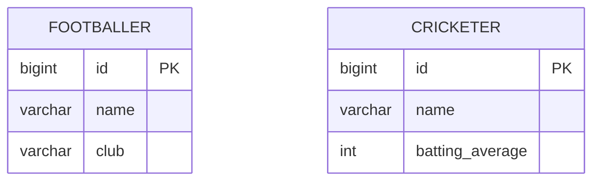

# Concrete Table Inheritance

## Description

Concrete Table Inheritance represents a hierarchy with one table per concrete class. Each table contains all of the class's fields, including inherited ones, and the abstract superclass has no table.

Loading an object reads a single table, with no joins. In exchange, inherited fields are repeated in every table, and polymorphic queries (over the superclass) require reading several tables, usually with `UNION`.

Keys must be unique across all the tables; otherwise references to the superclass become ambiguous.

## Problems it solves

- Avoiding joins when loading objects from a hierarchy.
- Keeping each table independent and self-contained.

## When to use

- When queries almost always access a single concrete type.
- When the data of each subtype is handled independently.
- When you want `NOT NULL` per type without joins.

### When to avoid

- When there are many polymorphic queries or references to the superclass.
- When superclass fields change frequently (the change applies to every table).

## Trade-offs

| Benefit | Cost / Risk |
| --- | --- |
| No joins for a concrete type | Inherited columns duplicated in each table |
| Each table is self-contained | Polymorphic queries require `UNION` |
| No null columns due to inheritance | No foreign key to the superclass |

- **Consistency:** requires unique keys across the tables, through a shared sequence or UUIDs.
- **Evolution:** changing a superclass field alters all the concrete tables.

## Diagram



Each table repeats `id` and `name`, inherited from `Player`, and adds its own fields; there is no `PLAYER` table.

## Example

A JPA mapping with one table per concrete class.

```java
@Entity
@Inheritance(strategy = InheritanceType.TABLE_PER_CLASS)
public abstract class Player {
    @Id
    @GeneratedValue(strategy = GenerationType.SEQUENCE)
    private Long id;
    private String name;
}

@Entity
public class Footballer extends Player {
    private String club;
}
```

The shared `SEQUENCE` guarantees unique keys across the tables. In EF Core, this is Table-per-Concrete-type (TPC).

## Related patterns

- [Single Table Inheritance](/application/poeaa/object-relational-structural/single-table-inheritance) — an alternative with one table for the whole hierarchy.
- [Class Table Inheritance](/application/poeaa/object-relational-structural/class-table-inheritance) — an alternative with one table per class, with joins.
- [Inheritance Mappers](/application/poeaa/object-relational-structural/inheritance-mappers) — organizes the hierarchy's mappers.
- [Identity Field](/application/poeaa/object-relational-structural/identity-field) — requires uniqueness across the tables.

## Reference

- [Pattern page in Fowler's catalog](https://martinfowler.com/eaaCatalog/concreteTableInheritance.html)
- *Patterns of Enterprise Application Architecture*, Martin Fowler (Addison-Wesley, 2002)
