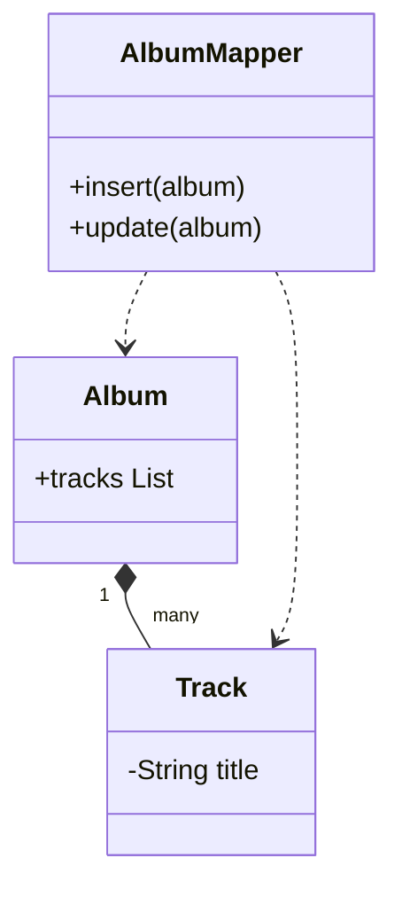

# Dependent Mapping

## Description

Dependent Mapping makes one class responsible for saving and loading the children that depend on it. A dependent object only makes sense in the context of its owner: no other class references it, and it has no identity of its own outside the owner.

For this reason, the dependent has no mapper of its own. The owner's mapper loads the children along with it and, when saving, deletes and reinserts the children (or computes the differences). Dependents also don't need an Identity Field or an Identity Map.

The lifecycle is controlled by the owner: when it's removed, its children are removed too.

## Problems it solves

- Simplifying the mapping of objects that exist only because of another one.
- Avoiding mappers, identities, and locks for subordinate objects.

## When to use

- When the dependent is referenced by a single owner.
- When the dependent isn't queried independently.
- In DDD Aggregates, for the objects internal to the aggregate.

### When to avoid

- When other objects need to reference the dependent directly.
- When the collection is very large and rewriting it on every change is expensive.

## Trade-offs

| Benefit | Cost / Risk |
| --- | --- |
| Fewer mapping classes | The owner must know the children's schema |
| No need for an identity for the child | The child can't be referenced from outside |
| Simple lifecycle (cascade) | Rewriting the collection can be costly |

- **Coupling:** the owner becomes coupled to the dependents' mapping.
- **Consistency:** the owner is the only entry point for changing the children.

## Diagram



`AlbumMapper` saves and loads the `Album` and its dependent `Track`s; `Track` has no mapper of its own.

## Example

An `Order` has `OrderLine`s. The lines exist only inside the order and are deleted along with it.

```java
@Entity
public class Order {
    @Id @GeneratedValue
    private Long id;

    @OneToMany(cascade = CascadeType.ALL, orphanRemoval = true)
    @JoinColumn(name = "order_id")
    private List<OrderLine> lines = new ArrayList<>();
}
```

`cascade` and `orphanRemoval` in JPA implement the behavior: the owner controls the children's lifecycle.

## Related patterns

- [Foreign Key Mapping](/application/poeaa/object-relational-structural/foreign-key-mapping) — the general way to map an association; Dependent Mapping is the case where the child has no life of its own.
- [Association Table Mapping](/application/poeaa/object-relational-structural/association-table-mapping) — another association that the owner can control.
- [Embedded Value](/application/poeaa/object-relational-structural/embedded-value) — for dependents in a one-to-one relationship, with no table of their own.
- [Unit of Work](/application/poeaa/object-relational-behavioral/unit-of-work) — coordinates writing the owner and the dependents.
- [Data Mapper](/application/poeaa/data-source-architectural/data-mapper) — the owner's mapper takes care of the dependents.

## Reference

- [Pattern page in Fowler's catalog](https://martinfowler.com/eaaCatalog/dependentMapping.html)
- *Patterns of Enterprise Application Architecture*, Martin Fowler (Addison-Wesley, 2002)
