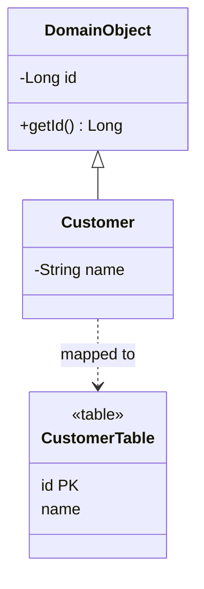

# Identity Field

## Description

Identity Field stores the database row's primary key in the object, to maintain identity between the in-memory object and the corresponding row. In memory, two objects are the same if they're the same reference. In the database, two rows are the same if they have the same key. The identity field links these two notions.

With the field in the object, the mapper can tell whether the object has already been inserted (key filled in) or is new (key empty), run `UPDATE` and `DELETE` on the right row, and build foreign keys for associations.

The main decisions are the key type (simple or composite, meaningful or surrogate), uniqueness (per table or global), and how to generate the value (sequence, auto-increment, GUID, application-generated).

## Problems it solves

- Telling whether an object already exists in the database, to choose between `INSERT` and `UPDATE`.
- Reading the same record twice and getting two unrelated objects.
- Mapping associations between objects to foreign keys.

## When to use

- Whenever domain objects are mapped to table rows with object-relational mapping.
- When the object's identity must outlive the session lifecycle.

### When to avoid

- For Value Objects without identity, which can be mapped as Embedded Value or Serialized LOB.
- When the model is simple read-only and doesn't need identity between row and object.

## Trade-offs

| Benefit | Cost / Risk |
| --- | --- |
| Clear identity between object and row | Exposes a persistence detail in the domain model |
| Foundation for associations and Identity Map | Composite or meaningful keys complicate the code |
| Allows precise `UPDATE` and `DELETE` | Key generation may require a trip to the database before the `INSERT` |

- **Surrogate vs. meaningful key:** surrogate keys (with no business meaning) are more stable; meaningful keys can change.
- **Consistency:** unique keys prevent duplication and enable concurrency control.
- **Performance:** numeric types index better than long strings.

## Diagram



`DomainObject` holds the `id` field, which corresponds to the row's primary key in `CustomerTable`. Domain objects inherit the field.

## Example

A store maps `Customer` to the `customer` table. The `id` field is generated by the database and filled in after the `INSERT`.

```java
@MappedSuperclass
public abstract class DomainObject {
    @Id
    @GeneratedValue(strategy = GenerationType.IDENTITY)
    private Long id;

    public Long getId() { return id; }
    public boolean isNew() { return id == null; }
}

@Entity
public class Customer extends DomainObject {
    private String name;
    protected Customer() {}
    public Customer(String name) { this.name = name; }
}
```

JPA uses `@Id` as the Identity Field; the superclass follows the [Layer Supertype](/application/poeaa/base/layer-supertype) pattern.

## Related patterns

- [Identity Map](/application/poeaa/object-relational-behavioral/identity-map) — uses the Identity Field as a key to avoid loading the same record twice.
- [Foreign Key Mapping](/application/poeaa/object-relational-structural/foreign-key-mapping) — uses the Identity Field to represent references between objects.
- [Layer Supertype](/application/poeaa/base/layer-supertype) — a common superclass that usually contains the identity field.
- [Value Object](/application/poeaa/base/value-object) — objects without identity, which don't need the field.
- [Embedded Value](/application/poeaa/object-relational-structural/embedded-value) — an alternative for small objects without identity of their own.

## Reference

- [Pattern page in Fowler's catalog](https://martinfowler.com/eaaCatalog/identityField.html)
- *Patterns of Enterprise Application Architecture*, Martin Fowler (Addison-Wesley, 2002)
