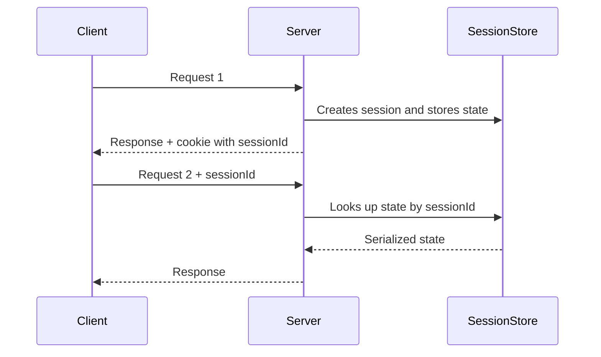

# Server Session State

## Description

Server Session State keeps session state on the server, in serialized form or as in-memory objects. The client receives only a session identifier (usually in a cookie) and sends it with every request; the server uses that identifier to locate the corresponding data.

The state can live in process memory, in a serialized object in a file, or in a fast external store such as Redis or Memcached. This storage is treated as a session cache: losing it doesn't corrupt business data, it just forces the user to start over.

With local memory, the approach is simple and fast, but it ties the user to one instance (sticky sessions). With a shared session store, instances become interchangeable again, at the cost of a network round trip per request.

## Problems it solves

- Large or sensitive session state that must not travel through the client.
- Fast access to session data without hitting the main database on every request.
- Need to invalidate a session immediately (logout, account lock).
- Complex session objects that would be expensive or unsafe to send to the client.

## When to use

- When the state is larger than the client can hold or contains data that must stay on the server.
- When immediate session revocation is a requirement.
- When a shared session store (Redis) is available, keeping instances interchangeable.
- When occasional loss of the session is tolerable.

### When to avoid

- When the state must survive restarts and failures without exception; prefer persisting it in a database.
- When local memory is used across several instances without sticky sessions, which causes "lost" sessions.
- When the volume of concurrent sessions can exhaust the server's memory.
- When you want completely stateless servers.

## Trade-offs

| Benefit | Cost / Risk |
| --- | --- |
| Fast access to state, without leaving the application layer | Consumes server or store memory per active session |
| Lightweight client: carries only an identifier | Sticky sessions or a shared store are needed to scale |
| Immediate revocation and full control of the state | State is lost on failure if it's only in memory |
| Supports complex objects and sensitive data | A shared store becomes a point of failure and adds network latency |

- **Scalability:** local memory limits load balancing; an external store frees it.
- **Security:** the session identifier is the credential and must be random, with an `HttpOnly` and `Secure` cookie.
- **Cleanup:** an expiration (TTL) must be defined so abandoned sessions don't pile up.

## Diagram



The `Client` keeps only the `sessionId`. The `Server` queries the `SessionStore` (local memory or Redis) to retrieve the state on every request.

## Example

A shopping cart is kept in Redis, keyed by the session identifier, expiring after 30 minutes of inactivity.

```python
import json, secrets
import redis

r = redis.Redis()
TTL = 30 * 60

def create_session(data: dict) -> str:
    session_id = secrets.token_urlsafe(32)
    r.setex(f"session:{session_id}", TTL, json.dumps(data))
    return session_id

def load_session(session_id: str) -> dict | None:
    raw = r.get(f"session:{session_id}")
    if raw is None:
        return None
    r.expire(f"session:{session_id}", TTL)  # renews the expiration
    return json.loads(raw)
```

It appears as `HttpSession` in Java EE, `Session` in ASP.NET, and `express-session` with Redis in Node.js.

## Related patterns

- [Client Session State](/application/poeaa/session-state/client-session-state) — keeps the state on the client, leaving the server stateless.
- [Database Session State](/application/poeaa/session-state/database-session-state) — persists the state as committed data in the database, with more durability and less speed.
- [Cache-Aside](/cloud/cloud-design-patterns/data-management/cache-aside) — the Redis session store uses the same kind of cache storage, with expiration.
- [Registry](/application/poeaa/base/registry) — both keep context data accessible to several points of the application, but the Registry isn't keyed by session.

## Reference

- [Pattern page in Fowler's catalog](https://martinfowler.com/eaaCatalog/serverSessionState.html)
- *Patterns of Enterprise Application Architecture*, Martin Fowler (Addison-Wesley, 2002)
