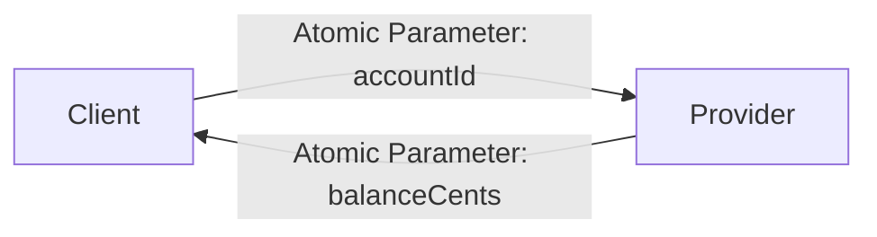

# Atomic Parameter

## Description

The Atomic Parameter pattern defines a single parameter or message body element, of a basic type of the chosen exchange format (number, text, boolean or binary block), as the smallest unit of data transmitted between an API client and provider. It is the foundation of all message structure: it appears in paths, queries, headers and bodies, and is the leaf of any larger structure.

The designer picks the type, gives the atom a name from the domain vocabulary when the receiver needs to identify it, and documents type, cardinality (one, optional, many) and optionality in the [API Description](/architecture/api-patterns/documentation/api-description). It is also worth explaining the meaning informally, including the unit of measure, and constraining the accepted values (range, format) in a schema such as JSON Schema or Protocol Buffers. Binary data often needs encoding, such as Base64. An atom may have internal structure, such as text that follows a regular expression, but that structure is the applications' responsibility, not the serialization's.

## Problems it solves

- Exchanging simple, unstructured data (number, text, flag, bytes) between client and provider
- Making the meaning, unit and value range of each transmitted datum explicit
- Keeping the message minimal when the client needs only one value
- Giving each element a name that developers and business people understand

## When to use

- In operations whose input or output is a single value, such as an identifier, a balance or a confirmation
- As the building block of parameter lists and trees
- When the datum has full meaning on its own and needs no grouped metadata

## When to avoid

- When several values only make sense together: use an [Atomic Parameter List](/architecture/api-patterns/basic-structure/atomic-parameter-list)
- When there are container and content relationships: use a [Parameter Tree](/architecture/api-patterns/basic-structure/parameter-tree)
- To "hide" a structure inside a text (for example, serialized JSON in a string), which bypasses serialization tooling and brings technical and security risks

## Trade-offs

| Benefit | Cost / Risk |
| --- | --- |
| Simple contract, easy to understand and test | An operation with many loose atoms becomes a long, fragile signature |
| Maps to any format and technology | Meaning and unit depend on documentation, since the basic type does not express them |
| Minimum data on the wire | Validation rules live at the implementation level, not in the interoperability contract |

- **Names:** use domain terms and stay consistent across operations.
- **Unit and range:** declare them in the schema or metadata; a monetary value, for example, must be an integer in cents, never a floating-point number.
- **Cardinality:** decide whether the atom is required, optional or multiple, and record it in the API description.
- **Tunneling:** avoid packing structures into opaque strings.

## Diagram



A single request message carries one parameter and the response returns another, both of a basic type.

## Example

Querying the balance of a fintech account. The identifier in the path and the balance in the response are atoms; the balance comes in cents, as an integer.

```http
GET /accounts/acc-7f3a/balance HTTP/1.1
Accept: application/json
```

```http
HTTP/1.1 200 OK
Content-Type: application/json

{ "balanceCents": 1523075 }
```

A multi-valued atom would be, for example, `{ "tags": ["salary", "rent"] }`, with a documented "zero or more" cardinality.

## Related patterns

- [Atomic Parameter List](/architecture/api-patterns/basic-structure/atomic-parameter-list) — groups several related atoms into a single element
- [Parameter Tree](/architecture/api-patterns/basic-structure/parameter-tree) — uses atoms as the leaves of a hierarchy
- [Data Element](/architecture/api-patterns/element-stereotypes/data-element) — semantic role an atom often takes, as do [Id Element](/architecture/api-patterns/element-stereotypes/id-element), [Metadata Element](/architecture/api-patterns/element-stereotypes/metadata-element) and [Link Element](/architecture/api-patterns/element-stereotypes/link-element)
- [Version Identifier](/architecture/api-patterns/versioning/version-identifier) — usually an atom
- [API Description](/architecture/api-patterns/documentation/api-description) — where name, type and cardinality are recorded
- [Value Object](/design/poeaa/base/value-object) — in the domain, values such as `Money` encapsulate the atom and its rules; on the API it travels as a basic type

## Reference

- [Patterns for API Design, chapter 4: Atomic Parameter](https://api-patterns.org/)
