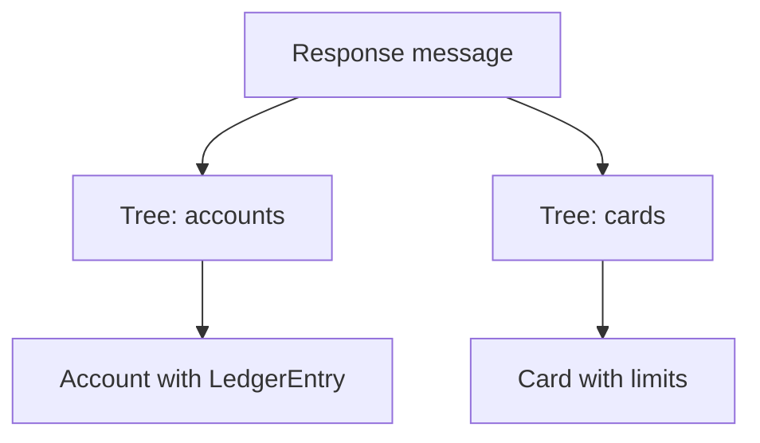

# Parameter Forest

## Description

The Parameter Forest pattern gathers two or more parameter trees at the top level of a message header or body, located by position or by name. Just as atoms form lists, trees can be grouped, but only at the top: a forest does not contain another forest.

In most technology mappings, a forest is equivalent to a [Parameter Tree](/architecture/api-patterns/basic-structure/parameter-tree) whose first level is the forest members, and the resulting JSON is practically identical. The difference shows in the operation signature: a service interface can take a single object holding both trees or two separate parameters. In HTTP APIs, the set of path, query and cookie parameters plus the body already forms a forest. A forest becomes a tree by introducing an artificial root, and the book keeps both patterns to model technologies such as HTTP, SOAP and gRPC faithfully.

## Problems it solves

- Exposing several independent structures as the payload of a single operation
- Faithfully modeling technologies in which the operation receives several top-level parameters
- Avoiding an artificial root when the parts do not belong to a single concept

## When to use

- When an operation receives or returns distinct sets of business data, such as a list of accounts and a list of cards
- When describing HTTP APIs that combine path, query and body
- When the platform technology treats top-level parameters as separate items

## When to avoid

- When the parts form a single concept: use a [Parameter Tree](/architecture/api-patterns/basic-structure/parameter-tree) with its own root
- When there is only one structure: the forest would be an abstraction with no gain
- When the format does not distinguish forests from trees and the difference would only confuse the contract

## Trade-offs

| Benefit | Cost / Risk |
| --- | --- |
| Accurately models operations with several top-level parameters | In JSON it is indistinguishable from a tree, which causes confusion |
| Keeps the parts independent and named | Has limited support in some technologies (for example, WSDL) |
| Lets each tree evolve separately | Many top-level trees make the operation less cohesive |

- **Equivalence:** a forest can always become a tree with an artificial root; choose the form that best matches the platform.
- **Cohesion:** if an operation needs many independent trees, it may be doing too much.
- **Location:** identify members by name whenever possible, since position is fragile.

## Diagram



The message carries two trees at the top level, with no common root.

## Example

Response of a financial summary of the fintech with two top-level trees, accounts and cards, located by name.

```http
GET /customers/cus-42/summary HTTP/1.1
Accept: application/json
```

```http
HTTP/1.1 200 OK
Content-Type: application/json

{
  "accounts": [
    {
      "accountId": "acc-7f3a",
      "balanceCents": 1523075,
      "recentEntries": [
        { "entryId": "le-1001", "type": "PIX_IN", "amountCents": 25000 }
      ]
    }
  ],
  "cards": [
    { "cardId": "card-88", "limitCents": 500000, "usedCents": 120000 }
  ]
}
```

In a service interface, this can be a single object with both fields or two separate parameters, such as `List<Account>` and `List<Card>`; the first form is easier to evolve.

## Related patterns

- [Parameter Tree](/architecture/api-patterns/basic-structure/parameter-tree) — each forest member is a tree, and a forest is equivalent to a tree with an artificial root
- [Atomic Parameter List](/architecture/api-patterns/basic-structure/atomic-parameter-list) — the parallel for atoms: a list groups atoms, a forest groups trees
- [Atomic Parameter](/architecture/api-patterns/basic-structure/atomic-parameter) — the simplest building block of the family
- [Request Bundle](/architecture/api-patterns/message-exchange-optimization/request-bundle) — also gathers several parts in one message, but groups whole requests, not data
- [Data Transfer Object](/design/poeaa/distribution/data-transfer-object) — the object that aggregates the several trees in a service interface

## Reference

- [Patterns for API Design, chapter 4: Parameter Forest](https://api-patterns.org/)
