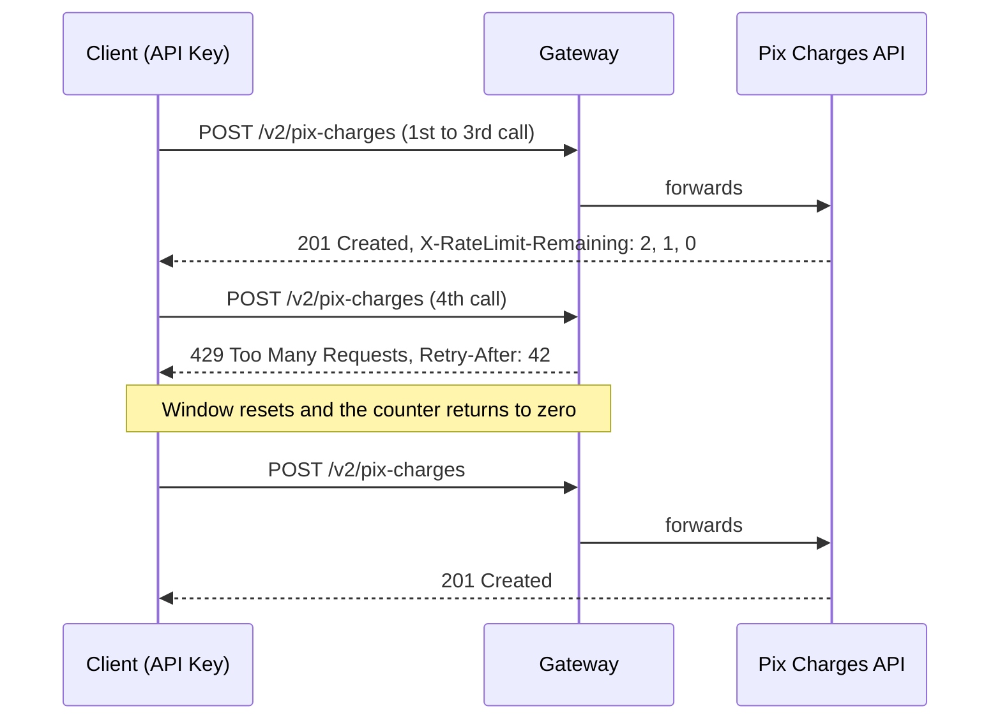

# Rate Limit

## Description

The Rate Limit pattern protects an API against excessive use by defining and communicating a maximum number of requests each client may make in a time window, rejecting, postponing or degrading those beyond the limit.

The limit can apply to the whole API, an endpoint or a group of operations, and not every call has to weigh the same: expensive operations can consume more units than a simple read. The window (per minute, day or month) can be fixed, with periodic resets, or rolling. The limit can also restrict concurrency, for example a single simultaneous request on the free plan. When the quota is exceeded, the provider can refuse calls (in HTTP, with status 429 Too Many Requests), serve with fewer resources, defer to the next period or offer a higher plan. Repeat offenders may have their key suspended.

To measure and enforce the limit, the provider must identify the client, usually through an [API Key](/architecture/api-patterns/special-purpose-representations/api-key) or authentication, or, in open services, through the IP address. Responsible clients track their remaining quota, which the provider helps by reporting the limit state in responses, for example in HTTP headers.

## Problems it solves

- Clients that, through abuse or error, consume capacity and degrade the service for others
- Bursts that exhaust the monthly quota in minutes and overload the provider
- Infrastructure costs growing out of proportion to revenue
- Lack of transparency for the client about how much it can still use

## When to use

- In public or partner APIs with capacity shared among many clients
- When there are plans with different usage levels and the difference must be enforced
- When the impact of an abusive client, deliberate or accidental, is high enough to justify the cost of the measure
- To protect expensive operations, such as statement generation or score lookup

## When to avoid

- When the risk of abuse is low and the cost of implementing and communicating limits outweighs the benefit
- When aggressive limits would drive away important clients without protecting anything relevant
- In trusted internal APIs, where other forms of load control are enough
- When the provider cannot identify the client, because then the limit punishes those who share an IP

## Trade-offs

| Benefit | Cost / Risk |
| --- | --- |
| Protects service quality for all clients | Tuning the limit takes experimentation: too high does not protect, too low annoys |
| More predictable capacity and controlled cost | The API becomes stateful (counters), which affects horizontal scaling |
| Technical basis to differentiate pricing plans | Clients must handle the limit: retry with backoff, queue, prioritize |
| Defense against bots and malicious use | Cost of maintaining and monitoring per-client metering |

- **Window:** a fixed window is simple but allows a double burst at the boundary; rolling windows or a token bucket smooth this out, at the cost of more state.
- **Distributed state:** with several instances, counters must live in a shared store or be approximated per instance.
- **Communication:** report limit, remaining and reset in responses so the client can adjust by itself.
- **Combination:** a monthly limit usually comes with a per-second limit, to prevent the whole quota from being spent at once.

## Diagram



The gateway counts calls per client in each window, lets through those that fit the quota and answers 429 to the rest, saying when to try again.

## Example

The fintech's Pix charges API allows 3 requests per 60-second window per key (reduced for the example; in production it would be much higher). One response within the limit and one above it:

```http
HTTP/1.1 201 Created
X-RateLimit-Limit: 3
X-RateLimit-Remaining: 2
X-RateLimit-Reset: 1790000060
Content-Type: application/json

{"id": "pix_981", "accountId": "acc_1042", "amountCents": 15000, "status": "PENDING"}
```

```http
HTTP/1.1 429 Too Many Requests
X-RateLimit-Limit: 3
X-RateLimit-Remaining: 0
X-RateLimit-Reset: 1790000060
Retry-After: 42
Content-Type: application/json

{"error": "RATE_LIMIT_EXCEEDED", "message": "Limit of 3 requests per minute reached."}
```

A per-client fixed-window limiter, with time passed in as a parameter so the result is predictable:

<Tabs groupId="lang" queryString>
<TabItem value="java" label="Java">

```java
import java.util.HashMap;
import java.util.Map;

public class RateLimitDemo {
    static class FixedWindowRateLimiter {
        private final int limit;
        private final long windowSeconds;
        private final Map<String, long[]> state = new HashMap<>(); // {window, count}

        FixedWindowRateLimiter(int limit, long windowSeconds) {
            this.limit = limit;
            this.windowSeconds = windowSeconds;
        }

        boolean tryAcquire(String clientId, long nowSeconds) {
            long window = nowSeconds / windowSeconds;
            long[] s = state.computeIfAbsent(clientId, k -> new long[] {window, 0});
            if (s[0] != window) {
                s[0] = window;
                s[1] = 0;
            }
            if (s[1] >= limit) {
                return false;
            }
            s[1]++;
            return true;
        }
    }

    public static void main(String[] args) {
        FixedWindowRateLimiter limiter = new FixedWindowRateLimiter(3, 60);
        for (long t : new long[] {0, 1, 2, 3, 61}) {
            System.out.print(limiter.tryAcquire("pix-partner-42", t) + " ");
        }
        System.out.println(); // true true true false true
    }
}
```

</TabItem>
<TabItem value="python" label="Python">

```python
from typing import Dict, List


class FixedWindowRateLimiter:
    def __init__(self, limit: int, window_seconds: int) -> None:
        self.limit = limit
        self.window_seconds = window_seconds
        self.state: Dict[str, List[int]] = {}  # {window, count}

    def try_acquire(self, client_id: str, now_seconds: int) -> bool:
        window = now_seconds // self.window_seconds
        current = self.state.get(client_id)
        if current is None or current[0] != window:
            current = [window, 0]
            self.state[client_id] = current
        if current[1] >= self.limit:
            return False
        current[1] += 1
        return True


limiter = FixedWindowRateLimiter(3, 60)
print(" ".join(str(limiter.try_acquire("pix-partner-42", t)).lower() for t in (0, 1, 2, 3, 61)))
# true true true false true
```

</TabItem>
<TabItem value="go" label="Go">

```go
package main

import "fmt"

type window struct{ id, count int64 }

type RateLimiter struct {
	limit         int64
	windowSeconds int64
	state         map[string]*window
}

func NewRateLimiter(limit, windowSeconds int64) *RateLimiter {
	return &RateLimiter{limit: limit, windowSeconds: windowSeconds, state: map[string]*window{}}
}

// No synchronization, to keep the example short: in production use a mutex or a shared store.
func (r *RateLimiter) TryAcquire(clientID string, nowSeconds int64) bool {
	id := nowSeconds / r.windowSeconds
	w, ok := r.state[clientID]
	if !ok || w.id != id {
		w = &window{id: id}
		r.state[clientID] = w
	}
	if w.count >= r.limit {
		return false
	}
	w.count++
	return true
}

func main() {
	limiter := NewRateLimiter(3, 60)
	for _, t := range []int64{0, 1, 2, 3, 61} {
		fmt.Print(limiter.TryAcquire("pix-partner-42", t), " ")
	}
	fmt.Println() // true true true false true
}
```

</TabItem>
</Tabs>

## Related patterns

- [Pricing Plan](/architecture/api-patterns/documentation/pricing-plan) — the limit enforces the plan's billing tiers
- [Service Level Agreement](/architecture/api-patterns/documentation/service-level-agreement) — the details of the limit can be part of the SLA
- [API Key](/architecture/api-patterns/special-purpose-representations/api-key) — identifies the client the limit applies to
- [Context Representation](/architecture/api-patterns/special-purpose-representations/context-representation) — can carry the current quota state in the message
- [Wish List](/architecture/api-patterns/response-shaping/wish-list) and [Wish Template](/architecture/api-patterns/response-shaping/wish-template) — help avoid breaking data-volume-based limits
- [Rate Limiting](/architecture/cloud-design-patterns/resiliency/rate-limiting-pattern) — the same technique seen from the cloud architecture side; here the focus is the contract published to the client
- [Throttling](/architecture/cloud-design-patterns/resiliency/throttling) — controls resource consumption to sustain the service, sometimes without an explicit agreement; Rate Limit is a quota declared per client
- [Retry](/architecture/cloud-design-patterns/resiliency/retry) — the client should wait and try again on a 429, honoring `Retry-After`

## Reference

- [Patterns for API Design, chapter 9: Rate Limit](https://api-patterns.org/)
- [RFC 6585: 429 Too Many Requests](https://www.rfc-editor.org/rfc/rfc6585#section-4)
