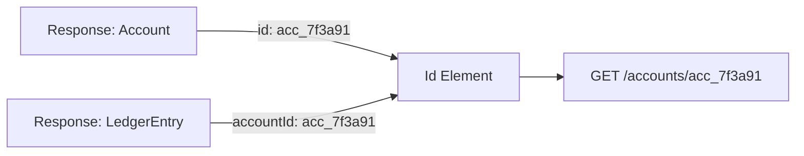

# Id Element

## Description

The Id Element pattern introduces a special kind of Data Element, the unique identifier, to tell apart endpoints, operations and message elements that must be distinguished at design time and at runtime. The same identifier should be used consistently across the API description and implementation.

You must decide on the naming scheme and document it in the [API Description](/architecture/api-patterns/documentation/api-description). Popular approaches are UUIDs (128-bit identifiers that standard libraries generate), human-readable strings generated by the provider, and surrogate keys assigned by lower layers, such as a database primary key. You must also define the scope: a local identifier is only valid within one endpoint or API, while a global one is unique across systems and lasts longer, at the cost of coordinating the namespace.

Id Elements usually travel as [Atomic Parameters](/architecture/api-patterns/basic-structure/atomic-parameter), list entries or leaves of parameter trees. In DDD, they identify elements of the Published Language, such as entities and aggregates.

Identifiers can be readable by both people and machines: if users must type them, prefer short, easy-to-pronounce names; otherwise use numeric UUIDs. URIs are globally unique but can be reassigned over time and then point to unexpected targets; URNs, with a hierarchical prefix, are an alternative. Scope can also be bounded in time, such as a pagination cursor valid only during the session.

## Problems it solves

- Ambiguity when referencing entities that live in different endpoints or services
- The need to follow relationships without embedding all related data in the response
- Name clashes when local identifiers are used outside their context
- Predictable identifiers that let others enumerate or guess resources

## When to use

- When the model is split into several resources or services that reference each other
- When the client must point unambiguously to a specific instance
- When you want to correlate calls, audits and events about the same entity
- When entities have a long life cycle and the identifier must stay stable

## When to avoid

- When the related data fits in the response and the client always uses it: consider [Embedded Entity](/architecture/api-patterns/message-granularity/embedded-entity)
- When the client needs a network-accessible address, not just a name: use a [Link Element](/architecture/api-patterns/element-stereotypes/link-element)
- To identify ephemeral objects that are never referenced afterwards
- Exposing sequential database keys in contexts where predictability is a risk

## Trade-offs

| Benefit | Cost / Risk |
| --- | --- |
| Short, unambiguous reference to any API element | Global identifiers require coordination and maintenance of the namespace |
| Smaller messages than embedding the whole entity | The client needs extra calls to get the details |
| Allows following relationships between endpoints | Local identifiers can collide if used outside their original context |
| Basis for correlation, auditing and idempotency | Exposing predictable keys makes enumeration easier |

- **Effort versus stability:** local names are easy to create, but global ones last longer.
- **Readability:** long, structured identifiers help people; short, opaque ones serve machines.
- **Security:** when guessing an identifier would be a risk, use random values and check authorization on every access.
- **Scope and lifetime:** document where the identifier is unique and for how long the uniqueness is guaranteed.
- **Counters:** auto-incrementing numbers leak information and are hard to keep unique in distributed settings; ideally all identifiers of a kind share the same scheme, which eases monitoring and event correlation.
- **Authorization:** even with random identifiers, protect access to the identified element with per-object authorization, to prevent broken object-level authorization attacks.

## Diagram



Two different messages reference the same account by the same Id Element, which lets the client relate them and fetch the details when needed.

## Example

In the fintech, a Pix charge and the ledger entry it generates reference each other through opaque identifiers, with a prefix that indicates the type. They are generated by the provider and do not reveal creation order.

```json
{
  "id": "pix_01HZX4Q8M2",
  "accountId": "acc_7f3a91",
  "amountCents": 25000,
  "currency": "BRL",
  "status": "PAID",
  "ledgerEntryId": "le_9001"
}
```

The client keeps `id` to query or reconcile the charge and uses `accountId` and `ledgerEntryId` to navigate to the other resources.

## Related patterns

- [Data Element](/architecture/api-patterns/element-stereotypes/data-element) — the Id Element is a specialization of it
- [Link Element](/architecture/api-patterns/element-stereotypes/link-element) — goes further, making the reference a network-accessible address
- [API Key](/architecture/api-patterns/special-purpose-representations/api-key) and [Version Identifier](/architecture/api-patterns/versioning/version-identifier) — particular kinds of identifiers
- [Master Data Holder](/architecture/api-patterns/endpoint-roles/master-data-holder) and [Operational Data Holder](/architecture/api-patterns/endpoint-roles/operational-data-holder) — resources whose instances need robust identification
- [Embedded Entity](/architecture/api-patterns/message-granularity/embedded-entity) — alternative that avoids the identifier by embedding the data
- [Identity Field](/design/poeaa/object-relational-structural/identity-field) — keeps the database identity in the object; the Id Element exposes it in the API
- [Entity](/design/ddd/building-blocks/entity) — domain object defined by its identity, which the Id Element represents in the message
- [Correlation Identifier](/architecture/eip/message-construction/correlation-identifier) — identifier that ties a reply to its request in messaging

## Reference

- [Patterns for API Design, chapter 6: Id Element](https://api-patterns.org/)
- [RFC 4122: A UUID URN Namespace](https://www.rfc-editor.org/rfc/rfc4122)
