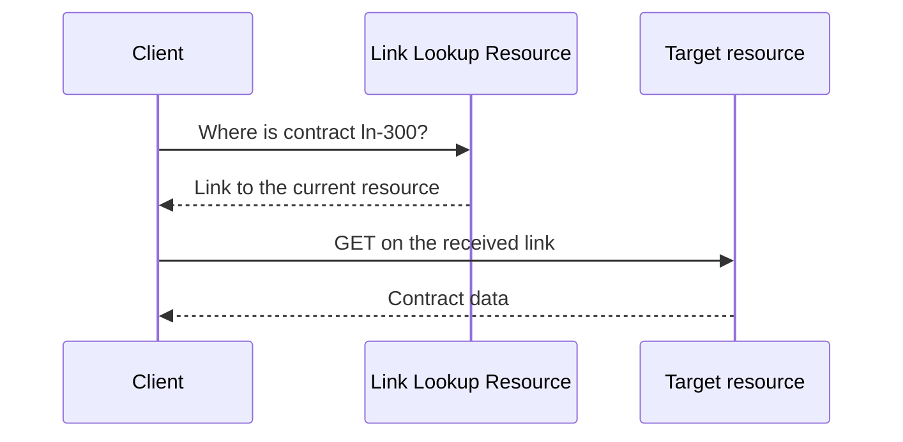

# Link Lookup Resource

## Description

The Link Lookup Resource pattern exposes an endpoint that resolves references, returning to the client the current addresses of other resources instead of the data itself.

The client says what it is looking for, for example a business identifier, and receives one or more links to the matching resources. This way, the real addresses can change (through migration, load balancing or service reorganization) without clients having to know them in advance. The endpoint works as a dynamic address catalog and acts as a stable entry point to a set of resources.

The operations are retrievals and return one or several link elements, which may point to any kind of endpoint: data resources (operational, master, reference, transfer) or processing resources. The simplest search takes a unique identifier; richer versions accept several criteria. When the links point to Processing Resources, the variant known as hypermedia as the engine of application state (HATEOAS) appears, in which a few root addresses are published and the rest is discovered in the responses.

The pattern reduces coupling to fixed URLs and gives the provider freedom to move resources, at the cost of an additional call to resolve the link before using it.

## Problems it solves

- Clients with resource addresses baked in, which break when the resources move
- The need to dynamically discover where a resource is, for example in another region or service
- Bloated responses that carry data from many related resources when references would do
- Coupling between the internal URL structure and external consumers

## When to use

- Resource addresses change or vary by context, such as region, partner or version
- It is useful to offer a single entry point that forwards to several endpoints
- The client only wants to locate a resource and will decide later whether to query it
- Services must be reorganized without changing consumer code

## When to avoid

- When addresses are stable and known: the indirection just adds a call
- When the client almost always needs the data, not just the link: return the data directly
- When the Link Lookup Resource itself would become a single point of failure without proper redundancy
- When the response can simply embed the links in the resource the client already queries

## Trade-offs

| Benefit | Cost / Risk |
| --- | --- |
| Addresses can change without breaking clients | Extra call to resolve the link before using the resource |
| Stable entry point and dynamic discovery | The lookup endpoint becomes a critical dependency of the system |
| Smaller responses, with references only | Resolved links may go stale if cached |
| Freedom to reorganize the internal structure | The link catalog must be kept up to date and consistent |

- **Availability:** the lookup must be highly available and fast, since many flows pass through it.
- **Caching:** links may be kept for a short time; the client must know how to repeat the search if the link fails.
- **Consistency:** the catalog must reflect the resources that actually exist, with no dangling references.
- **Broken links:** if a link fails, the client must repeat the search; caching reduces the extra calls when the lookup is repeated only after a broken link is detected.
- **Alternatives:** infrastructure-level service discovery (service registry, API gateway) solves a similar problem, at the cost of another runtime dependency; if the combination with links does not pay off, use a direct link or embed the entity.
- **More endpoints:** the pattern improves cohesion (lookup is separated from processing) but increases the number of endpoints and the operational cost.
- **Format:** use a standardized link element, with a relation (`rel`) and an address.

## Diagram



The client first queries the lookup, receives the current address and only then accesses the target resource.

## Example

The fintech's loan contracts started to live in different regions depending on the product. Instead of embedding addresses, the client queries a lookup by contract identifier.

```http
GET /loan-links?contractId=ln-300 HTTP/1.1
Accept: application/json
```

```http
HTTP/1.1 200 OK
Content-Type: application/json

{
  "contractId": "ln-300",
  "links": [
    { "rel": "contract", "href": "https://credit-sp.fintech.example/loans/ln-300" },
    { "rel": "installments", "href": "https://credit-sp.fintech.example/loans/ln-300/installments" }
  ]
}
```

The client follows the `contract` link to get the `LoanContract`. If the contract is migrated to another region, only the catalog changes.

## Related patterns

- [Link Element](/architecture/api-patterns/element-stereotypes/link-element) — the element used to represent each returned address
- [Linked Information Holder](/architecture/api-patterns/message-granularity/linked-information-holder) — one resource's message contains links to others, instead of a central table
- [Information Holder Resource](/architecture/api-patterns/endpoint-roles/information-holder-resource) — the general role of data-centric endpoints
- [Id Element](/architecture/api-patterns/element-stereotypes/id-element) — the business identifier used as the search key
- [API Gateway](/architecture/microservices/external-api/api-gateway) — also forwards to internal services, but acts as a proxy rather than only returning addresses
- [Embedded Entity](/architecture/api-patterns/message-granularity/embedded-entity) — the opposite: embeds the data and dispenses with link resolution
- [Open Host Service](/design/ddd/context-mapping/open-host-service) — offers a published, stable access point to a context

## Reference

- [Patterns for API Design, chapter 5: Link Lookup Resource](https://api-patterns.org/)
