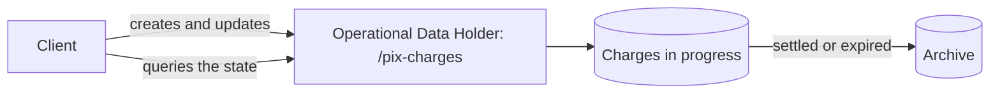

# Operational Data Holder

## Description

The Operational Data Holder pattern exposes an endpoint for short-lived, fast-changing data that clients can create, read, update and delete frequently.

Operational data is the result of the system's day-to-day work: orders in progress, open charges, sessions, recent entries. It has a short or medium life and usually has many outgoing references, pointing to master data and to other operational data, while hardly anything points to it. It tends to be archived when the process ends. The endpoint offers full maintenance operations, and therefore carries the responsibility of keeping consistency and dealing with concurrent access.

Because it changes often, this data is poorly suited to aggressive caching or long-term referencing. The boundary between operational and master data is subjective and context-dependent: what is transient for one application may be a core asset for another. Data that survives many cycles and is pointed to by many others fits better in a [Master Data Holder](/architecture/api-patterns/endpoint-roles/master-data-holder).

## Problems it solves

- Clients that need to quickly record and update the state of work in progress
- Maintaining transient data without paying the governance cost of long-lived data
- Efficient access to information that changes all the time, with low latency
- Exposing simple CRUD for entities whose life cycle follows a business process

## When to use

- Data is born, changes and ends within a process, such as a pending Pix charge
- There are many writes and reads, and freshness of the information matters
- Entities point to longer-lived data, and almost nothing points to them
- Read and write speed and flexibility to change the schema are needed
- Clients need create, update and remove operations exposed directly

## When to avoid

- When data lives for years and is referenced by many others: use a [Master Data Holder](/architecture/api-patterns/endpoint-roles/master-data-holder)
- When data almost never changes and strong caching is ideal: use a [Reference Data Holder](/architecture/api-patterns/endpoint-roles/reference-data-holder)
- When the business rule requires executing an activity, not just maintaining data: use a [Processing Resource](/architecture/api-patterns/endpoint-roles/processing-resource)
- When consistency across several operational entities depends on distributed transactions that are hard to sustain

## Trade-offs

| Benefit | Cost / Risk |
| --- | --- |
| Simple model for direct maintenance of in-flight data | Caching and replication are of limited use, since data changes quickly |
| Fresh data, suited to active business processes | Concurrent writes require conflict handling |
| Low governance cost because the data is transient | Referential integrity with other resources is hard to guarantee |
| Full operations available to the client | Exposing broad update and removal increases the risk of state corruption |

- **Concurrency:** use a version or ETag to detect simultaneous updates and avoid lost overwrites.
- **Life cycle:** define when data is archived or removed, so the endpoint does not accumulate undue history.
- **Consistency:** references to operational data must tolerate the target having disappeared.
- **Transactions:** with several simultaneous clients, offer isolation and atomicity, revert to the last consistent state after failures and de-duplicate retries that are not idempotent.
- **Relations:** do not embed master data in messages unnecessarily; prefer referencing it by link, and keep closely related operational holders evolving together.
- **History:** they are good candidates for event sourcing, which exposes every state change, at the cost of more complexity for those who query old snapshots.
- **Evolution:** short life and few dependents make it easier to change or even rewrite the resource, and relaxing consistency to eventual can improve availability.
- **Performance:** indexes and pagination matter, since volume is high and reads are frequent.

## Diagram



The client maintains charges while the process is active; when it ends, the data leaves the operational set.

## Example

The fintech's pending Pix charges are operational data: they are born when the merchant generates the QR code, change state when the payment arrives and expire within minutes.

```http
POST /pix-charges HTTP/1.1
Content-Type: application/json

{
  "receiverAccountId": "acc-2040",
  "amount": { "cents": 8990, "currency": "BRL" },
  "expiresInSeconds": 900
}
```

```http
HTTP/1.1 201 Created
Location: /pix-charges/chg-5581
ETag: "1"
Content-Type: application/json

{ "id": "chg-5581", "status": "PENDING", "amount": { "cents": 8990, "currency": "BRL" } }
```

```http
PATCH /pix-charges/chg-5581 HTTP/1.1
If-Match: "1"
Content-Type: application/json

{ "status": "CANCELLED" }
```

`If-Match` makes the update fail with `412 Precondition Failed` if the charge was paid between the read and the write. Fees and limits are illustrative.

## Related patterns

- [Information Holder Resource](/architecture/api-patterns/endpoint-roles/information-holder-resource) — the general role of which this is a specialization
- [Master Data Holder](/architecture/api-patterns/endpoint-roles/master-data-holder) — long-lived, widely referenced data
- [Reference Data Holder](/architecture/api-patterns/endpoint-roles/reference-data-holder) — stable, read-only data
- [Conditional Request](/architecture/api-patterns/message-exchange-optimization/conditional-request) — avoids concurrent overwrites with `If-Match`
- [Embedded Entity](/architecture/api-patterns/message-granularity/embedded-entity) and [Linked Information Holder](/architecture/api-patterns/message-granularity/linked-information-holder) — embedding related operational data or linking to the master data
- [Pagination](/architecture/api-patterns/response-shaping/pagination) — controls volume when listing many entities
- [Entity](/design/ddd/building-blocks/entity) — the domain concept usually behind operational data

## Reference

- [Patterns for API Design, chapter 5: Operational Data Holder](https://api-patterns.org/)
