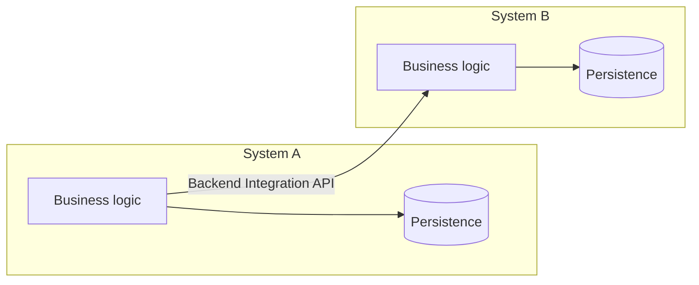

# Backend Integration

## Description

The Backend Integration pattern integrates the backend of a distributed application with other backends, of the same or other applications, by exposing its services through a message-based remote API. These APIs are never used directly by frontends: only other backends consume them.

There are two usage contexts. The first is integration between systems, business-to-business or system-to-system, where independently built and deployed applications exchange data and trigger activities in each other. The second is the internal decomposition of an application into services, as in microservices, which talk through [Solution-Internal APIs](/architecture/api-patterns/foundations/solution-internal-api). The suitable entry point is usually the business logic layer, where access control, transactions and rules already live; in data-centric scenarios it can make sense to integrate at the persistence layer instead.

Because the parts are independent, the integration must preserve the conceptual integrity of each system without creating undesired coupling. That calls for planning the whole set of systems, for example with strategic Domain-Driven Design, and a mature communication technology with standardized formats. Asynchronous queue-based messaging is widely used here, besides HTTP.

## Problems it solves

- Making independently built systems exchange data and trigger activities in each other
- Keeping the internal model of each system coherent when integrating it with the others
- Avoiding undesired coupling between separately deployed components
- Giving services of the same application an explicit collaboration contract

## When to use

- When the fintech's banking core must notify the anti-fraud system, or query the credit system
- When integrating with partners and external institutions, such as the payment scheme
- When an application is split into services that evolve and scale separately
- When the flow is system to system and can benefit from asynchronous messaging

## When to avoid

- To feed the user interface: use [Frontend Integration](/architecture/api-patterns/foundations/frontend-integration)
- When components are inseparable and run in the same process, with no gain from a remote boundary
- When the service design is still uncertain: poor cuts produce APIs that keep changing and distributed coupling

## Trade-offs

| Benefit | Cost / Risk |
| --- | --- |
| Systems and services deployed and evolved independently | Network failures and eventual consistency become part of the design |
| Explicit boundaries that protect each system's internal model | Requires planning of the whole landscape and governance of contracts |
| Freedom to choose the protocol, including asynchronous messaging | Operating and observing asynchronous integrations is more complex |
| Capabilities reused across several consumers | Contract changes affect all consumers |

- **Visibility:** the same pattern covers public, community or internal APIs; decide early, since it sets security and stability promises.
- **Protocol:** HTTP favors simplicity; queues favor decoupling in time and tolerance to outages.
- **Service cuts:** use functional, operational and independent-change criteria, without multiplying services unnecessarily.

## Diagram



Each backend exposes its own business logic through a remote API that only other backends consume.

## Example

The fintech's credit service asks the accounts service for the available balance before approving a `LoanContract`. The call is system to system, with no interface involved, and uses a correlation identifier for tracing.

```http
GET /internal/accounts/acc-7781/available-balance HTTP/1.1
Accept: application/json
X-Correlation-Id: 5b1c2f0e-77d4-4f43-a1c1-0d6f2b7e9a10

HTTP/1.1 200 OK
Content-Type: application/json

{ "accountId": "acc-7781", "available": { "amountCents": 125090, "currency": "BRL" } }
```

In an asynchronous scenario, the accounts service would publish the same data as an event on a queue, and the credit service would consume it when available.

## Related patterns

- [Frontend Integration](/architecture/api-patterns/foundations/frontend-integration) — the opposite integration type, aimed at the user interface
- [Solution-Internal API](/architecture/api-patterns/foundations/solution-internal-api) — the typical visibility when services belong to the same application
- [Public API](/architecture/api-patterns/foundations/public-api) and [Community API](/architecture/api-patterns/foundations/community-api) — possible visibilities when the integration crosses organizations
- [Bounded Context](/design/ddd/model-in-practice/bounded-context) — a cutting criterion between systems that the integration must respect
- [Anti-Corruption Layer](/architecture/cloud-design-patterns/integration-and-modernization/anti-corruption-layer) — protects a system's internal model when integrating it with another
- [Command Message](/architecture/eip/message-construction/command-message) and [Event Message](/architecture/eip/message-construction/event-message) — message forms common in asynchronous integration
- [Shared Database](/architecture/microservices/service-collaboration/shared-database) — integration through persistence, which brings strong coupling

## Reference

- [Patterns for API Design, chapter 4: Backend Integration](https://api-patterns.org/)
